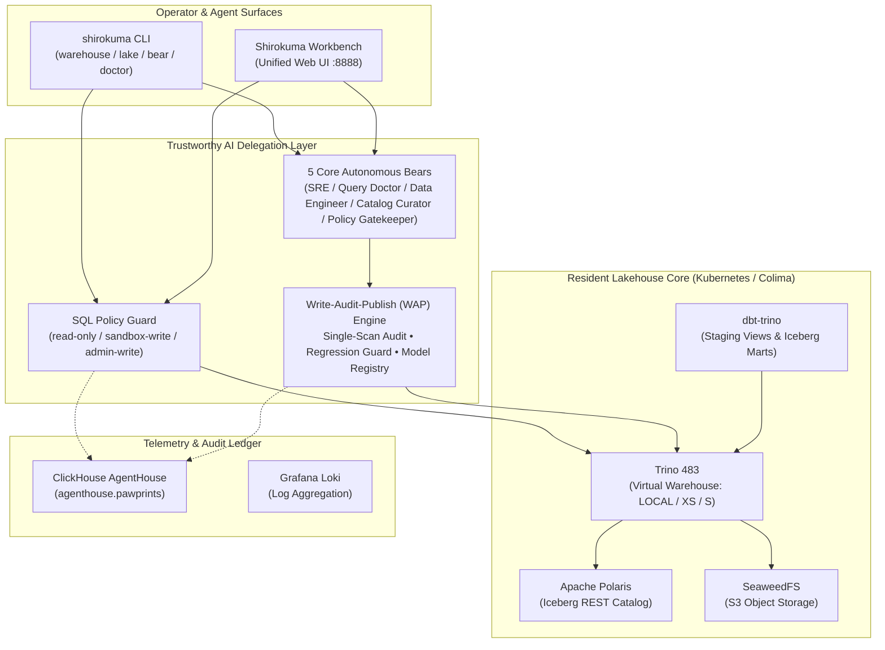

# 🐻‍❄️ Shirokuma (しろくま)

**Trustworthy Agentic OSS Data Warehouse & Lakehouse**
*AIエージェントにデータ処理を安心して任せられる、中小規模向けオープンソース Data Cloud / Lakehouse 基盤*

[**English**](#english) | [**日本語**](#日本語)

---

<a id="english"></a>

## English

### Overview

**Shirokuma** is a lightweight, self-hosted Open Source Data Warehouse & Lakehouse built on **Apache Iceberg**, **Apache Polaris**, **Trino**, **SeaweedFS**, **dbt**, and **ClickHouse**, designed from the ground up so **human operators and AI agents can collaborate safely on production data**.

Instead of attempting to clone every heavyweight enterprise feature of Snowflake or Databricks, Shirokuma focuses on what small-to-medium teams actually need:
1. **A clean, resident Iceberg Lakehouse** that runs reliably on a single machine (macOS Apple Silicon / Colima k3s) or Kubernetes cluster and can `chill` (scale to zero) and auto-`wake` on demand.
2. **Defense-in-Depth Guardrails for AI Agents** so autonomous agents can ingest files, write analytical SQL, build marts, and refresh pipelines **without risking production data corruption**.

---

### Architecture at a Glance



---

### Key Capabilities

| Capability | What It Does |
|---|---|
| **1. SQL Safety Guardrails** | Enforces `read-only` by default on `shirokuma warehouse query`. `sandbox-write` permits DDL/DML only in `iceberg.scratch`, `iceberg.staging`, and `iceberg.raw`. Production `iceberg.marts` writes require `admin-write` or audited WAP publish. |
| **2. Write-Audit-Publish (WAP) & Regression Guard** | AI-generated or operator SQL is materialized in `iceberg.scratch.<stage_table>` first. A single-scan audit checks row count (`--min-rows`), `NULL` constraints (`--not-null`), and **blocks publication if baseline checks fail or >50% shrinkage / missing columns occur**. Tables are published pinned to the exact audited snapshot. |
| **3. WAP Publication Rollback** | Published WAP models and builds are tracked. `shirokuma lake wap rollback --publication-id <id>` restores the predecessor published by the same database, without direct writes to `iceberg.marts`. |
| **4. Zero-Friction File Ingestion, Atomic Staging Swap, Idempotent Upsert, & Full Table Export** | `shirokuma lake ingest` loads local **CSV, TSV, JSONL, and Parquet** files into Iceberg with robust type preservation (leading zeroes `'000123'`, exact `DECIMAL` precision, empty string vs `NULL`, CP932 auto-detection, Japanese column names, `--schema-hints`, and `--encoding`). Ingestion uses **Staging & Swap** to guarantee atomic multi-batch commits (no corrupted partial states). Keyed `upsert` preserves columns absent from input. `shirokuma lake export` guarantees full table export with row count verification. All `lake` commands require a database runtime profile. |
| **5. Bilingual (`EN` / `日本語`) Snowsight-Style Workbench & Pawprints Audit Trail** | `shirokuma workbench` launches a fast, zero-dependency bilingual local Web UI (`http://127.0.0.1:8888`) with a top-right `EN / 日本語` switcher, multi-tab SQL worksheets (Schema selector, Run Selected SQL, inline Object Explorer, AI Copilot, inline SVG Bar/Line Charts, CSV/JSON/TSV export), drag-and-drop browser file upload with pre-ingest schema preview, a 6-tab Table Inspector with 1-click **Clone to Sandbox**, **Export Table (Full)**, and **Iceberg Time Travel Snapshot Preview & Rollback**, server-side background **Auto-Chill** daemon with Trino running-query protection, and dedicated Query & Copy/Load History monitoring. |

---

### Quick Start

#### 1. Start the Logical Lab

See the [Shirokuma startup guide](docs/guides/shirokuma-startup-guide.md) for daily start/stop (`tools/local_experiment/instance.sh`), versions and rebuilds, and [Clean-cluster bootstrap of a local logical_v1 instance](docs/guides/logical-local-bootstrap-2026-11-23.md) for the detailed clean-cluster procedure (Trino 484 foundation, Workbench `:8888`, SQL endpoint `:8080`). The old `make lab-up` / `shirokuma-dev` Flux path is retired.

#### 2. Build Database-Mode Models
```bash
# Seeding and resident dbt targets (make lake-seed/lake-build/lake-test) were
# retired with the legacy execution mode. Use the authenticated database-mode
# `shirokuma dbt` and `shirokuma lake wap` commands with a runtime profile.
```

#### 3. Ingest & Export Local Files (Replace / Append / Idempotent Upsert / Export)
```bash
# All lake commands require a database runtime profile (see step 5).
# Automatically infer schema and load CSV/JSONL/Parquet into Iceberg
go run ./cmd/shirokuma lake ingest customers.csv --table raw.customers --mode replace

# Idempotent keyed upsert (deduplicates input batch and atomically merges by key)
go run ./cmd/shirokuma lake ingest orders_delta.jsonl --table raw.orders --mode upsert --key order_id

# Export an Iceberg table to local CSV, JSONL, or Parquet
go run ./cmd/shirokuma lake export marts.fct_orders --output fct_orders.csv --format csv
```

#### 4. Query the Virtual Warehouse & Manage Compute Lifecycle
```bash
# Run analytical SQL (read-only guardrail by default; supports Trino QUALIFY rewrite)
go run ./cmd/shirokuma warehouse query LOCAL "SELECT region, COUNT(*) FROM iceberg.raw.customers GROUP BY 1"

# Scale Trino down to zero replicas when idle, and auto-wake on the next query
go run ./cmd/shirokuma warehouse chill LOCAL
go run ./cmd/shirokuma warehouse status LOCAL
```

#### 5. Launch Shirokuma Workbench (Web UI)
```bash
go run ./cmd/shirokuma workbench --port 8888
# Open http://127.0.0.1:8888
```
> The Workbench requires a database runtime profile. Set `SHIROKUMA_RUNTIME_PROFILE` or provide `var/shirokuma/runtime-profile.json`; without one it exits with status 2.

#### 6. Run Verification Suites
```bash
make verify-core   # Fast resident core Python + Go CLI + design context checks (~6s)
make verify        # Full CI verification including OpenTofu, Kyverno policy tests, and secret scan (~12s)
```

---

<a id="日本語"></a>

## 日本語

### 概要

**Shirokuma（しろくま）** は、**Apache Iceberg**・**Apache Polaris**・**Trino**・**SeaweedFS**・**dbt**・**ClickHouse** を組み合わせた、**「AIエージェントにデータ処理を安心して任せることができる中小規模向けオープンソース Data Warehouse / Lakehouse 基盤」** です。

Snowflake や Databricks の巨大機能をすべて模倣するのではなく、中小規模のデータチームや AI ネイティブな開発現場に本当に必要な **2つの柱** に集中しています。
1. **軽量・常駐型の本物の Iceberg Lakehouse**: 単一の Mac（Apple Silicon / Colima k3s）や Kubernetes 上で軽快に常駐稼働し、アイドル時の `chill`（ゼロスケール停止）とクエリ実行時の自動 `wake`（コールドスタート復帰）を備えています。
2. **AIエージェント安全委任ガードレール**: AI エージェントがローカルデータの取り込み、SQL 生成、マート構築、パイプライン更新を自律実行しても、**本番データを決して破壊しない多層防御（SQL ポリシー・Write-Audit-Publish・回帰ガード・1コマンド Snapshot Rollback・全操作監査証跡）** を標準搭載しています。

---

### 主要機能

| 機能領域 | 内容 |
|---|---|
| **1. SQL 安全ガードレール** | `shirokuma warehouse query` はデフォルトで `read-only`（DDL/DML 遮断）を強制します。`sandbox-write` は `iceberg.scratch` / `staging` / `raw` のみ書き込みを許可し、本番 `iceberg.marts` の直接変更は遮断します。 |
| **2. Write-Audit-Publish (WAP) と厳格な回帰ガード** | AI またはオペレータの変換 SQL をまず `iceberg.scratch.<stage_table>` にステージング作成し、単一テーブルスキャンで件数（`--min-rows`）・NULL 制約（`--not-null`）・**既存テーブルとの回帰検証（比較失敗時の公開即時停止・50%以上の急減やカラム欠落ブロック）** を自動検査。監査を通過した特定の Snapshot ID を固定して `iceberg.marts` へアトミックに公開します。 |
| **3. WAP 公開の Rollback** | 公開済みの WAP モデルとビルドを記録し、`shirokuma lake wap rollback --publication-id <id>` で同一データベースが公開した直前の版へ戻せます。`iceberg.marts` への直接書き込みは行いません。 |
| **4. 堅牢な Ingest・原子的 Staging Swap・列保持 Upsert・全件 Export** | `shirokuma lake ingest` により、ローカルの **CSV / TSV / JSONL / Parquet** から型を推論してロード。**先頭ゼロ識別子（`000123`）や DECIMAL 精度の保持、VARCHAR 空文字と NULL の区別、CP932 自動判定、日本語列名、`--schema-hints`** を完備。多バッチ取り込みは **Staging & Swap** で原子的更新（途中失敗時の破損防止）を保証し、`upsert` は入力にない既存カラムを保持します。`shirokuma lake export` はサイレント打ち切りなく全件出力を保証します。`lake` コマンドはデータベース runtime profile が必須です。 |
| **5. 日英バイリンガル対応 Snowsight 風 Shirokuma Workbench & 監査台帳** | `shirokuma workbench`（`http://127.0.0.1:8888`）により、右上の `EN / 日本語` 切替ボタン付きで、オブジェクトツリー・スキーマ切替・選択範囲 SQL 実行・AI Copilot・インライン SVG チャート（棒/折れ線）・CSV/JSON/TSV 出力を備えたマルチタブ SQL ワークシート、D&D ブラウザアップロード＆事前プレビュー、1-Click **サンドボックス Clone** / **全件テーブル Export** / **Time Travel プレビュー＆Rollback** 付き 6タブ Table Inspector、Trino クエリ実行中保護付きサーバーサイド **Auto-Chill（自動休止）**、クエリ履歴＆ロード履歴監視を単一画面で完結できます。 |

---

### クイックスタート（主要コマンド）

日常の起動・停止・作り直しは [Shirokuma 起動ガイド](docs/guides/shirokuma-startup-guide.md)、
クリーンクラスタからの詳細手順は [logical_v1 起動ガイド](docs/guides/logical-local-bootstrap-2026-11-23.md) を参照してください。
旧 `make lab-up` / `shirokuma-dev` 経路は廃止されています。

```bash
# 2. レガシー実行モードのサンプルデータ seed / dbt ターゲット
# (make lake-seed / lake-build / lake-test) は廃止されました。
# データベースモードでは runtime profile を設定し、認証済みの
# `shirokuma dbt` / `shirokuma lake wap` コマンドを使用してください。

# 3. ローカルファイル (CSV / TSV / JSONL / Parquet) の取り込み・冪等 Upsert・エクスポート
# lake コマンドはデータベース runtime profile が必須です (手順 5 参照)。
go run ./cmd/shirokuma lake ingest customers.csv --table raw.customers --mode replace
go run ./cmd/shirokuma lake ingest orders_q3.jsonl --table raw.orders --mode upsert --key order_id
go run ./cmd/shirokuma lake export marts.fct_orders --output fct_orders.csv --format csv

# 4. Virtual Warehouse での SQL 実行（QUALIFY 句対応）と Chill / Wake
go run ./cmd/shirokuma warehouse query LOCAL "SELECT * FROM iceberg.marts.fct_orders LIMIT 10"
go run ./cmd/shirokuma warehouse chill LOCAL
go run ./cmd/shirokuma warehouse wake LOCAL

# 5. 統合 Web UI「Shirokuma Workbench」の起動 (http://127.0.0.1:8888)
go run ./cmd/shirokuma workbench --port 8888
# データベース runtime profile が必須です。SHIROKUMA_RUNTIME_PROFILE を設定するか
# var/shirokuma/runtime-profile.json を配置してください。未設定時は終了コード 2 で終了します。

# 6. 高速コア検証（約6秒）およびフル CI 検証（約12秒）
make verify-core
make verify
```

---

### Repository Structure / リポジトリ構成

| Path | Description / 役割 |
|---|---|
| [`cmd/shirokuma/`](cmd/shirokuma/) | Go CLI entrypoint (`shirokuma`) / CLI エントリポイント |
| [`internal/cli/`](internal/cli/) | Go CLI commands (`warehouse`, `lake`, `workbench`, `doctor`, `version`) |
| [`tools/local_experiment/`](tools/local_experiment/) | Resident Lakehouse modules (`warehouse_resident.py`, `workbench_server.py`, `lab_lifecycle.py`, `dataops_client.py`, `agenthouse/`, `loki/`, `workbench/`, `dataops/dbt_persistent/`) |
| [`deploy/`](deploy/) | Kubernetes / Flux v2 GitOps manifests for SeaweedFS, Polaris, PostgreSQL, Trino, and local overlays |
| [`opentofu/dev/`](opentofu/dev/) | OpenTofu infrastructure definitions for the local Kubernetes environment |
| [`policies/kyverno/`](policies/kyverno/) | Kyverno admission security policies (`baseline.yaml`) |
| [`docs/design/`](docs/design/) | Architecture Decision Records ([`ADR-0036`](docs/design/07_ADR/ADR-0036_Adopt_Commander_Worker_Model_and_Pragmatic_Core_Reset.md)), Roadmap ([`DEV-04F`](docs/design/04_Development/04F_Commander_Worker_and_Pragmatic_Roadmap.md)), Gate Summary ([`DEV-04D`](docs/design/04_Development/04D_Current_Gate_Summary.md)), Optional Plugin Tracks ([`ARCH-02D`](docs/design/02_Architecture/02D_Optional_Plugin_Tracks.md)), and Milestones ([`WP-061`](docs/design/06_WorkPackages/061_Local_Experiment_Milestones.md)) |

---

### License

Apache License 2.0 — see [`LICENSE`](LICENSE).
