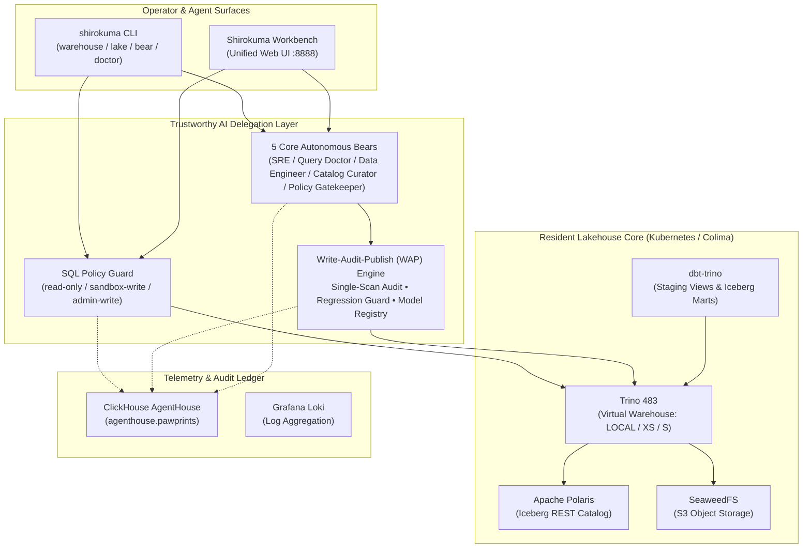

# 🐻‍❄️ Shirokuma (しろくま)

**Trustworthy Agentic OSS Data Warehouse & Lakehouse**
*AIエージェントにデータ処理を安心して任せられる、中小規模向けオープンソース Data Cloud / Lakehouse 基盤*

[**English**](#english) | [**日本語**](#日本語)

---

<a id="english"></a>

## English

### Overview

**Shirokuma** is a lightweight, self-hosted Open Source Data Warehouse & Lakehouse built on **Apache Iceberg**, **Apache Polaris**, **Trino**, **SeaweedFS**, **dbt**, and **ClickHouse**, designed from the ground up so **human operators and AI agents can collaborate safely on production data**.

Instead of attempting to clone every heavyweight enterprise feature of Snowflake or Databricks, Shirokuma focuses on what small-to-medium teams actually need:
1. **A clean, resident Iceberg Lakehouse** that runs reliably on a single machine (macOS Apple Silicon / Colima k3s) or Kubernetes cluster and can `chill` (scale to zero) and auto-`wake` on demand.
2. **Defense-in-Depth Guardrails for AI Agents** so autonomous agents can ingest files, write analytical SQL, build marts, and refresh pipelines **without risking production data corruption**.

---

### Architecture at a Glance



---

### Key Capabilities

| Capability | What It Does |
|---|---|
| **1. SQL Safety Guardrails** | Enforces `read-only` by default on `shirokuma warehouse query`. `sandbox-write` permits DDL/DML only in `iceberg.scratch`, `iceberg.staging`, and `iceberg.raw`. Production `iceberg.marts` writes require `admin-write` or audited WAP publish. |
| **2. Write-Audit-Publish (WAP) & Regression Guard** | AI-generated or operator SQL is materialized in `iceberg.scratch.<stage_table>` first. A single-scan audit checks row count (`--min-rows`), `NULL` constraints (`--not-null`), and **blocks accidental >50% row shrinkage or missing columns** before atomically publishing to `iceberg.marts` and recording dynamic lineage. |
| **3. 1-Command Iceberg Snapshot Rollback** | Every Iceberg table snapshot is tracked. If a bad publish occurs, `shirokuma bear data --table marts.<name> --rollback --snapshot-id <id>` instantaneously restores the table via `iceberg.system.rollback_to_snapshot`. |
| **4. Zero-Friction File Ingestion & Idempotent Upsert** | `shirokuma lake ingest` loads local **CSV, TSV, JSONL, and Parquet** files into Iceberg with automatic schema inference (`BIGINT`, `DOUBLE`, `BOOLEAN`, `DATE`, `VARCHAR`) and supports `replace`, `append`, and keyed idempotent `upsert` (`--mode upsert --key <cols>`). |
| **5. 5 Core Autonomous Bears** | **SRE Bear** (cluster health & metrics), **Query Doctor Bear** (Trino `EXPLAIN` & skew analysis), **Data Engineer Bear** (LLM SQL generation with `QUALIFY` rewrite, 1-retry `EXPLAIN` self-correction, WAP, & `--refresh`), **Catalog Curator Bear** (Iceberg metadata & dbt + WAP lineage), and **Policy Gatekeeper Bear** (Kubernetes pod security audit). |
| **6. Shirokuma Workbench & Pawprints Audit Trail** | `shirokuma workbench` launches a zero-dependency local Web UI (`http://127.0.0.1:8888`) uniting SQL execution, Catalog & Lineage browsing, File Ingestion, Bear & WAP controls, and live ClickHouse `agenthouse.pawprints` telemetry (tracking snapshot IDs, duration, and LLM token counts). |

---

### Quick Start

#### 1. Start the Resident Lakehouse Lab
```bash
# Boot Colima (mac-studio-solo), unsuspend Flux/Polaris/SeaweedFS/Trino/ClickHouse/Loki, and verify health
make lab-up
make lab-status
go run ./cmd/shirokuma doctor --profile local-experiment
```

#### 2. Seed Sample TPC-H Data & Build dbt Marts
```bash
# Seed 8 persistent TPC-H tables into iceberg.tpch_tiny and build dbt staging/marts models
make lake-seed
make lake-build
make lake-test
```

#### 3. Ingest Local Files (Replace / Append / Idempotent Upsert)
```bash
# Automatically infer schema and load CSV/JSONL/Parquet into Iceberg
go run ./cmd/shirokuma lake ingest --file customers.csv --table raw.customers --mode replace

# Idempotent keyed upsert (deduplicates input batch and atomically merges by key)
go run ./cmd/shirokuma lake ingest --file orders_delta.jsonl --table raw.orders --mode upsert --key order_id
```

#### 4. Query the Virtual Warehouse & Manage Compute Lifecycle
```bash
# Run analytical SQL (read-only guardrail by default; supports Trino QUALIFY rewrite)
go run ./cmd/shirokuma warehouse query LOCAL "SELECT region, COUNT(*) FROM iceberg.raw.customers GROUP BY 1"

# Scale Trino down to zero replicas when idle, and auto-wake on the next query
go run ./cmd/shirokuma warehouse chill LOCAL
go run ./cmd/shirokuma warehouse status LOCAL
```

#### 5. Delegate Data Engineering to AI Bears with WAP & Rollback
```bash
# Stage, audit, and atomically publish a mart with quality & regression guards
go run ./cmd/shirokuma bear data "aggregate net revenue by customer segment" \
  --sql "SELECT segment, COUNT(*) AS orders, SUM(amount) AS revenue FROM iceberg.raw.orders GROUP BY 1" \
  --stage-table stg_segment_rev \
  --publish marts.segment_revenue \
  --min-rows 1 \
  --not-null segment,revenue

# Re-run a registered WAP mart in one command as upstream raw data changes
go run ./cmd/shirokuma bear data --refresh marts.segment_revenue

# Inspect combined dbt + WAP lineage or roll back to a previous Iceberg snapshot
go run ./cmd/shirokuma bear catalog lineage
go run ./cmd/shirokuma bear data --table marts.segment_revenue --rollback --snapshot-id <SNAPSHOT_ID>
```

#### 6. Launch Shirokuma Workbench (Web UI)
```bash
go run ./cmd/shirokuma workbench --port 8888
# Open http://127.0.0.1:8888
```

#### 7. Run Verification Suites
```bash
make verify-core   # Fast resident core Python + Go CLI + design context checks (~6s)
make verify        # Full CI verification including OpenTofu, Kyverno policy tests, and secret scan (~12s)
```

---

<a id="日本語"></a>

## 日本語

### 概要

**Shirokuma（しろくま）** は、**Apache Iceberg**・**Apache Polaris**・**Trino**・**SeaweedFS**・**dbt**・**ClickHouse** を組み合わせた、**「AIエージェントにデータ処理を安心して任せることができる中小規模向けオープンソース Data Warehouse / Lakehouse 基盤」** です。

Snowflake や Databricks の巨大機能をすべて模倣するのではなく、中小規模のデータチームや AI ネイティブな開発現場に本当に必要な **2つの柱** に集中しています。
1. **軽量・常駐型の本物の Iceberg Lakehouse**: 単一の Mac（Apple Silicon / Colima k3s）や Kubernetes 上で軽快に常駐稼働し、アイドル時の `chill`（ゼロスケール停止）とクエリ実行時の自動 `wake`（コールドスタート復帰）を備えています。
2. **AIエージェント安全委任ガードレール**: AI エージェントがローカルデータの取り込み、SQL 生成、マート構築、パイプライン更新を自律実行しても、**本番データを決して破壊しない多層防御（SQL ポリシー・Write-Audit-Publish・回帰ガード・1コマンド Snapshot Rollback・全操作監査証跡）** を標準搭載しています。

---

### 主要機能

| 機能領域 | 内容 |
|---|---|
| **1. SQL 安全ガードレール** | `shirokuma warehouse query` はデフォルトで `read-only`（DDL/DML 遮断）を強制します。`sandbox-write` は `iceberg.scratch` / `staging` / `raw` のみ書き込みを許可し、本番 `iceberg.marts` の直接変更は遮断します。 |
| **2. Write-Audit-Publish (WAP) と回帰ガード** | AI またはオペレータの変換 SQL をまず `iceberg.scratch.<stage_table>` にステージング作成し、単一テーブルスキャンで件数（`--min-rows`）・NULL 制約（`--not-null`）・**既存本番テーブル比 50% 以上の急減やカラム欠落（回帰ガード）** を自動検査してから `iceberg.marts` へアトミックに公開します。 |
| **3. Iceberg スナップショット Rollback** | 万一誤ったデータを公開しても、`shirokuma bear data --table marts.<name> --rollback --snapshot-id <id>` 1コマンドで過去のスナップショットへ即座に無停止ロールバックできます。 |
| **4. 自動スキーマ推論 Ingest & 冪等 Upsert** | `shirokuma lake ingest` により、ローカルの **CSV / TSV / JSONL / Parquet** ファイルから型（`BIGINT`, `DOUBLE`, `BOOLEAN`, `DATE`, `VARCHAR`）を自動推論して Iceberg テーブルへロードします。`replace`（全置換）・`append`（追記）に加え、複合キー対応の冪等 `upsert`（`--mode upsert --key <cols>`）に対応しています。 |
| **5. 5頭の自律 AI Bear と SQL 自己修復** | **SRE Bear**（稼働・リソース監視）、**Query Doctor Bear**（Trino 実行計画・Skew 診断）、**Data Engineer Bear**（自然言語からの SQL 生成、`QUALIFY` 句自動書き換え、`EXPLAIN` 失敗時の自動再試行、WAP 公開、`--refresh` 再実行）、**Catalog Curator Bear**（カタログ探索・dbt + WAP 統合リネージ）、**Policy Gatekeeper Bear**（Kubernetes セキュリティ監査）を提供します。 |
| **6. Shirokuma Workbench & Pawprints 監査台帳** | `shirokuma workbench`（`http://127.0.0.1:8888`）により、Warehouse 操作・SQL 実行・カタログ＆リネージ閲覧・ファイル Ingest・5 Bears＆WAP/Rollback 操作・ClickHouse `agenthouse.pawprints` 監査ログ（対象スナップショット ID や LLM トークン消費量を含む）を単一のローカル Web UI で完結できます。 |

---

### クイックスタート（主要コマンド）

```bash
# 1. ローカル Lakehouse ラボの起動・ヘルスチェック
make lab-up
make lab-status
go run ./cmd/shirokuma doctor --profile local-experiment

# 2. サンプルデータ (TPC-H) のシードと常設 dbt パイプラインのビルド・検証
make lake-seed
make lake-build
make lake-test

# 3. ローカルファイル (CSV / TSV / JSONL / Parquet) の取り込みと冪等 Upsert
go run ./cmd/shirokuma lake ingest --file customers.csv --table raw.customers --mode replace
go run ./cmd/shirokuma lake ingest --file orders_q3.jsonl --table raw.orders --mode upsert --key order_id

# 4. Virtual Warehouse での SQL 実行（QUALIFY 句対応）と Chill / Wake
go run ./cmd/shirokuma warehouse query LOCAL "SELECT * FROM iceberg.marts.fct_orders LIMIT 10"
go run ./cmd/shirokuma warehouse chill LOCAL
go run ./cmd/shirokuma warehouse wake LOCAL

# 5. Data Engineer Bear による WAP ステージング・品質監査・本番 Publish・ワンコマンド Refresh・Rollback
go run ./cmd/shirokuma bear data "セグメント別の純売上を集計" \
  --sql "SELECT segment, COUNT(*) AS order_count, SUM(net_amount) AS revenue FROM iceberg.raw.orders GROUP BY 1" \
  --stage-table stg_seg_rev \
  --publish marts.segment_revenue \
  --min-rows 1 \
  --not-null segment,revenue

go run ./cmd/shirokuma bear data --refresh marts.segment_revenue
go run ./cmd/shirokuma bear catalog lineage
go run ./cmd/shirokuma bear data --table marts.segment_revenue --rollback --snapshot-id <SNAPSHOT_ID>

# 6. 統合 Web UI「Shirokuma Workbench」の起動 (http://127.0.0.1:8888)
go run ./cmd/shirokuma workbench --port 8888

# 7. 高速コア検証（約6秒）およびフル CI 検証（約12秒）
make verify-core
make verify
```

---

### Repository Structure / リポジトリ構成

| Path | Description / 役割 |
|---|---|
| [`cmd/shirokuma/`](cmd/shirokuma/) | Go CLI entrypoint (`shirokuma`) / CLI エントリポイント |
| [`internal/cli/`](internal/cli/) | Go CLI commands (`warehouse`, `lake`, `bear`, `workbench`, `doctor`, `version`) |
| [`tools/local_experiment/`](tools/local_experiment/) | Resident Lakehouse core modules (`warehouse_resident.py`, `wap_resident.py`, `bears_resident.py`, `lake_ingest.py`, `lake_seed.py`, `lake_pipeline.py`, `workbench_server.py`, `lab_lifecycle.py`, `agenthouse/`, `loki/`, `workbench/`, `dataops/dbt_persistent/`) |
| [`deploy/`](deploy/) | Kubernetes / Flux v2 GitOps manifests for SeaweedFS, Polaris, PostgreSQL, Trino, and local overlays |
| [`opentofu/dev/`](opentofu/dev/) | OpenTofu infrastructure definitions for the local Kubernetes environment |
| [`policies/kyverno/`](policies/kyverno/) | Kyverno admission security policies (`baseline.yaml`) |
| [`docs/design/`](docs/design/) | Architecture Decision Records ([`ADR-0036`](docs/design/07_ADR/ADR-0036_Adopt_Commander_Worker_Model_and_Pragmatic_Core_Reset.md)), Roadmap ([`DEV-04F`](docs/design/04_Development/04F_Commander_Worker_and_Pragmatic_Roadmap.md)), Gate Summary ([`DEV-04D`](docs/design/04_Development/04D_Current_Gate_Summary.md)), Optional Plugin Tracks ([`ARCH-02D`](docs/design/02_Architecture/02D_Optional_Plugin_Tracks.md)), and Milestones ([`WP-061`](docs/design/06_WorkPackages/061_Local_Experiment_Milestones.md)) |

---

### License

Apache License 2.0 — see [`LICENSE`](LICENSE).
