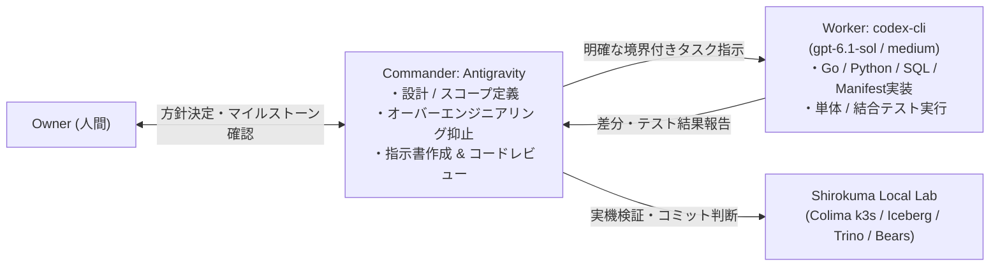

# DEV-04F: 司令塔×実装ワーカー体制と実用コア再起動ロードマップ

本ドキュメントは [ADR-0036](../07_ADR/ADR-0036_Adopt_Commander_Worker_Model_and_Pragmatic_Core_Reset.md) に基づき、2026年10月16日以降の Shirokuma の開発体制（**Antigravity 司令塔 × `codex-cli` GPT-6.1 Sol Medium 実装ワーカー**）および **Phase 0〜Phase 6 再起動ロードマップ** を定義する。

---

## 1. 開発体制：Commander–Worker 分担モデル

従来の無人500セッション連続実行ループ（`autonomous_runner.py` および各種 `*_supervisor.py`）は廃止し、設計・判断と実装を明確に分離した **2階層体制** で開発を進める。



### 1.1 役割定義

| 役割 | 担当 | 責務と権限 |
|---|---|---|
| **司令塔 (Commander / Architect / Reviewer)** | **Antigravity** | 1. ロードマップ管理と Work Package（WP）のスコープ定義<br>2. `codex-cli` への具体的・有界なプロンプト指示の作成<br>3. **オーバーエンジニアリングの厳格な阻止**（過剰な防御コード、Fixture専用ハック、不要な監査ラッパーの却下）<br>4. 実装差分のコードレビュー・実機検証・Vault/設計書の同期 |
| **実装ワーカー (Implementation Worker)** | **`codex-cli`**<br>(`gpt-6.1-sol` / `medium`) | 1. Antigravity が指定したファイル・モジュールに対するコード実装とテスト作成<br>2. 指定されたテストコマンドの実行と結果報告<br>3. スコープ外のファイル変更・独自のポリシー解釈・過剰な自己防衛コードの禁止 |

### 1.2 `codex-cli` 呼び出し標準テンプレート

Antigravity が `codex-cli` に実装を委譲する際は、以下のコマンド体系を使用する（`rtk proxy` 経由で実行）。

```bash
rtk proxy /Applications/ChatGPT.app/Contents/Resources/codex-cli/bin/codex exec \
  -m gpt-6.1-sol \
  -c model_reasoning_effort="medium" \
  -s workspace-write \
  -C "$(git rev-parse --show-toplevel)" \
  "<Antigravityが作成した構造化タスク指示>"
```

### 1.3 Antigravity から `codex-cli` へのタスク指示フォーマット

各タスク指示には必ず以下の5項目を含め、ワーカーが迷走しないように境界を固定する。

1. **Goal（達成すべき機能成果）**: 何が動くようにするか（1〜3文）。
2. **Target Files（変更対象ファイル）**: 触ってよいファイル・ディレクトリの明示。
3. **Anti-Over-Engineering Rules（禁止事項）**: 今回のタスクで絶対にやってはいけない過剰実装。
4. **Verification（検証コマンド）**: 完了判定に使う具体的な `pytest` / `unittest` / `go test` コマンド。
5. **Scope Stop（完了条件）**: テストが通ったら余計なドキュメント追記や周辺リファクタをせず即座に終了すること。

---

## 2. オーバーエンジニアリング防止の「5つの鉄則（Anti-Bloat Rules）」

過去の520セッションで発生した停滞を二度と繰り返さないため、Antigravity は以下の5原則で `codex-cli` の設計・実装をコントロールする。

1. **No Fixture-Only Features（ハリボテFixture実装の禁止）**
   - `--case retained-fixture` や固定2行・固定48行のデータしか通らないハードコード実装を禁止する。最初から任意の有効なSQL・任意のテーブル名・任意のパラメータを受け付ける実装にする。
2. **No Symlink / FD Paranoia in Local Tooling（過剰なシステムコール防衛の禁止）**
   - シングルユーザーのローカル実験環境において、一時ディレクトリや内部ソケットに対する過剰な `openat2(NO_XDEV)`、多段の fd 相対 `unlink`/`chmod`、Mach 時計ドリフト監視などを増殖させない。標準ライブラリの安全なパス操作とシンプルなバリデーションで十分とする。
3. **No Supervisors of Supervisors（監視スクリプトの自己増殖禁止）**
   - AIセッションを監視・再試行・ハッシュ監査するための親スクリプト（`*_supervisor.py`）や数千行のJSONレシート検証器をこれ以上作らない。
4. **No Upstream Binary Surgery（上流OSSコンテナの自前パッチ・再ビルド禁止）**
   - Flux、Trino、Polaris 等の公式イメージに対するCVE消込み目的のソースビルドやAPKレイヤー差し替えは一切行わない。公式の ARM64 Digest Pinning をそのまま利用する。
5. **Human-Readable Documentation Only（人間が読める簡潔な記録）**
   - WBS やマイルストーン記録に SHA256 ハッシュの羅列や「何が未完か」の免責ポエムを書かない。1つのタスク完了記録は「何を実現したか・どう動かすか」を3〜5行で簡潔に記す。

---

## 3. 実用コア再起動ロードマップ（Phase 0 〜 Phase 6）

L0〜L6 に分散していた「局所的な実験スクリプト群」を整理し、**実際に毎日触って動かせる OSS Data Cloud (Snowflake / Databricks / Fabric のコア体験)** を最短距離で完成させる。

### Phase 0: ルール・証跡の大掃除とテスト正常化【即時】

| WP ID | タスク名 | 完了条件 (Definition of Done) | 状態 |
|---|---|---|---|
| **WP-P0-001** | ADR-0036・新ロードマップ策定と旧肥大化ログのアーカイブ | ADR-0036 と DEV-04F を作成し、12,463行の旧マイルストーンと2,794行の旧WBSを `archive/` に退避してスリム化する。 | **Completed (2026-10-16)** |
| **WP-P0-002** | `warehouse_lifecycle` の `UNSAFE_PATH` テストエラー1件の修正 | `codex-cli` (GPT-6.1 Sol Medium) に指示し、macOS `/var` シンボリックリンク起因のテストFixtureエラーを修正して `make verify-local-experiment` のテスト群をオールグリーンにする。 | **Completed (2026-10-16)** |

### Phase 1: L0/L1 常駐コアの「普通に動く化」【1〜2日】

| WP ID | タスク名 | 完了条件 (Definition of Done) | 状態 |
|---|---|---|---|
| **WP-P1-001** | Colima (`mac-studio-solo`) 起動と L0/L1 コアのアンサスペンド | 停止・サスペンドされていた Flux v2、SeaweedFS、PostgreSQL、Polaris、Trino、ClickHouse (AgentHouse) を公式 ARM64 Digest イメージで通常稼働（`Ready=True`）させる。 | **Completed (2026-10-16)** |
| **WP-P1-002** | `shirokuma doctor` 完全Green化と1コマンド運用 (`make lab-up / down / status`) | 「サスペンド中のためDegraded」ではなく、実稼働クラスタに対して `shirokuma doctor` が全項目 Healthy を返し、1コマンドで起動・停止できる。 | **Completed (2026-10-16)** |

### Phase 2: 「脱Fixture化」— 本物の Lakehouse & AI Bear 体験への昇格【1〜2週間】

| WP ID | タスク名 | 完了条件 (Definition of Done) | 状態 |
|---|---|---|---|
| **WP-P2-001** | Virtual Warehouse (`shirokuma warehouse`) の汎用SQL・常駐制御対応 | 固定の `nation` 25行クエリ限定を解除し、`shirokuma warehouse status / chill / wake / query <size> "<任意のSQL>"` が常駐 Trino に対して汎用的に動作する。**注記 (2026-10-17 Owner合意)**: リソース効率最優先のため XS/S/LOCAL は単一の常駐 `trino-local` を共有する仕様とし、Gateway 経由の物理的複数クラスタ分割は Optional Track へ移行。 | **Completed (2026-10-16, 確定 2026-10-17)** |
| **WP-P2-002** | 常設 Iceberg データレイク & Dagster/dbt/OpenMetadata パイプライン | テスト後に即 `DROP` するのではなく、Polaris + Iceberg 上にサンプルデータセット（TPC-H）と dbt staging/mart モデルを常設（`make lake-seed`, `make lake-build`, `make lake-test`）。OpenMetadata/Superset 連携基盤を確立。 | **Completed (2026-10-17)** |
| **WP-P2-003** | 5 Core Bears の汎用 CLI / MCP ワークフロー化 | `SRE Bear`、`Query Doctor Bear`、`Data Engineer Bear`、`Catalog Curator Bear`、`Policy Gatekeeper Bear` から Fixture 制限を外し、実常駐Trino/Kubernetes/Icebergカタログ/ローカル推論サーバと連携。`shirokuma bear sre/query/data/catalog/policy` 及び `make bears-smoke` が Pawprints (ClickHouse) テレメトリ記録付きで完全稼働。 | **Completed (2026-10-17)** |

### Phase 3: スコープ集中と統合オペレータUI（Shirokuma Workbench）【2〜3週間〜】

| WP ID | タスク名 | 完了条件 (Definition of Done) | 状態 |
|---|---|---|---|
| **WP-P3-001** | 周辺エンジンの Optional Plugin トラック分離 | コア構成（SeaweedFS + Polaris + Iceberg + Trino + Spark + ClickHouse + Dagster/dbt + OpenMetadata + Superset）に集中し、Trino Gateway複数クラスタ分割、StarRocks / Doris / Gravitino / XTable / RustFS / Cube / Ray / Amoro を Optional Plugin Track（`02D_Optional_Plugin_Tracks.md`）として分離・境界策定。 | **Completed (2026-10-17)** |
| **WP-P3-002** | Shirokuma Workbench（統合ローカルWeb UI）の構築 | バラバラの静的HTMLレポートを統合し、`shirokuma workbench`（ポート 8888）により、Virtual Warehouse の稼働/Chill/Wake操作、SQLワークスペース、Iceberg カタログ＆dbtリネージ、5頭のAutonomous Bears対話実行、AgentHouse Pawprints (ClickHouse) テレメトリを1つの洗練されたローカルWeb画面で統合操作可能にする。 | **Completed (2026-10-17)** |

### Phase 4: Trustworthy Agentic DWH — 中小規模向け実用データ基盤＆AI安全委任ガードレール【2026-10-17】

| WP ID | タスク名 | 完了条件 (Definition of Done) | 状態 |
|---|---|---|---|
| **WP-P4-001** | SQL安全ガードレール & Write-Audit-Publish (WAP) サンドボックス実行 + Iceberg Snapshot Rollback | SQL実行の安全性を検査し、WAPで変更を監査してから公開できる。Icebergスナップショットへのロールバックを提供する。 | **Completed (2026-10-17)** |
| **WP-P4-002** | ローカルファイル (CSV / TSV / JSONL / Parquet) 自動スキーマ推論インジェスト (`shirokuma lake ingest`) | ローカルファイルからスキーマを推論し、指定したIcebergテーブルへ取り込める。 | **Completed (2026-10-17)** |
| **WP-P4-003** | AgentHouse Pawprints リッチ監査証跡・常駐Trinoトンネル再利用・Shirokuma Workbench WAP/Ingest UI 統合 | Pawprintsの監査情報を拡充し、常駐Trinoトンネルを再利用する。WorkbenchからWAPとファイル取り込みを操作できる。 | **Completed (2026-10-17)** |
| **WP-P4-004** | 高速コア検証ターゲット (`make verify-core`) 整備と設計ドキュメント・Vault・GitHub 同期 | 常駐コア7モジュール、Go、設計整合性、リポジトリ衛生を高速検証し、Phase 4のロードマップ・ゲート・マイルストーンを同期する。 | **Completed (2026-10-17)** |

### Phase 5: WAP品質・モデル更新・冪等インジェスト【2026-10-17】

| WP ID | タスク名 | 完了条件 (Definition of Done) | 状態 |
|---|---|---|---|
| **WP-P5-001** | WAP単一スキャン監査・QUALIFY書換・回帰ガード・AI SQL自己修正 | 単一スキャンで品質を監査し、QUALIFY書換と回帰ガードでSQL実行を補助する。AI生成SQLの自己修正を提供する。 | **Completed (2026-10-17)** |
| **WP-P5-002** | 動的WAPモデル・リネージ登録とワンコマンド更新 | WAPモデルとリネージを登録し、`--refresh` で登録モデルを再実行できる。 | **Completed (2026-10-17)** |
| **WP-P5-003** | 冪等UpsertインジェストとWorkbench UI・Phase 5文書同期 | `shirokuma lake ingest --mode upsert --key <cols>` で最終入力行を優先し、キー単位で既存データを更新する。Workbenchのキー入力とPhase 5完了記録を同期する。 | **Completed (2026-10-17)** |

### Phase 6: 常駐コアへの集約とLegacy Fixture整理【2026-10-17】

| WP ID | タスク名 | 完了条件 (Definition of Done) | 状態 |
|---|---|---|---|
| **WP-P6-001** | WAPモジュール分離とSQLヘルパー共通化 | `wap_resident.py` にWAP処理を集約し、Bears・Warehouse・Ingest間のSQLヘルパー重複を解消する。 | **Completed (2026-10-17)** |
| **WP-P6-002** | Legacy Fixture CLI削除と常駐Warehouse CLI集約 | 旧Fixtureサブコマンドと関連Goテストを削除し、Warehouse CLIを常駐コア経路へ集約する。 | **Completed (2026-10-17)** |
| **WP-P6-003** | 旧スクリプト・テスト・仮想環境・Makefile整理とPhase 6文書同期 | 常駐コアのスクリプトとCIテストを保持し、旧Fixtureと不要な仮想環境・Makeターゲットを削除する。`make verify-core` と保持テストを検証し、3文書を同期する。 | **Completed (2026-10-17)** |
| **WP-P6-004** | 旧CVEソースビルド証跡削除と検証整理 | 廃止したCVEソースビルドのスクリプト・証跡・テストを削除し、`make verify` を現行コアに整合させる。 | **Completed (2026-10-17)** |
| **WP-P6-005** | Doctor実装とテストの簡素化 | JSONバイト改変の過剰な防御を除去し、Doctorの状態判定と常駐コア検証を保持する。 | **Completed (2026-10-17)** |
| **WP-P6-006** | AgentHouse管理モジュール簡素化とPhase 6文書同期 | 資格情報・常駐API・5つのCLI操作を保持して管理コードを簡素化し、標準HTTP応答とライブ環境を検証する。 | **Completed (2026-10-17)** |

### Phase 7: Snowsight 風ナビゲーション刷新 ＆ DWH コア使い勝手アップグレード【2026-10-17】

| WP ID | タスク名 | 完了条件 (Definition of Done) | 状態 |
|---|---|---|---|
| **WP-P7-001** | リッチ Table Inspector・Time Travel プレビュー・ブラウザアップロード＆事前プレビュー・モデルレジストリ API | カタログ詳細（データプレビュー・NULL統計プロファイル・DDL・上下流リネージ・スナップショット時点の Time Travel プレビュー）、安全ガード付きサンドボックステーブル削除、ブラウザからのファイルアップロード＆スキーマ事前プレビュー、dbt/WAP 統合モデル一覧・ビルド API を提供する。 | **Completed (2026-10-17)** |
| **WP-P7-002** | Snowsight 風 3 カテゴリ 7 メニュー構成・マルチタブ SQL ワークシート・統合 DWH WebUI 刷新 | 左ナビゲーションを `Work with Data` / `Catalog` / `Manage & Monitor` の 7 セクションへ刷新し、SQL ワークシート内オブジェクトツリー・マルチタブ＆履歴永続化・AI Bear Copilot・結果フィルタ/ソート/CSV・JSON・TSV エクスポート、D&D ブラウザファイルプレビュー＆Ingest、6 タブ Table Inspector を実装する。 | **Completed (2026-10-17)** |

### Phase 8: Snowflake コア体験の仕上げ（バイリンガル UI・インラインチャート・Clone・Export・Auto-Chill・履歴監視）【2026-10-17】

| WP ID | タスク名 | 完了条件 (Definition of Done) | 状態 |
|---|---|---|---|
| **WP-P8-001** | スキーマコンテキスト切替・1-Click サンドボックス Clone・テーブル Export (`shirokuma lake export`)・Auto-Chill・クエリ＆ロード履歴 API | ワークシートのデフォルトスキーマ指定、最新または過去スナップショットからの `sandbox`/`raw` 複製、CSV/JSONL/Parquet テーブルエクスポート CLI & API、アイドル自動休止タイマー、Trino 実行履歴＆データロード履歴 API を提供する。 | **Completed (2026-10-17)** |
| **WP-P8-002** | 右上 Language 切替 (`EN` / `日本語`)・インライン SVG チャート・選択範囲 SQL 実行・Clone/Export/Auto-Chill/履歴 WebUI 統合 | 画面右上の言語切替と完全日英対応、結果の `Table` / `Chart`（棒・折れ線 SVG）切替、選択範囲 SQL 実行、Table Inspector からの 1-Click Clone & Export、Auto-Chill 設定、クエリ履歴（1-Click ワークシート復元）＆ロード履歴ビューを実装する。 | **Completed (2026-10-17)** |

### Phase 9: データ整合性と基盤健全化（型保持・原子的取込・Upsert列保持・全件Export・WAP厳格監査・常駐Auto-Chill）【2026-10-17】

| WP ID | タスク名 | 完了条件 (Definition of Done) | 状態 |
|---|---|---|---|
| **WP-P9-001** | 型保持・先頭ゼロ/DECIMAL精度・CP932/日本語列名・明示的スキーマヒント対応 | 識別子先頭ゼロ（`000123`）、高精度小数の DECIMAL 保持、VARCHAR空文字とNULLの区別、CP932 CSV自動判定、日本語列名保持、および `--schema-hints` / `--encoding` オプションを実装する。 | **Completed (2026-10-17)** |
| **WP-P9-002** | Staging & Swap による取り込みの原子的更新保証 | `replace` および `upsert` 時に中間ステージングテーブルへ全バッチをロードし、検証成功後に単一CTASで原子的に置換。途中でエラーが発生しても本番テーブルを破損させず無傷で保持する。 | **Completed (2026-10-17)** |
| **WP-P9-003** | Upsert 差分更新の列欠損バグ解消 | 差分入力に存在しない既存テーブルのカラムを欠損・削除させず、`LEFT JOIN` / `IS NOT DISTINCT FROM` によるセットベース更新で既存列値と新規行を保持する。 | **Completed (2026-10-17)** |
| **WP-P9-004** | Export Table の全件保証と件数照合 | 10,000 件のサイレント打ち切りを撤廃し、全件出力モードを標準化。テーブル総行数と出力行数を照合し、Web UI・CLIで正確な件数を表示する。 | **Completed (2026-10-17)** |
| **WP-P9-005** | WAP 回帰検査失敗時の公開停止と Snapshot 固定 | 既存マートの行数・列取得エラー時に公開を即座にブロックし、監査を通過した特定のサンドボックス Snapshot ID に固定してマートへ公開する。 | **Completed (2026-10-17)** |
| **WP-P9-006** | サーバーサイド Auto-Chill デーモン & Trino 実行中クエリ保護 | ブラウザ非表示時もバックグラウンドスレッドで自動休止を判定。Trinoの `system.runtime.queries` を検査し、実行中・待機中クエリがある場合は休止を自動延長する。 | **Completed (2026-10-17)** |


