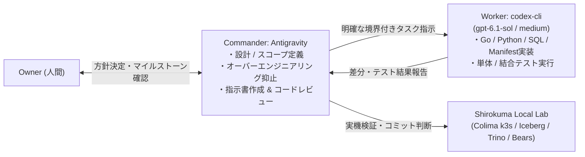

# DEV-04F: 司令塔×実装ワーカー体制と実用コア再起動ロードマップ

2026-11-03 JST、[DB-P6-5G](../../guides/database-p6-5g-compute-explanations-2026-11-03.md)でComputeの観測済み操作条件と停止状態の説明を既存panelへ追加し、限定技術受入を完了した。取得済み候補と現在認可・受付・成功を区別し、Chillだけの6区分条件、元要求の保持、停止原因不明と保存engine証跡の意味を説明する。API・取得契機を増やさず、無効な設定入力だけを従来の送信前検証に合わせてSaveへ反映した。119群4,752成功・34 skip、Workbench実statusの認可境界、日英／390px／実200%と保全を確認した。次はBears／Policyの既存action・必須行・通常導線を照合して残件を限定する。P6全体／M1本人受入は継続し、実伸縮はM1後とする。

2026-11-03、[DB-P6-5F](../../guides/database-p6-5f-compute-history-2026-11-03.md)で共有LOCALの保存済み操作履歴をP専用の手動Compute一覧へ接続し、限定技術受入を完了した。4action・policy変更と保存状態／時刻・要求分類を区別し、実停止や現在原因を推定しない。118群4,722成功・34 skip、実API全144件、日英／390px／実200%と保全を確認した。次は現在権限と停止理由の説明を既存対応と照合して限定実装し、Bears／Policy残件、89行の全体閉鎖、DB-P6-7／M1本人受入という順序を維持する。

2026-11-03、[DB-P6-5E](../../guides/database-p6-5e-platform-capacity-2026-11-03.md)で登録Nodeの容量・利用可能量をComputeの独立したP専用手動観測へ接続し、限定技術受入を完了した。現在認可・固定Node対応・sample鮮度、容量／割当予算とメモリ推定・3FSの区別を検査し、116群4,663成功・34 skip、実API・日英／390px／実200%と保全を確認した。次は起動・停止履歴／停止理由・現在権限の説明を既存対応と照合して限定実装し、Bears／Policy残件、89行の全体閉鎖、DB-P6-7／M1本人受入の順序を維持する。

2026-11-03、[DB-P6-5D](../../guides/database-p6-5d-platform-usage-2026-11-03.md)で固定LOCALのCPU・メモリ実使用量をComputeの独立した手動観測へ接続し、限定技術受入を完了した。sourceの現在所有関係・コンテナ再起動・sample期間とP認可、設定requests／limitsとの区別、114群と修正後Workbench 1,092件・実API／画面・保全を検証した。次はComputeの容量／履歴等を限定単位で進め、Bears／Policy残件、89行の全体照合、DB-P6-7／M1本人受入の順序を維持する。

2026-11-03、[DB-P6-6E](../../guides/database-p6-6e-table-drop-2026-11-02.md)でEXP-11のカタログ解除・データ保持を限定技術受入済みとした。現在Aの正規認可と不変Refを検査し、ACK／UNKNOWN、対象消失後とID未受領時の元key照会を分離する。canonical 112群と最終backend 40／retirement 28／Workbench 1,083、実4 ACK・同名再作成保全・22ファイル保持・通常画面と元行／設定保全を確認した。次はComputeの観測・管理を限定単位で進め、P6全必須行とM1本人受入、M1後の実コンピュート伸縮という順序は維持する。

2026-11-02、[DB-P6-6D](../../guides/database-p6-6d-table-lineage-2026-11-02.md)でEXP-13／14のTable・Explorer lineageを限定技術受入済みとした。保存WAP／dbtの確定証跡と版を固定しない定義、現在／過去、計画中モデルを分け、現在query権限とdbt本人／保存roleを検査する。canonical 110群（旧UI期待値修正後のWorkbench 1,058件再実行を含む）と実HTTP 40件、通常画面・Lineage領域の390px／200%・元台帳／設定保全を確認した。次はEXP-11のDrop導線を別単位で進め、P6全必須行とM1本人受入は継続する。

2026-11-02、[DB-P6-6C](../../guides/database-p6-6c-table-profiling-2026-11-02.md)でEXP-12の全行・全列NULL統計を通常Explorerへ接続し、限定技術受入を完了した。現在query権限と固定Snapshotを検査し、正確な件数文字列・NULL率、元key回復・取消・遅着応答消去を実装した。全体回帰4,460成功・34 skip、実2DB×3roleの8件＋通常画面3件、再送・拒否・再起動GETと元行／設定保全を確認した。次はTable／Explorer lineageを限定して進め、P6全必須行とM1本人受入は継続する。

2026-11-02、[DB-P6-6B](../../guides/database-p6-6b-table-clone-2026-11-02.md)でEXP-10の同DB・現在／過去Snapshotから新規SANDBOX TABLEへの物理コピーを接続し、限定技術受入を完了した。source queryとtarget writeを分離し、単一CTAS・元key回復・UNKNOWN・commit後確認未完了を保持する。全体回帰4,385成功・34 skip、実2DB×Engineer／adminの4コピーと通常画面の過去Snapshotコピー、値照合・拒否・reload回復・元行／設定保全を確認した。次はEXP-12のprofiling／NULL統計を限定して進め、P6全必須行とM1本人受入は継続する。

2026-11-02、[DB-P6-6A](../../guides/database-p6-6a-result-save-contract-2026-11-02.md)でSQL-08の返却済みWorksheet結果保存を接続し、限定技術受入を完了した。元queryの本人・保存role・現在context・受領page列を検査し、サーバーの保持値からCSV／JSON／TSVを生成する。全体回帰4,328成功・34 skip、実2DB×3role・22成果物／72要求、ブラウザー実ファイル・cache喪失拒否と保全を確認した。次はEXP-10の固定Snapshotから新規SANDBOX TABLEへの物理コピーを進め、P6全必須行の閉鎖とM1本人受入は継続する。

2026-11-02、[DB-P6-4E](../../guides/database-p6-4e-ai-settings-2026-11-02.md)でAI-06の共有AI設定をDatabaseモードの通常画面へ接続し、限定技術受入を完了した。現在の真P・上限admin・選択global adminをDB grantと独立して検査し、active設定・key保護・明示接続test・保存・遅着応答の無効化を実装した。既存LOCAL推論条件を維持し、全体回帰4,264成功・34 skip、両HTTP面84要求・実LOCAL疎通・ブラウザーと原設定／既存データの保全を確認した。次は[SQL-08／DB-P6-6A設計案](../../guides/database-p6-6a-result-save-contract-2026-11-02.md)に沿って結果保存を進め、P6全必須行とM1本人受入は継続する。

2026-11-02、[DB-P6-4C2C1](../../guides/database-p6-4c2c1-workload-baseline-2026-11-02.md)で固定LOCAL Pod-template宣言基準の読取りレビューを実装した。現在の真P・上限admin・選択adminを全source取得前後に検査し、DB／schema／grantを前提にしない。固定2 Deploymentの全ordinary／initをordinalで扱い、旧Policyの意図を限定した4項目のmet／not_metだけを返す。nonRoot=trueかつUID未指定は旧宣言ruleどおり許し、native-baselineの8 admission policyやglobal policy全体の検証にはしない。不正・部分sourceは全体を確認不可とし、aggregate PASS／allowや操作許可を返さない。SRE／PolicyのPlatform scopeとComputeに独立共有cacheを手動表示し、旧C2B・P5A／P5B／P5Cを変更しない。C2C1の限定範囲を2026-11-02 JSTに技術受入済みとした（全体回帰4,232成功・34 skip、両HTTP面の実APIとWorkbenchの3面表示、最終保全PASS）。usage・AI設定より先に進めた順序は今回のCommander判断であり、P6-4全体／P6-5全体／P6-7／M1本人受入は継続する。

2026-11-02、[DB-P6-5C](../../guides/database-p6-5c-contract-2026-11-02.md)でCompute専用DB保存activity一覧の読取り統合を実装した。既存AUD-03のquery／job_runだけを、独立した参照role・READY DB・self／database scope・手動filter／cache／前後pageで読むUIのみの単位であり、新しいbackend・API・認可policyを作らない。本人・保存roleと現在のDB／Schema権限を検査し、現在のplatform admin account・account role admin・選択adminに対する既存effective DB admin例外も維持する。P5A／P5BのP専用観測とAuditの状態を使い回さず、SQL・結果・live activity・詳細・復旧・export・自動pollを追加しない。P5Cの限定範囲を2026-11-02 JSTに技術受入済みとした（全体回帰4,188成功・34 skip、既存AUD-03の実APIとWorkbenchの実画面、最終保全PASS）。P6-4全体／P6-5全体／P6-7／M1本人受入、C2C／global policy・usage／capacity・AI設定は継続する。

2026-11-02、[DB-P6-5B](../../guides/database-p6-5b-platform-resources-2026-11-02.md)で固定LOCALコンテナ設定資源の読取り表示を実装した。独立した入力なしの明示GETで、真のplatform account・principal、上限admin・選択adminを全source読取り前後に確認し、DB／schema／grantを前提にしない。Computeの独立panel・P cacheで、coordinator／workerの全ordinary・initコンテナのCPU／memory requests・limitsをliteral文字列または未指定として扱う。既存C2B API・閉じたDTO・cache・requestは維持する。P5Bの限定範囲を2026-11-02 JSTに技術受入済みとした（全体回帰4,166成功・34 skip、両HTTP面の実API・Workbenchの実画面、最終保全PASS）。 P6-4全体／P6-5全体／P6-7／M1本人受入はOPENのまま、C2C／global policy、usage／capacity／activity、resizingは別タスクとする。

2026-11-02、[DB-P6-4D1](../../guides/database-p6-4d1-ai-audit-metadata-2026-11-01.md)で既存AUD-03へ保存済みAI要約metadataを統合した。`source=ai`と閉じた5種のactionを既存event形状へ投影し、`links=[]`、内容fieldの追加なしとする。最新の保存要約であり、状態遷移監査ではない。self／databaseの現在認可を維持し、保存full9の内部整合を現在revisionとの一致条件へ置き換えない。platform scopeにはAIを含めず、本文の表示・検索、AI取得・復旧や書込みを追加しない。D1の限定範囲を2026-11-02 JSTに技術受入済みとした（全体回帰4,135成功・34 skip、Workbenchの実API・実画面、最終保全PASS）。 C2C／P5B・AI設定とP6-4全体／P6-5全体／P6-7／M1本人受入は継続する。

2026-11-01、[DB-P6-5A](../../guides/database-p6-5a-compute-observations-2026-11-01.md)でCompute画面へのP専用固定LOCAL観測の読取り統合を実装した。受入済みC2Bの明示GET・strict DTO・global P cacheを再利用し、新しいAPIやDB context／grantの前提を追加しない。現在の真P・上限admin・選択adminを条件とし、完了snapshotと観測時刻をSRE／Policy／Computeで共有する。画面を開くだけでplatform観測を取得せず、既存Warehouse操作へも接続しない。desired／ready要約・過去のengine証拠・保存AutoChill設定・限定admission件数を現在healthや完全なPolicy監査へ読み替えない。P6-5Aの限定範囲を技術受入済みとした（全体回帰4,122成功・34 skip、両HTTP面の実APIと権限拒否、Computeの実画面、最終保全PASS）。C2Cのworkload baselineは独立後続とし、旧SRE check／Policy baseline・global auditは閉じたまま、P6-4全体／P6-5全体／P6-7／M1本人受入は継続する。

2026-11-01、[DB-P6-4C2B](../../guides/database-p6-4c2b-platform-observations-2026-11-01.md)でSRE／PolicyのP専用固定LOCAL観測を実装した。現在のaccountとprincipal双方のP権限、上限admin、選択adminをsource取得前後に確認し、DBやgrantを利用条件にしない。固定2 Deploymentのdesired／ready要約、過去のengine検証日時、保存AutoChill設定、LOCALの保存admission件数だけを扱う。desired／readyの一致や両方0をSQL health・完全停止・資源解放の証明にせず、保存日時を現在の稼働保証へ変換しない。明示GETだけで書込み・SQL・LLM・操作を行わず、C2AのDB観測はplatform sourceを読まないままとする。C2Bの限定範囲を技術受入済みとした（全体回帰4,109成功・34 skip、両HTTP面の実APIと権限拒否、Pの実画面、復元と最終保全PASS）。global workload／policy検査、旧SRE／Policyのrun／manifestとComputeの旧検査は開放せず、P6-4全体／P6-5／P6-7／M1本人受入は継続する。

2026-11-01、[DB-P6-4C2A](../../guides/database-p6-4c2a-context-observations-2026-11-01.md)でSRE／PolicyのDB-only観測を実装した。現在の本人・保存9項目context・primary schema権限を新しいread-only snapshotでも再確認し、本人のquery／AI保存metadataを各20候補以内から限定表示する。21件目は古い候補の存在だけを示し、不正候補を省略しても補充走査しない。保存状態・時刻を現在healthへ変換せず、Policyの権限・SQL mode上限も個別statementの承認にはしない。platform能力flagは現在認可で計算するが、Pを含む全roleでplatform sourceを読まない。SQL・LLM・既存get／履歴／lease・照合・書込みを呼ばない。重点backend335件・UI889件、実API・admin実画面と復元を確認し、最終8ファイルで全体回帰を完了した。C2Aの限定範囲を技術受入済みとした（全体回帰4,073成功・34 skip、2DB・3実行ロールの実API、未付与権限の拒否、adminの実画面、最終保全PASS）。P専用platform観測と全体policy検査は別単位とし、P6-4全体／P6-5／P6-7／M1本人受入は継続する。

2026-11-01、[DB-P6-4C1](../../guides/database-p6-4c1-catalog-proposals-2026-11-01.md)でCatalog Curatorの許可metadata説明・説明文案を実装した。ワークシートに依存しない明示contextと、同じprimary schemaのTABLE／VIEW 1件を対象に、現在の権限・Ref・UUID・列構造を検査してLOCAL推論だけを行う。入力は名前・列名・型へ限定し、VIEWの定義・依存や既存の説明文を転用しない。出力は推定の表説明と最大8列の部分的な説明文案であり、保存・適用・SQL実行を追加しない。既存AIの元key／受付ID・履歴・取消・UNKNOWN境界を保ち、metadataの直接読取りでregistryを更新しない。C1の限定範囲を技術受入済みとした（全体回帰4,020成功・34 skip、2DB・3roleの実API、adminの実画面、最終保全PASS）。SRE／PolicyのDBとplatformの観測、lineage・説明保存は後続に分け、P6-4全体／P6-5／P6-7／M1本人受入は継続する。

2026-11-01、[DB-P6-4B2](../../guides/database-p6-4b2-wap-handoff-2026-11-01.md)でB1案から既存Manual WAPへの明示引渡しを実装し、限定範囲の技術受入を完了した。元案の本人・保存9項目contextと全source schema権限を保ち、利用者が選んだ同一DB・同一E／A roleのSANDBOX実行先9項目contextを別に検査する。保存済み元SQLの使用TABLEだけを現在の識別情報・列で確認し、scopeに従うalias変換と既存WAP compilerを通す。使用VIEWを拡張せず、未使用VIEWはschema権限だけを確認する。明示GETはmetadata読取りだけで、新しい未保存WAP下書きへ取り込んだ後のSQL・source・target・品質編集と版保存／build／audit／A公開は既存WAPの責務とする。B2の限定範囲を技術受入済みとした（全体回帰3,944成功・34 skip、2DBの実機・画面・最終保全PASS）。次は他Bearsの必須導線を統合し、P6-4全体／P6-7／M1本人受入は継続する。

2026-11-01、[DB-P6-4B1](../../guides/database-p6-4b1-sql-proposals-2026-11-01.md)で、許可metadataに基づくSQL案生成を実装した。入力は依頼文・明示的な1〜8件の同一DB ResourceRef・保存9項目contextへ限定し、全参照の現在権限とregistry identityをREST取得前に検査する。原文の依頼文とTABLE／VIEWの公開列metadataだけをLOCALモデルへ渡し、VIEW定義や再帰依存、行データを生成metadataへ含めない。単一read-only SELECTと選択した参照範囲を検査し、実行しない下書きとして表示する。独立した元key復旧・履歴・取消を持ち、未知の結果を自動再推論しない。B1を技術受入済みとした（全体回帰3,892成功・34 skip、2DB・3role実機・最終保全PASS）。B1受入時点の後続B2は上記で受入済みであり、P6-4全体／P6-7／M1本人受入は継続する。

2026-10-31、[DB-P6-4A5](../../guides/database-p6-4a5-saved-plan-explanation-2026-10-31.md)で保存済み計画の明示再説明を実装した。元A2／A3のCOLLECTED証拠と、保存値・現在台帳の両方でFINISHEDの元queryを検証し、安全な取得時点の計画とmetadataを別kindの推論要求へ原子的に固定する。元親がSUCCEEDED／FAILED／CANCELED／UNKNOWNでも条件が合えば扱い、元UNKNOWNやA2の新規query guardを変更しない。保存9項目contextと全凍結依存schemaの現在権限を検査し、catalog・Engine・Wake・admissionを呼ばずにLOCAL推論だけを行う。新要求の元key復旧・履歴・取消を分離し、UNKNOWNを自動再推論しない。重点backend198件・UI190件、全体回帰3,824成功・34 skip、2DB・3roleの休止中実機確認と最終保全照合を完了した。次はSQL案生成、その後に既存WAPへの明示引渡し・他Bearsを扱う。P6-4全体／P6-7／M1本人受入は継続する。

2026-10-31、[DB-P6-4A4](../../guides/database-p6-4a4-latest-query-source-2026-10-31.md)でQuery Doctorの最新SELECT読込を実装した。本人・保存済み9項目context・通常read-only queryへ対象を限定し、全参照schema権限と現在のlogical identityを検査する。明示GETでSQLと元queryのID・時刻・状態だけを取り出し、SQL・AI・Wake・catalogは呼ばない。入力変更・認可変更・遅着応答を拒み、未解決のA1／A2要求を保持する。A1は元IDのGETまたは元key／bodyの明示復旧で確認し、異なる現在入力へ古い説明を表示しない。重点backend116件・UI168件、全体回帰92単位（3,779成功・34 skip）、2DB・3roleの実機・画面と既存状態の保全を確認し、この限定範囲を技術受入済みとした。A4時点の後続だった保存済み計画の明示再説明はA5で扱い、P6-4全体／P6-7／M1本人受入は継続する。

2026-10-31、[DB-P6-4A3](../../guides/database-p6-4a3-view-plan-explanation-2026-10-31.md)でQuery Doctor／Copilotの計画説明を、TABLEから`logical_v1`の対応するINVOKER VIEWへ拡張した。native／外部登録を名前で限定せず、stored defaultsに従う再帰依存の同一DB・全schema権限とprivateなhead証拠を固定・再検査する。VIEW定義内の整数snapshot付きTABLE参照は全指定snapshotとschemaを検証し、通常のdata appendを妨げない。VIEW定義をSQLへ展開せず、元SQLへの固定非ANALYZE EXPLAINを通常受付・Wakeで実行する。元SQLは未実行であり、catalog検証はversion固定ではない楽観的検証である。実機・画面で重点検証した。全体回帰91単位（3,719成功・34 skip）に加え、回帰開始後の修正を最終重点backend204件・UI80件で確認し、この限定範囲を技術受入済みとした。DEFINER・他DB・履歴schema差分・timestamp／tag等のtime travel、SQL案／WAP・他Bearsは後続で、P6-4全体／P6-7／M1本人受入は未完了である。

本ドキュメントは [ADR-0036](../07_ADR/ADR-0036_Adopt_Commander_Worker_Model_and_Pragmatic_Core_Reset.md) に基づき、2026年10月16日以降の Shirokuma の開発体制（**Antigravity 司令塔 × `codex-cli` GPT-6.1 Sol Medium 実装ワーカー**）および **Phase 0〜Phase 6 再起動ロードマップ** を定義する。

### Databaseコア機能統合とコンピュート拡張の後続計画

2026-11-02、所有者の指示により、残件は[AI設定（AI-06／DB-P6-4E）](../../guides/database-p6-4e-ai-settings-2026-11-02.md)→Worksheet結果保存・探索操作→Compute観測／管理→Bears／Policy残件→89行とDB-P6-3・4・5・6の全体照合→DB-P6-7／M1本人受入の順で進める。探索の契約・読取り調査は並行できる。dbtの別拡張はTRF-11必須範囲と分け、実compute伸縮のDB-P7はM1後とする。

2026-10-31、TRF-11の必須操作対応を確認し、[DB-P6-4A1](../../guides/database-p6-4a1-local-sql-explanation-2026-10-31.md)で許可されたSQLのローカル説明を実装した。Query Doctor／Copilotは保存キー・本人履歴・遅着ガードを共有し、SQL／planの実行や旧INTERNAL経路を使わない。2DB実推論とブラウザー検証を終え、canonical 89単位（3,595成功・34 skip）と文書検証を完了し、この限定範囲を技術受入済みとした。実行計画はA2へ分け、5 Bears全面対応やM1完了にはしない。

2026-10-28、[Database後続実装計画](../../guides/database-full-capability-and-compute-plan-2026-10-28.md)を作成した。新しいDatabase trackは`DB-P6`〜`DB-P9`とし、下記の旧コアPhase番号と区別する。
最優先のDB-P6は変換・AI・監査・ガバナンスと共有Warehouseの自動休止／復帰を通常導線へ統合し、技術受入と所有者受入でM1を判定する。
DB-P7は実サイズ／Worker増減、DB-P8は条件付きの用途別Warehouse、DB-P9は外部S3とRoutine／Taskを扱う。LOCAL／XS／Sは現状同一computeの別名であり、計画を実装完了と扱わない。

2026-10-29、DB-P6-0の[89項目の表示契約](../../guides/database-capability-matrix-2026-10-29.md)と[DB-P6-1の保存metadata監査](../../guides/database-p6-1-implementation-2026-10-29.md)は技術受入済みである。
[DB-P6-2の共有LOCAL休止・自動復帰](../../guides/database-p6-2-implementation-2026-10-29.md)はAPI／CLI／UIを実装し、技術受入が完了（cold 30回: p50 26.44秒・p95 26.92秒（30回すべて成功））。warm各30回の標本p95差は35.3ms、限定復旧は元UNKNOWNを保持して実行だけを閉鎖した。
[DB-P6-3B](../../guides/database-p6-3b-implementation-2026-10-29.md)・[C1](../../guides/database-p6-3c-dbt-compatibility-2026-10-29.md)・[C2A](../../guides/database-p6-3c2-sandbox-views-2026-10-30.md)・[C2B1](../../guides/database-p6-3c2b-native-materialization-2026-10-30.md)・[C2B2](../../guides/database-p6-3c2b2-native-runs-2026-10-30.md)・[C2B3](../../guides/database-p6-3c2b3-native-ui-2026-10-30.md)は各限定範囲の技術受入済み。[C2B4](../../guides/database-p6-3c2b4-native-quality-tests-2026-10-30.md)で新規native TABLE 1件に付属する品質test一式を明示選択でき、TABLE作成の検証と品質結果を分離した。API／実CLI／画面、E／A・2DB・休止復帰・品質失敗・SDK停止／取消／owner喪失と保全を実機確認した。この限定範囲の技術受入を完了した。C2B4時点の通常RunTask／全graphは後述のC2Cで扱う。native VIEWの構築・testは後述C2E1で拡張する。native SDKの候補直接置換、native VIEWの正式公開、DB-P6-3全体とM1本人受入は後続である。

2026-10-31、[C2B5](../../guides/database-p6-3c2b5-native-publication-2026-10-31.md)で、品質成功済みnative TABLEの明示公開を実装した。Aが固定した公開先を確認し、最低1行の監査を経て同じDatabaseのMARTSへ公開する。E作成／A公開と元key回収を実機確認し、この限定範囲の技術受入を完了した。graph候補のTABLE公開は後述C2Dで対応した。native VIEWの構築・testは後述C2E1で拡張する。native SDKによる既存候補の直接置換、manual-WAP rollback統合、DB-P6-3全体とM1本人受入は後続である。

2026-10-31、[C2C native RunTask／全graph](../../guides/database-p6-3c2c-native-graph-2026-10-31.md)を実装した。対応する保存済みTABLE／EPHEMERAL全DAGを実際のRunTaskで構築し、明示選択時はsource test・TABLE間relationshipsを含む保存全testをTestTaskで実行する。画面／API／CLIに`native_graph`と利用条件を接続した。E／A・2DB・休止復帰・SQL失敗／SKIPPED・取消／owner停止と保全を実機確認し、この限定範囲の技術受入を完了した。graph候補のTABLE公開は後述C2Dで対応した。native VIEWの構築・testは後述C2E1で拡張し、incremental・並列実行は後続とし、C2B5の単一TABLE公開と既存SQL/WAPを維持する。

2026-10-31、優先unit [C2D graph候補の明示公開](../../guides/database-p6-3c2d-graph-publication-2026-10-31.md)を実装し、この範囲の技術受入を完了した。全graphの構築と保存全品質testの成功証拠を条件に、現在のAが選択TABLEと固定targetを確認し、最低1行の監査後に同じDBのMARTSへ公開する。他TABLEの公開は別操作であり、source Eとpublisher Aのcontext・資格情報、元要求の回収と履歴証拠を分けて保持する。

2026-10-31、優先unit [C2E1 native graphのINVOKER VIEW](../../guides/database-p6-3c2e1-native-views-2026-10-31.md)を実装し、この範囲の技術受入を完了した。同じDBのrun専用SANDBOXへVIEWを構築し、VIEWからTABLEへの依存と保存全品質testを実SDKで実行する。C2E1受入時点ではVIEWを含むgraphの正式公開を保留した。C2E2でVIEW定義・識別情報と推移依存を公開証拠へ接続する。既存のTABLE／EPHEMERAL graph公開とSQL/WAPを維持する。

2026-10-31、優先unit [C2E2 VIEWを含むnative graphのTABLE公開](../../guides/database-p6-3c2e2-view-graph-publication-2026-10-31.md)を実装し、この範囲の技術受入を完了した。全VIEWの定義・UUID／version・閉鎖済み作成queryと推移依存を公開intentへ固定し、全graph構築・品質成功後に選択TABLEを明示公開する。確認済みVIEW要約と受付結果を照合し、元VIEWが変更・削除された後も公開履歴を独立して照会できる。正式VIEW公開やVIEW連鎖は含めない。 実機の監査UNKNOWNは[R1の限定運用復旧](../../guides/database-p6-3r1-dbt-audit-recovery-2026-10-31.md)で、UNKNOWNを保持して実行閉鎖・受付再開を証明した。新しい未閉鎖実行は0件である。次はTRF-11の必須操作との対応を確認し、DB-P6-4AのQuery Doctor／Copilot Explain読取り専用context統合へ進む。

---

## 1. 開発体制：Commander–Worker 分担モデル

2026-10-18、所有者の指示により開発の司令塔を Antigravity から Codex に引き継いだ。
以下の分担モデルとローカル開発の範囲を維持し、Codex が作業分割・統合・レビューを担当する。
Phase 15 の残件対応と受入証拠は `docs/guides/phase16_remediation.md` に記録する。

従来の無人500セッション連続実行ループ（`autonomous_runner.py` および各種 `*_supervisor.py`）は廃止し、設計・判断と実装を明確に分離した **2階層体制** で開発を進める。



### 1.1 役割定義

| 役割 | 担当 | 責務と権限 |
|---|---|---|
| **司令塔 (Commander / Architect / Reviewer)** | **Antigravity** | 1. ロードマップ管理と Work Package（WP）のスコープ定義<br>2. `codex-cli` への具体的・有界なプロンプト指示の作成<br>3. **オーバーエンジニアリングの厳格な阻止**（過剰な防御コード、Fixture専用ハック、不要な監査ラッパーの却下）<br>4. 実装差分のコードレビュー・実機検証・Vault/設計書の同期 |
| **実装ワーカー (Implementation Worker)** | **`codex-cli`**<br>(`gpt-6.1-sol` / `medium`) | 1. Antigravity が指定したファイル・モジュールに対するコード実装とテスト作成<br>2. 指定されたテストコマンドの実行と結果報告<br>3. スコープ外のファイル変更・独自のポリシー解釈・過剰な自己防衛コードの禁止 |

### 1.2 `codex-cli` 呼び出し標準テンプレート

Antigravity が `codex-cli` に実装を委譲する際は、以下のコマンド体系を使用する（`rtk proxy` 経由で実行）。

```bash
rtk proxy /Applications/ChatGPT.app/Contents/Resources/codex-cli/bin/codex exec \
  -m gpt-6.1-sol \
  -c model_reasoning_effort="medium" \
  -s workspace-write \
  -C "$(git rev-parse --show-toplevel)" \
  "<Antigravityが作成した構造化タスク指示>"
```

### 1.3 Antigravity から `codex-cli` へのタスク指示フォーマット

各タスク指示には必ず以下の5項目を含め、ワーカーが迷走しないように境界を固定する。

1. **Goal（達成すべき機能成果）**: 何が動くようにするか（1〜3文）。
2. **Target Files（変更対象ファイル）**: 触ってよいファイル・ディレクトリの明示。
3. **Anti-Over-Engineering Rules（禁止事項）**: 今回のタスクで絶対にやってはいけない過剰実装。
4. **Verification（検証コマンド）**: 完了判定に使う具体的な `pytest` / `unittest` / `go test` コマンド。
5. **Scope Stop（完了条件）**: テストが通ったら余計なドキュメント追記や周辺リファクタをせず即座に終了すること。

---

## 2. オーバーエンジニアリング防止の「5つの鉄則（Anti-Bloat Rules）」

過去の520セッションで発生した停滞を二度と繰り返さないため、Antigravity は以下の5原則で `codex-cli` の設計・実装をコントロールする。

1. **No Fixture-Only Features（ハリボテFixture実装の禁止）**
   - `--case retained-fixture` や固定2行・固定48行のデータしか通らないハードコード実装を禁止する。最初から任意の有効なSQL・任意のテーブル名・任意のパラメータを受け付ける実装にする。
2. **No Symlink / FD Paranoia in Local Tooling（過剰なシステムコール防衛の禁止）**
   - シングルユーザーのローカル実験環境において、一時ディレクトリや内部ソケットに対する過剰な `openat2(NO_XDEV)`、多段の fd 相対 `unlink`/`chmod`、Mach 時計ドリフト監視などを増殖させない。標準ライブラリの安全なパス操作とシンプルなバリデーションで十分とする。
3. **No Supervisors of Supervisors（監視スクリプトの自己増殖禁止）**
   - AIセッションを監視・再試行・ハッシュ監査するための親スクリプト（`*_supervisor.py`）や数千行のJSONレシート検証器をこれ以上作らない。
4. **No Upstream Binary Surgery（上流OSSコンテナの自前パッチ・再ビルド禁止）**
   - Flux、Trino、Polaris 等の公式イメージに対するCVE消込み目的のソースビルドやAPKレイヤー差し替えは一切行わない。公式の ARM64 Digest Pinning をそのまま利用する。
5. **Human-Readable Documentation Only（人間が読める簡潔な記録）**
   - WBS やマイルストーン記録に SHA256 ハッシュの羅列や「何が未完か」の免責ポエムを書かない。1つのタスク完了記録は「何を実現したか・どう動かすか」を3〜5行で簡潔に記す。

---

## 3. 実用コア再起動ロードマップ（Phase 0 〜 Phase 6）

L0〜L6 に分散していた「局所的な実験スクリプト群」を整理し、**実際に毎日触って動かせる OSS Data Cloud (Snowflake / Databricks / Fabric のコア体験)** を最短距離で完成させる。

### Phase 0: ルール・証跡の大掃除とテスト正常化【即時】

| WP ID | タスク名 | 完了条件 (Definition of Done) | 状態 |
|---|---|---|---|
| **WP-P0-001** | ADR-0036・新ロードマップ策定と旧肥大化ログのアーカイブ | ADR-0036 と DEV-04F を作成し、12,463行の旧マイルストーンと2,794行の旧WBSを `archive/` に退避してスリム化する。 | **Completed (2026-10-16)** |
| **WP-P0-002** | `warehouse_lifecycle` の `UNSAFE_PATH` テストエラー1件の修正 | `codex-cli` (GPT-6.1 Sol Medium) に指示し、macOS `/var` シンボリックリンク起因のテストFixtureエラーを修正して `make verify-local-experiment` のテスト群をオールグリーンにする。 | **Completed (2026-10-16)** |

### Phase 1: L0/L1 常駐コアの「普通に動く化」【1〜2日】

| WP ID | タスク名 | 完了条件 (Definition of Done) | 状態 |
|---|---|---|---|
| **WP-P1-001** | Colima (`mac-studio-solo`) 起動と L0/L1 コアのアンサスペンド | 停止・サスペンドされていた Flux v2、SeaweedFS、PostgreSQL、Polaris、Trino、ClickHouse (AgentHouse) を公式 ARM64 Digest イメージで通常稼働（`Ready=True`）させる。 | **Completed (2026-10-16)** |
| **WP-P1-002** | `shirokuma doctor` 完全Green化と1コマンド運用 (`make lab-up / down / status`) | 「サスペンド中のためDegraded」ではなく、実稼働クラスタに対して `shirokuma doctor` が全項目 Healthy を返し、1コマンドで起動・停止できる。 | **Completed (2026-10-16)** |

### Phase 2: 「脱Fixture化」— 本物の Lakehouse & AI Bear 体験への昇格【1〜2週間】

| WP ID | タスク名 | 完了条件 (Definition of Done) | 状態 |
|---|---|---|---|
| **WP-P2-001** | Virtual Warehouse (`shirokuma warehouse`) の汎用SQL・常駐制御対応 | 固定の `nation` 25行クエリ限定を解除し、`shirokuma warehouse status / chill / wake / query <size> "<任意のSQL>"` が常駐 Trino に対して汎用的に動作する。**注記 (2026-10-17 Owner合意)**: リソース効率最優先のため XS/S/LOCAL は単一の常駐 `trino-local` を共有する仕様とし、Gateway 経由の物理的複数クラスタ分割は Optional Track へ移行。 | **Completed (2026-10-16, 確定 2026-10-17)** |
| **WP-P2-002** | 常設 Iceberg データレイク & Dagster/dbt/OpenMetadata パイプライン | テスト後に即 `DROP` するのではなく、Polaris + Iceberg 上にサンプルデータセット（TPC-H）と dbt staging/mart モデルを常設（`make lake-seed`, `make lake-build`, `make lake-test`）。OpenMetadata/Superset 連携基盤を確立。 | **Completed (2026-10-17)** |
| **WP-P2-003** | 5 Core Bears の汎用 CLI / MCP ワークフロー化 | `SRE Bear`、`Query Doctor Bear`、`Data Engineer Bear`、`Catalog Curator Bear`、`Policy Gatekeeper Bear` から Fixture 制限を外し、実常駐Trino/Kubernetes/Icebergカタログ/ローカル推論サーバと連携。`shirokuma bear sre/query/data/catalog/policy` 及び `make bears-smoke` が Pawprints (ClickHouse) テレメトリ記録付きで完全稼働。 | **Completed (2026-10-17)** |

### Phase 3: スコープ集中と統合オペレータUI（Shirokuma Workbench）【2〜3週間〜】

| WP ID | タスク名 | 完了条件 (Definition of Done) | 状態 |
|---|---|---|---|
| **WP-P3-001** | 周辺エンジンの Optional Plugin トラック分離 | コア構成（SeaweedFS + Polaris + Iceberg + Trino + Spark + ClickHouse + Dagster/dbt + OpenMetadata + Superset）に集中し、Trino Gateway複数クラスタ分割、StarRocks / Doris / Gravitino / XTable / RustFS / Cube / Ray / Amoro を Optional Plugin Track（`02D_Optional_Plugin_Tracks.md`）として分離・境界策定。 | **Completed (2026-10-17)** |
| **WP-P3-002** | Shirokuma Workbench（統合ローカルWeb UI）の構築 | バラバラの静的HTMLレポートを統合し、`shirokuma workbench`（ポート 8888）により、Virtual Warehouse の稼働/Chill/Wake操作、SQLワークスペース、Iceberg カタログ＆dbtリネージ、5頭のAutonomous Bears対話実行、AgentHouse Pawprints (ClickHouse) テレメトリを1つの洗練されたローカルWeb画面で統合操作可能にする。 | **Completed (2026-10-17)** |

### Phase 4: Trustworthy Agentic DWH — 中小規模向け実用データ基盤＆AI安全委任ガードレール【2026-10-17】

| WP ID | タスク名 | 完了条件 (Definition of Done) | 状態 |
|---|---|---|---|
| **WP-P4-001** | SQL安全ガードレール & Write-Audit-Publish (WAP) サンドボックス実行 + Iceberg Snapshot Rollback | SQL実行の安全性を検査し、WAPで変更を監査してから公開できる。Icebergスナップショットへのロールバックを提供する。 | **Completed (2026-10-17)** |
| **WP-P4-002** | ローカルファイル (CSV / TSV / JSONL / Parquet) 自動スキーマ推論インジェスト (`shirokuma lake ingest`) | ローカルファイルからスキーマを推論し、指定したIcebergテーブルへ取り込める。 | **Completed (2026-10-17)** |
| **WP-P4-003** | AgentHouse Pawprints リッチ監査証跡・常駐Trinoトンネル再利用・Shirokuma Workbench WAP/Ingest UI 統合 | Pawprintsの監査情報を拡充し、常駐Trinoトンネルを再利用する。WorkbenchからWAPとファイル取り込みを操作できる。 | **Completed (2026-10-17)** |
| **WP-P4-004** | 高速コア検証ターゲット (`make verify-core`) 整備と設計ドキュメント・Vault・GitHub 同期 | 常駐コア7モジュール、Go、設計整合性、リポジトリ衛生を高速検証し、Phase 4のロードマップ・ゲート・マイルストーンを同期する。 | **Completed (2026-10-17)** |

### Phase 5: WAP品質・モデル更新・冪等インジェスト【2026-10-17】

| WP ID | タスク名 | 完了条件 (Definition of Done) | 状態 |
|---|---|---|---|
| **WP-P5-001** | WAP単一スキャン監査・QUALIFY書換・回帰ガード・AI SQL自己修正 | 単一スキャンで品質を監査し、QUALIFY書換と回帰ガードでSQL実行を補助する。AI生成SQLの自己修正を提供する。 | **Completed (2026-10-17)** |
| **WP-P5-002** | 動的WAPモデル・リネージ登録とワンコマンド更新 | WAPモデルとリネージを登録し、`--refresh` で登録モデルを再実行できる。 | **Completed (2026-10-17)** |
| **WP-P5-003** | 冪等UpsertインジェストとWorkbench UI・Phase 5文書同期 | `shirokuma lake ingest --mode upsert --key <cols>` で最終入力行を優先し、キー単位で既存データを更新する。Workbenchのキー入力とPhase 5完了記録を同期する。 | **Completed (2026-10-17)** |

### Phase 6: 常駐コアへの集約とLegacy Fixture整理【2026-10-17】

| WP ID | タスク名 | 完了条件 (Definition of Done) | 状態 |
|---|---|---|---|
| **WP-P6-001** | WAPモジュール分離とSQLヘルパー共通化 | `wap_resident.py` にWAP処理を集約し、Bears・Warehouse・Ingest間のSQLヘルパー重複を解消する。 | **Completed (2026-10-17)** |
| **WP-P6-002** | Legacy Fixture CLI削除と常駐Warehouse CLI集約 | 旧Fixtureサブコマンドと関連Goテストを削除し、Warehouse CLIを常駐コア経路へ集約する。 | **Completed (2026-10-17)** |
| **WP-P6-003** | 旧スクリプト・テスト・仮想環境・Makefile整理とPhase 6文書同期 | 常駐コアのスクリプトとCIテストを保持し、旧Fixtureと不要な仮想環境・Makeターゲットを削除する。`make verify-core` と保持テストを検証し、3文書を同期する。 | **Completed (2026-10-17)** |
| **WP-P6-004** | 旧CVEソースビルド証跡削除と検証整理 | 廃止したCVEソースビルドのスクリプト・証跡・テストを削除し、`make verify` を現行コアに整合させる。 | **Completed (2026-10-17)** |
| **WP-P6-005** | Doctor実装とテストの簡素化 | JSONバイト改変の過剰な防御を除去し、Doctorの状態判定と常駐コア検証を保持する。 | **Completed (2026-10-17)** |
| **WP-P6-006** | AgentHouse管理モジュール簡素化とPhase 6文書同期 | 資格情報・常駐API・5つのCLI操作を保持して管理コードを簡素化し、標準HTTP応答とライブ環境を検証する。 | **Completed (2026-10-17)** |

### Phase 7: Snowsight 風ナビゲーション刷新 ＆ DWH コア使い勝手アップグレード【2026-10-17】

| WP ID | タスク名 | 完了条件 (Definition of Done) | 状態 |
|---|---|---|---|
| **WP-P7-001** | リッチ Table Inspector・Time Travel プレビュー・ブラウザアップロード＆事前プレビュー・モデルレジストリ API | カタログ詳細（データプレビュー・NULL統計プロファイル・DDL・上下流リネージ・スナップショット時点の Time Travel プレビュー）、安全ガード付きサンドボックステーブル削除、ブラウザからのファイルアップロード＆スキーマ事前プレビュー、dbt/WAP 統合モデル一覧・ビルド API を提供する。 | **Completed (2026-10-17)** |
| **WP-P7-002** | Snowsight 風 3 カテゴリ 7 メニュー構成・マルチタブ SQL ワークシート・統合 DWH WebUI 刷新 | 左ナビゲーションを `Work with Data` / `Catalog` / `Manage & Monitor` の 7 セクションへ刷新し、SQL ワークシート内オブジェクトツリー・マルチタブ＆履歴永続化・AI Bear Copilot・結果フィルタ/ソート/CSV・JSON・TSV エクスポート、D&D ブラウザファイルプレビュー＆Ingest、6 タブ Table Inspector を実装する。 | **Completed (2026-10-17)** |

### Phase 8: Snowflake コア体験の仕上げ（バイリンガル UI・インラインチャート・Clone・Export・Auto-Chill・履歴監視）【2026-10-17】

| WP ID | タスク名 | 完了条件 (Definition of Done) | 状態 |
|---|---|---|---|
| **WP-P8-001** | スキーマコンテキスト切替・1-Click サンドボックス Clone・テーブル Export (`shirokuma lake export`)・Auto-Chill・クエリ＆ロード履歴 API | ワークシートのデフォルトスキーマ指定、最新または過去スナップショットからの `sandbox`/`raw` 複製、CSV/JSONL/Parquet テーブルエクスポート CLI & API、アイドル自動休止タイマー、Trino 実行履歴＆データロード履歴 API を提供する。 | **Completed (2026-10-17)** |
| **WP-P8-002** | 右上 Language 切替 (`EN` / `日本語`)・インライン SVG チャート・選択範囲 SQL 実行・Clone/Export/Auto-Chill/履歴 WebUI 統合 | 画面右上の言語切替と完全日英対応、結果の `Table` / `Chart`（棒・折れ線 SVG）切替、選択範囲 SQL 実行、Table Inspector からの 1-Click Clone & Export、Auto-Chill 設定、クエリ履歴（1-Click ワークシート復元）＆ロード履歴ビューを実装する。 | **Completed (2026-10-17)** |

### Phase 9: データ整合性と基盤健全化（型保持・原子的取込・Upsert列保持・全件Export・WAP厳格監査・常駐Auto-Chill）【2026-10-17】

| WP ID | タスク名 | 完了条件 (Definition of Done) | 状態 |
|---|---|---|---|
| **WP-P9-001** | 型保持・先頭ゼロ/DECIMAL精度・CP932/日本語列名・明示的スキーマヒント対応 | 識別子先頭ゼロ（`000123`）、高精度小数の DECIMAL 保持、VARCHAR空文字とNULLの区別、CP932 CSV自動判定、日本語列名保持、および `--schema-hints` / `--encoding` オプションを実装する。 | **Completed (2026-10-17)** |
| **WP-P9-002** | Staging & Swap による取り込みの原子的更新保証 | `replace` および `upsert` 時に中間ステージングテーブルへ全バッチをロードし、検証成功後に単一CTASで原子的に置換。途中でエラーが発生しても本番テーブルを破損させず無傷で保持する。 | **Completed (2026-10-17)** |
| **WP-P9-003** | Upsert 差分更新の列欠損バグ解消 | 差分入力に存在しない既存テーブルのカラムを欠損・削除させず、`LEFT JOIN` / `IS NOT DISTINCT FROM` によるセットベース更新で既存列値と新規行を保持する。 | **Completed (2026-10-17)** |
| **WP-P9-004** | Export Table の全件保証と件数照合 | 10,000 件のサイレント打ち切りを撤廃し、全件出力モードを標準化。テーブル総行数と出力行数を照合し、Web UI・CLIで正確な件数を表示する。 | **Completed (2026-10-17)** |
| **WP-P9-005** | WAP 回帰検査失敗時の公開停止と Snapshot 固定 | 既存マートの行数・列取得エラー時に公開を即座にブロックし、監査を通過した特定のサンドボックス Snapshot ID に固定してマートへ公開する。 | **Completed (2026-10-17)** |
| **WP-P9-006** | サーバーサイド Auto-Chill デーモン & Trino 実行中クエリ保護 | ブラウザ非表示時もバックグラウンドスレッドで自動休止を判定。Trinoの `system.runtime.queries` を検査し、実行中・待機中クエリがある場合は休止を自動延長する。 | **Completed (2026-10-17)** |
### Phase 10: SQL Server → Shirokuma → Power BI の実線開通【2026-10-17】

| WP ID | タスク名 | 完了条件 (Definition of Done) | 状態 |
|---|---|---|---|
| **WP-P10-001** | 固定 SQL Endpoint (`127.0.0.1:8080`) & BI Read-Only Guard | 外部 BI ツール向け固定ポート Trino プロトコルプロキシを提供し、`bi_reader` ロールによる読取専用および `marts` スキーマ隔離を強制する。 | **Completed (2026-10-17)** |
| **WP-P10-002** | Power BI Desktop Import 接続・検証ガイド & コントラクトテスト | Power BI Desktop (Import モード) 接続ガイド、データ型マッピング、Windows Gateway スケジュール更新手順を策定し、実 User-Agent を模した契約テストをパスする。 | **Completed (2026-10-17)** |
| **WP-P10-003** | SQL Server バッチ抽出 & 自動照合レポート (`sqlserver_sync.py`) | SQL Server からの型安全バッチ抽出（DECIMAL/先頭ゼロVARCHAR保持）と、ソース vs ターゲットの総行数・主キーユニーク数・金額合計・NULL 数を完全照合するレポートを提供する。 | **Completed (2026-10-17)** |

### Phase 11: AI設定と業務上の正答性（マルチプロバイダー・認証管理・セマンティックベンチマーク・UI設定）【2026-10-17】

| WP ID | タスク名 | 完了条件 (Definition of Done) | 状態 |
|---|---|---|---|
| **WP-P11-001** | マルチプロバイダー AI 設定 & 認証ヘッダー管理・堅牢な SQL 抽出 | OpenAI互換/OpenAI/Bedrockプロバイダー切替、`Authorization: Bearer` 認証ヘッダー対応、接続テストAPI、JSON/Markdown/生SQLの堅牢抽出、Pawprints累積トークン集計を実装する。 | **Completed (2026-10-17)** |
| **WP-P11-002** | 業務セマンティック辞書注入 & メタデータ制限解除 | 1,000行サイレント打ち切りを撤廃し、完了売上・粗利・期間粒度・Grain-Safe JOIN 等の業務セマンティック定義を AI プロンプトへ注入する。 | **Completed (2026-10-17)** |
| **WP-P11-003** | 15問の業務セマンティック正答性ベンチマーク評価器 (`ai_benchmark.py`) | 構文実行可否だけでなく、除外条件・集計粒度・税・返品・二重計上防止等の業務正当性を検証する 15 問のゴールドクエリ対比評価器を提供する。 | **Completed (2026-10-17)** |
| **WP-P11-004** | Shirokuma Workbench AI モデル設定モーダル & リアルタイム接続テスト UI | プロバイダー・モデル・URL・APIキーを設定・保存するモーダルと、ミリ秒単位の接続レイテンシを表示するリアルタイム接続テストボタンを日英対応で実装する。 | **Completed (2026-10-17)** |

### Phase 12: 少人数の継続利用と本番運用基盤（3階層ロール分離・永続化・ディザスタリカバリ・Linux配備）【2026-10-17】

| WP ID | タスク名 | 完了条件 (Definition of Done) | 状態 |
|---|---|---|---|
| **WP-P12-001** | 3階層ロール分離 (Admin / Data Engineer / BI Viewer) & 権限制御 | ユーザー・ロール単位の厳格な権限解決と、Workbench UI 上での 1-Click ロール切替および画面・API レベルでの不当操作遮断を実装する。 | **Completed (2026-10-17)** |
| **WP-P12-002** | 状態の永続化 (`var/shirokuma`) & 保存失敗時の Fail-Closed 保証 | WAP モデル定義や AI 設定を `tmp/` から永続ディレクトリへ移管し、保存失敗時にサイレントに無視せず即座にエラーを通知する。 | **Completed (2026-10-17)** |
| **WP-P12-003** | 包括的ディザスタリカバリ バックアップ＆リストア スイート (`disaster_recovery.py`) | カタログDDL、データファイル、WAP定義、AI設定、dbtモデルを SHA256 検証付き単一アーカイブとして安全にバックアップ・復元する。 | **Completed (2026-10-17)** |
| **WP-P12-004** | 汎用 Linux 本番配備ガイド & Kubernetes コンテキスト結合の解消 | `KUBE_CONTEXT` の環境変数オーバーライド対応、バックアップの macOS 固有制限解除、Ubuntu 22/24 本番ガイドおよび systemd 設定を提供する。 | **Completed (2026-10-17)** |

### Phase 17.1: 登録ジョブと手動実行【2026-10-18】

| WP ID | タスク名 | 完了条件 (Definition of Done) | 状態 |
|---|---|---|---|
| **WP-P17-001** | 登録ジョブ・手動実行・処理別履歴 | 既存のSQL／dbt／取込／WAPを名前付きジョブとして保存し、型付き引数で手動実行する。所有者とロールを引き継ぎ、同時実行を1件に制限する。途中失敗で後続を止め、中断時は結果不明として自動再試行しない。 | **Completed (2026-10-18)** |

構成、API、再実行時の制約と検証結果は [登録ジョブガイド](../../guides/registered_jobs.md) に記録する。
標準ライブラリのSQLiteと既存Workbenchのバックグラウンドスレッドを利用する。
スケジュール実行は Phase 17.2 で追加する。

### Phase 17.2: スケジュール実行【2026-10-18】

| WP ID | タスク名 | 完了条件 (Definition of Done) | 状態 |
|---|---|---|---|
| **WP-P17-002** | 一定間隔・日次スケジュール | 登録ジョブの予定をSQLiteに保存し、Workbench内で実行する。保存時の利用者・権限を再検証し、予定消費の原子性、競合・遅延時のスキップ、停止操作、復旧時の無効化を確認する。 | **Completed (2026-10-18)** |

設定、時刻・停止・復旧の扱いと検証記録は [スケジュール実行ガイド](../../guides/scheduled_jobs.md) を参照する。

### Phase 17.3: アラート【2026-10-18】

| WP ID | タスク名 | 完了条件 (Definition of Done) | 状態 |
|---|---|---|---|
| **WP-P17-003** | SQL条件のアラート判定・通知・確認 | 既存ジョブとスケジュールで読取専用条件を判定し、通知の集約・確認・解消・再発をSQLiteに保存する。所有者境界、定義変更、判定失敗時の既存通知保持と実機動作を検証する。 | **Completed (2026-10-18)** |

構成、使い方、状態遷移と検証結果は [アラートガイド](../../guides/alerts.md) に記録する。

2026-10-18、Phase 17.1〜17.3の統合レビューを完了。入力解析失敗による後続予定の停止と、共有HTTPS Originの拒否を修正した。
認証付きHTTPでの再起動、予定から手動実行への通知共有、権限失効、確認状態の保持、DR復元を検証した。
検証範囲・結果・運用上の境界は [Phase 17 最終レビュー](../../guides/phase17_final_review.md) に記録する。

### Phase 18.1: ローカルステージの登録・一覧・手動取込【2026-10-18】

| WP ID | タスク名 | 完了条件 (Definition of Done) | 状態 |
|---|---|---|---|
| **WP-P18-001** | ローカルフォルダ登録・プレビュー・手動取込 | 管理者が登録したフォルダの直下ファイルを確認し、既存ジョブの排他・実行・履歴を通じて取り込む。所有者境界、保存設定とファイルの版照合、再起動・復元と実機取込を検証する。 | **Completed (2026-10-18)** |

構成、操作、API、検証結果は [ローカルステージガイド](../../guides/local_stages.md) を参照する。
SQLite・取込処理・Workbenchを再利用し、追加サービスやライブラリは導入しない。
定期確認・処理済みファイルの自動除外はPhase 18.2、ファイル出力はPhase 18.3の対象とする。

### Phase 18.2: ステージの定期確認・自動取込・重複取込防止【2026-10-18】

| WP ID | タスク名 | 完了条件 (Definition of Done) | 状態 |
|---|---|---|---|
| **WP-P18-002** | 定期確認・内容単位の取込台帳 | 既存スケジューラで未処理ファイルを最大10件ずつ取り込み、成功済み・結果不明の自動再取込を防ぐ。権限・設定変更・再起動・復元・実機連携を検証する。 | **Completed (2026-10-18)** |

ステージ設定・取込台帳・予定は既存SQLiteに置き、追加サービスや依存ライブラリは導入しない。
構成と運用上の境界は [ローカルステージガイド](../../guides/local_stages.md) に記録する。

### Phase 18.3: ステージへのファイル出力【2026-10-18】

| WP ID | タスク名 | 完了条件 (Definition of Done) | 状態 |
|---|---|---|---|
| **WP-P18-003** | 登録ステージへの手動ファイル出力 | 既存エクスポート・ジョブ基盤でテーブル全件を `exports/` へ出力する。非上書き公開、入力スキャンとの分離、所有者・設定版・権限、失敗・再起動と実機出力を検証する。 | **Completed (2026-10-18)** |

CSV・JSONL・Parquet、最大100,000行・25 MiBを対象にする。
追加サービスや依存ライブラリ、出力スケジュール、双方向同期は導入しない。
構成と形式の制約は [ローカルステージガイド](../../guides/local_stages.md) に記録する。

### Phase 18: 最終レビュー・統合検証【2026-10-18】

手動取込・定期取込・出力の連携、重複防止、権限、再起動の確認を完了した。
ファイル別名の重複判定、予定受付競合の分離、別画面からの予定・設定変更の表示反映を修正した。
`make verify` と実機23件が成功し、通常Workbenchの既存状態保持と `healthy` を確認した。
修正と検証範囲は [Phase 18最終レビュー](../../guides/phase18_integration_review.md) に記録する。

### スケジュール設定の拡張【2026-10-18】

登録ジョブとステージ自動取込に、日時指定の1回実行・複数曜日・毎月の日付／月末を追加した。
既存SQLiteと実行器を再利用し、1回実行後の停止、欠けた日付・夏時間、権限・版照合・復旧の扱いを統一した。
`make verify`、新規実機2件・既存実機14件、日英画面と通常Workbenchの状態保持を確認した。
仕様・互換性・検証範囲は [日時・曜日・月次スケジュール](../../guides/calendar_schedules.md) に記録する。

2026-10-18、日時計算・権限・重複防止・停止と再起動の最終レビューを完了した。
履歴更新後に1回実行の有効状態・次回時刻が残る画面表示を修正し、編集中の入力を保持した。
`make verify` とカレンダー実機3件、通常Workbenchの既存状態保持を確認した。
修正内容と検証範囲は [スケジュール最終レビュー](../../guides/calendar_schedule_review.md) に記録する。

### Phase 19.1: 更新対象の登録・一覧・手動更新【2026-10-18】

Transformation画面でSELECTと品質条件を登録し、既存WAP・ジョブ基盤で手動全件更新できるようにした。
所有者・版・排他を検証し、品質不合格では公開済みテーブルを保持し、中断時の自動再実行を行わない。
`make verify`、実機9件、日英画面、再起動・復元、通常Workbenchの状態保持を確認した。
操作・構成・検証範囲は [登録マートの手動更新](../../guides/managed_marts.md) に記録する。

### Phase 19.2: 定期確認・変更検知・自動更新【2026-10-18】

明示したraw/stagingテーブルのスナップショットを定期確認し、変更時だけ既存WAPで全件更新する。
共通予定計算・ジョブ排他・履歴を再利用し、失敗時停止、結果不明の手動復旧、定義変更時の停止を確認した。
`make verify`、実機10件、日英画面の実時刻3回、再起動・復元、通常Workbenchの状態保持が成功した。
操作・検知範囲・検証記録は [登録マートの定期確認・自動更新](../../guides/scheduled_marts.md) を参照する。

### Phase 19.1–19.2: 最終レビュー・統合検証【2026-10-18】

手動・自動更新の連携、変更検知、権限、排他、停止・再起動、結果不明の復旧を統合確認した。
復旧判定の履歴読込を軽量化し、実公開直後のプロセス中断と手動復旧を実機テストに追加した。
`make verify`、独立レビュー、通常Workbench再起動時の状態保持を確認した。
結果と制約は [Phase 19最終レビュー・統合検証](../../guides/phase19_integration_review.md) に記録する。

### Workbench UI/UX 全面改修【2026-10-18】

画面構成・ナビゲーション・状態表示を見直し、ジョブ・ステージ・更新対象を「一覧→詳細（定義｜実行・自動実行）→履歴」に統一した。
スケジュールは状態欄・停止・保存の配置を共通化し、ジョブにも下書きを保持する停止操作を追加した。API契約と実行意味は変更していない。
共通デザイン規則と検証結果は [Workbench UI デザイン規則](../../guides/workbench_ui_design.md) に記録する。

### データベース探索のテーブル選択高速化【2026-10-19】

開いている詳細タブだけを取得し、ページ内の短期キャッシュ・同時要求の共有・カラム照会の再利用を追加した。
権限再確認、更新時の無効化、遅延応答、Time Travelを検証し、6操作の表示確認中央値は681 msから277.5 msに短縮した。
`make verify`は767件中736件成功・31件スキップ。比較条件と鮮度の範囲は [テーブル選択高速化](../../guides/catalog_selection_performance.md) に記録する。
