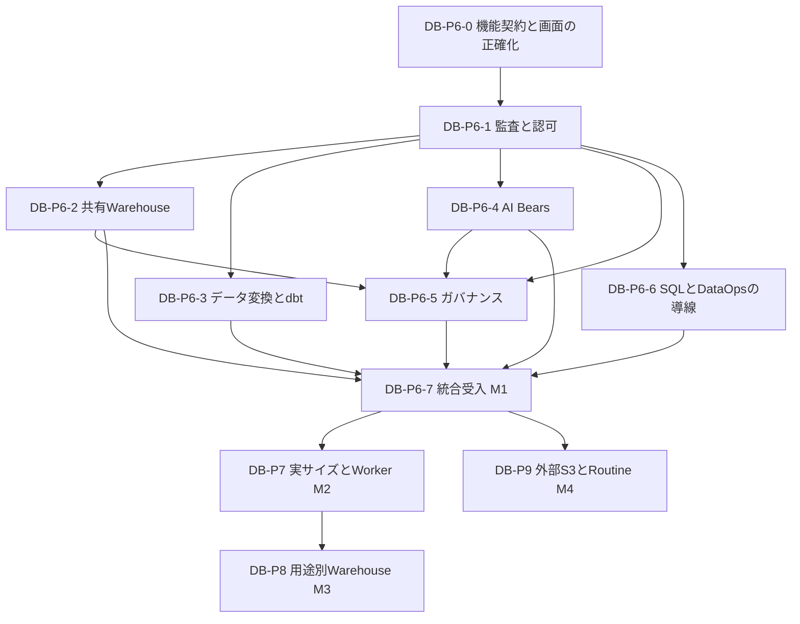

# Databaseコア機能統合とコンピュート拡張の実装計画

2026-11-02、[DB-P6-4C2C1](database-p6-4c2c1-workload-baseline-2026-11-02.md)で固定LOCAL Pod-template宣言基準の読取りレビューを実装した。現在の真P・上限admin・選択adminを全source取得前後に検査し、DB／schema／grantを前提にしない。固定2 Deploymentの全ordinary／initをordinalで扱い、旧Policyの意図を限定した4項目のmet／not_metだけを返す。nonRoot=trueかつUID未指定は旧宣言ruleどおり許し、native-baselineの8 admission policyやglobal policy全体の検証にはしない。不正・部分sourceは全体を確認不可とし、aggregate PASS／allowや操作許可を返さない。SRE／PolicyのPlatform scopeとComputeに独立共有cacheを手動表示し、旧C2B・P5A／P5B／P5Cを変更しない。C2C1の限定範囲を2026-11-02 JSTに技術受入済みとした（全体回帰4,232成功・34 skip、両HTTP面の実APIとWorkbenchの3面表示、最終保全PASS）。usage・AI設定より先に進めた順序は今回のCommander判断であり、P6-4全体／P6-5全体／P6-7／M1本人受入は継続する。

2026-11-02、[DB-P6-5C](database-p6-5c-contract-2026-11-02.md)でCompute専用DB保存activity一覧の読取り統合を実装した。既存AUD-03のquery／job_runだけを、独立した参照role・READY DB・self／database scope・手動filter／cache／前後pageで読むUIのみの単位であり、新しいbackend・API・認可policyを作らない。本人・保存roleと現在のDB／Schema権限を検査し、現在のplatform admin account・account role admin・選択adminに対する既存effective DB admin例外も維持する。P5A／P5BのP専用観測とAuditの状態を使い回さず、SQL・結果・live activity・詳細・復旧・export・自動pollを追加しない。P5Cの限定範囲を2026-11-02 JSTに技術受入済みとした（全体回帰4,188成功・34 skip、既存AUD-03の実APIとWorkbenchの実画面、最終保全PASS）。P6-4全体／P6-5全体／P6-7／M1本人受入、C2C／global policy・usage／capacity・AI設定は継続する。

2026-11-02、[DB-P6-5B](database-p6-5b-platform-resources-2026-11-02.md)で固定LOCALコンテナ設定資源の読取り表示を実装した。独立した入力なしの明示GETで、真のplatform account・principal、上限admin・選択adminを全source読取り前後に確認し、DB／schema／grantを前提にしない。Computeの独立panel・P cacheで、coordinator／workerの全ordinary・initコンテナのCPU／memory requests・limitsをliteral文字列または未指定として扱う。既存C2B API・閉じたDTO・cache・requestは維持する。P5Bの限定範囲を2026-11-02 JSTに技術受入済みとした（全体回帰4,166成功・34 skip、両HTTP面の実API・Workbenchの実画面、最終保全PASS）。 P6-4全体／P6-5全体／P6-7／M1本人受入はOPENのまま、C2C／global policy、usage／capacity／activity、resizingは別タスクとする。 次はP5Bの限定検証とCommanderレビューであり、configured値を実使用量・利用可能容量・実サイズ適用へ読み替えない。

2026年10月28日。状態は**実装計画案**。まず共有LOCAL WarehouseでDatabase対応のコア機能を揃え、その後に実サイズ変更とWorker増減へ進む。用途別Warehouse、外部S3、ストアドプロシージャは、それぞれの採用条件を満たした段階で追加する。

本計画ではDatabase trackの作業を`DB-P6`〜`DB-P9`と呼ぶ。[DEV-04F](../design/04_Development/04F_Commander_Worker_and_Pragmatic_Roadmap.md)にある旧コアPhase 6〜19とは別の番号である。計画作成によって製品機能・配備・既存の技術受入状態は変更しない。

## 1 到達点

最初の到達点を**Databaseコア機能統合完了 M1**とする。SQL・探索・取り込み・変換・Job・予定実行・AI Bears・監査・共有コンピュート管理を、通常のWorkbenchと対応API／CLIから、同じDatabaseと権限の意味で利用できる状態である。

「この段階では利用できません」という画面全体の案内を残したままM1としない。対応機能は実操作へつなぎ、権限不足、起動待ち、未対応の個別操作、復旧が必要な状態を区別する。未対応操作には理由と次に利用できる導線を表示する。

M1は単一Macのローカル実験版の完成条件であり、Snowflakeの全SQL言語・商用SLA・無制限容量を含まない。任意Schema管理、外部connector、全面DRなども、以下の追加trackに明記したもの以外は別計画とする。既存画面のコア操作はDB-P6-0で全件を必須行として棚卸しする。対象を外す場合は所有者と範囲変更を合意し、理由と代替導線を記録する。実装側の判断で除外してM1を完了にしない。

| 到達点 | 利用できる範囲 | 完了条件 |
| --- | --- | --- |
| M1 Databaseコア機能統合 | 共有LOCAL、DB別のデータ操作、5 Bears、監査、休止・自動復帰 | DB-P6の対象機能が技術受入と所有者操作性受入を通過 |
| M2 共有コンピュートの伸縮 | 実効的なサイズ変更、Worker増減、容量と性能の表示 | DB-P7で実資源・データ保全・性能・縮小時の挙動を確認 |
| M3 用途別コンピュート | LOAD_WHとBI_WH等の独立した実行先 | DB-P8の採用判断後、実行先固定・権限・干渉緩和を確認 |
| M4 外部接続と再利用可能な処理 | 個別に採用した外部S3とRoutine／Task | DB-P9の各unitを独立して受入。M1〜3の達成と合算しない |

## 2 現状と設計上の前提

### 2.1 現行実装

直近で限定技術受入済みとしたのは[DB-P6-4D1](database-p6-4d1-ai-audit-metadata-2026-11-01.md)の保存AI要約metadata統合である。既存AUD-03の最新保存要約へ`source=ai`と閉じた5種のactionを投影し、既存event形状・`links=[]`・内容field追加なしを契約とする。D1の限定範囲を2026-11-02 JSTに技術受入済みとした（全体回帰4,135成功・34 skip、Workbenchの実API・実画面、最終保全PASS）。 既存の受入結果とは分けて扱う。

2026年11月1日の開発checkoutへ更新した。DB作成・SQL・実データ・Job・role切替は[本人の条件付き受入](database-logical-create-owner-acceptance-2026-10-28.md)まで進んでいる。DB-P6-0／1は技術受入済み、DB-P6-2の技術受入は完了（cold 30回: p50 26.44秒・p95 26.92秒（30回すべて成功））とする。DB作成待ち時間の[性能改善](database-logical-create-performance-2026-10-28.md)とM1の本人受入は独立して継続する。

| 観点 | 現行実装 | 計画への反映 |
| --- | --- | --- |
| LOCAL／XS／S | 同じ`trino-local`の別名。実CPU・メモリのサイズ切替ではない | DB-P7まで実効サイズを偽装せず「共有LOCAL」と表示 |
| 手動休止・起動 | `logical_v1`のP専用API／CLI／UIと共有操作receiptを実装。技術受入は完了 | 0／0と1／設定Worker数、実engine検証、全DBへの共有影響を区別。旧profileの対応を自動宣言しない |
| 自動休止・自動復帰 | `logical_v1`の既存server lifecycleと共通SQL経路へ接続。技術受入は完了、cold 30回はp50 26.44秒・p95 26.92秒（30回すべて成功） | 元intent・現在権限・admissionを維持し、queued取消とUNKNOWNを保護。dbtとAI計画取得の型付きSQLも共通経路を使う |
| Coordinator／Worker | 分離済み。ただし現在のfoundationはWorker数を0または1に制限し、資源設定も固定 | DB-P7で設定契約・検証・秘密参照配布まで拡張する |
| ストレージ | SeaweedFSのデータとPolaris／PostgreSQLをTrinoから分離。catalog store・runtime秘密参照にも永続領域がある | compute停止試験とstorage／metadata保全を別々に確認 |
| データ変換 | 手動WAP・管理Mart、SQL/WAP dbt、SANDBOX INVOKER VIEW、単一native TABLEと付属品質test・明示MARTS公開を提供。C2CでTABLE／EPHEMERAL全graphのRunTask／TestTaskを技術受入済み。C2Dでgraph内TABLE単位の明示MARTS公開を技術受入済み。C2E1のnative VIEW graph構築・品質testを技術受入済み。C2E2のVIEW証拠付きTABLE公開・独立公開履歴を技術受入済み | 正式公開はTABLE。VIEW含有native graphのTABLE公開はC2E2の全VIEW・全品質条件を適用。incremental・並列実行・VIEW連鎖／正式VIEW公開とDB-P6-3全体は残件 |
| AIと監査 | DB-P6-1の保存metadata監査は技術受入済み。Pawprintsは独立P専用preview。SQL・計画説明と保存済み計画再説明、Doctorの最新SELECT読込、B1 SQL案に条件付き対応。B2のManual WAP下書き引渡しは限定技術受入済み。C1のCatalog Curator metadata説明・説明文案は限定技術受入済み。C2AのDB内SRE／Policy観測は限定技術受入済み。C2BのP専用固定LOCAL観測は限定技術受入済み。P6-5AのComputeへの読取り統合は限定技術受入済み。D1の保存AI要約統合は限定技術受入済み | B1／B2の既存条件を維持し、C1は独立contextの1件のTABLE／VIEWの公開列metadataから未適用の推定だけを生成する。DB観測とplatform管理権限を分ける。D1は現在のself／database認可を維持し、保存full9の内部整合と現在revisionを区別する。platform scopeはAIを除外し、本文の表示・検索、元内容取得・復旧は追加しない |

根拠は[Warehouse](../../tools/local_experiment/warehouse_resident.py)、[foundation生成](../../tools/local_experiment/logical_foundation.py)、[SQL共通実行](../../tools/local_experiment/query_service.py)、[Workbench server](../../tools/local_experiment/workbench_server.py)、[dbt pipeline](../../tools/local_experiment/lake_pipeline.py)、[Bears](../../tools/local_experiment/bears_resident.py)。旧PhaseのCompletedは、現在のDatabase対応を自動的に意味しない。

### 2.2 拡張の意味

コンピュートとオブジェクトストレージの分離は伸縮に適した土台である。ただしTrinoは実行中queryの状態を持ち、Podを増減するだけでは、安全な縮小・認可・再開・リサイズは完成しない。Worker追加、用途別Warehouse、同時実行数に応じた複数クラスタは別の機能として扱う。[Trinoの構成](https://trino.io/docs/current/overview/concepts.html)、[Snowflakeのmulti-cluster](https://docs.snowflake.com/en/user-guide/warehouses-multicluster)を参照する。

0スケールで減るのはTrinoの計算資源であり、Colima VM、k3s、SeaweedFS、Polaris、PostgreSQL等は残る。データ保全にはcatalog・Iceberg metadata・object・必要な秘密参照の整合が必要で、ホスト障害耐性やバックアップを自動的に得るものではない。[Icebergの整合性](https://iceberg.apache.org/docs/latest/reliability/)に従って検証する。

容量はMac／VMのディスク、PVC／StorageClass、SeaweedFSのvolume設定に制限される。容量追加時は既存ファイルの再配置が常に不要とは約束せず、実配置・空き容量・拡張方法を確認する。単一Mac内のWorkerやWarehouse追加では、ホストの総CPU・メモリは増えない。

## 3 実装順序と依存関係

| 段階 | 目的 | 着手条件 | 優先度 |
| --- | --- | --- | --- |
| DB-P6 | Databaseコア機能を通常導線へ統合 | 現行logical_v1と既存P3〜5の契約を出発点にする | 最優先 |
| DB-P7 | 単一Warehouseの実サイズ変更とWorker増減 | M1、容量計測、変更時のdrain／復旧契約 | 高 |
| DB-P8 | 用途別Warehouse | M2の計測で用途別分離の利益を確認し、Optional Trackの採用判断を記録 | 条件付き |
| DB-P9 | 外部S3とRoutine／Task | 各unitの認証・意味・費用・運用契約が確定 | 独立した追加track |

DB-P6-2〜6は契約と読取り実装を並行できる。DB-P6-5の管理操作とBears観測の統合受入は、DB-P6-2／4の対応API受入後に行う。実データ変更、Warehouse停止、故障注入は共有環境で競合させず、一単位ずつ実施する。P7以降の変更をP6の画面開放の前提へ増やさない。

## 4 DB-P6 Databaseコア機能統合

### DB-P6-0 機能契約と画面の正確化

2026-10-29：[89項目の機能一覧と利用条件](database-capability-matrix-2026-10-29.md)を固定し、画面案内・利用条件の表示の実装と技術検証を完了した。[実装と検証記録](database-p6-0-implementation-2026-10-29.md)を参照。後続DB-P6-1の監査対応を機能表へ反映した。

全ナビゲーション、Copilot、Worksheet出力、探索操作、AI設定、管理操作を棚卸しし、機能別に「DB／platform scope、許可role、入力、出力、実行owner、監査、回復、対応入口」を一表へ固定する。platform adminとDB内のadminを分け、既存の例外権限を各APIで再確認する。

手動WAP・管理Martまで利用不能に見える案内を修正する。DB対応済みの操作へ進める導線を示し、旧dbt等には具体的な未対応理由を出す。capabilityは現在のrole・DB状態・実装対応から一貫して返し、UI表示だけで認可しない。

**主対象**：`workbench/index.html`、`database_inventory.py`、`workbench_server.py`、`docs/guides/workbench_ui_design.md`と機能一覧。製品の大きな再構成は行わない。

**受入**：全表示操作に対応行がある。直リンク・reload・role切替・DB切替・失効・遅延応答で利用可否が一致する。既存WAP／Martへ実際に到達でき、未対応APIは明示拒否を維持する。

### DB-P6-1 Database別の監査ログ

2026-10-29：[実装契約](database-p6-1-contract-2026-10-29.md)に基づくAPI／CLI／Workbenchを実装し、[技術受入を完了](database-p6-1-implementation-2026-10-29.md)した。公開するのは保存済みmetadataであり、全遷移の再現やSQL本文の監査コピーではない。Pawprintsは独立したP専用previewとして扱い、現環境の`TELEMETRY_UNAVAILABLE`を耐久監査の失敗と混同しない。DB-P6-2の結果は以下に別記する。

既存control storeのquery／operation／Job／WAP／作成／権限変更を正本とし、Database・actor・保存role・実効role・実行先・版・時刻・状態・関連IDを辿れる監査APIと画面を作る。PawprintsはAI／運用テレメトリとして関連付け、実操作の成否を置き換えない。

利用者は本人に許可された履歴、DB管理者は契約で許可されたDB内管理情報、platform管理者は全体管理イベントを参照する。詳細・SQL・prompt・結果・downloadをそれぞれ再認可する。DB識別のない旧Pawprintsは新DBへ推測で割り当てず、権限のあるplatform履歴へ分ける。

SQL／promptの保存範囲、秘密値の除去、保持期間を契約にし、相関に不要な結果全文を監査へ複製しない。実行状態を決める台帳の保持と、補助テレメトリの削除方針は分ける。

**主対象**：`control_store.py`、`request_auth.py`、query／DataOpsの関連記録、監査route／client、`workbench/index.html`、AgentHouse投影。既存SQLite／ClickHouseを再利用する。

**受入**：同名資源を持つ2DB、別owner、role降格、grant剥奪、retireで一覧と詳細の漏えいがない。ページングと期間検索を提供し、最新100件だけを全履歴と表示しない。テレメトリ停止でも実効果を誤表示せず、UNKNOWN・commit後の記帳失敗を区別する。

### DB-P6-2 共有Warehouseの休止と自動復帰

2026-10-29：共有LOCALのAPI／HTTP CLI／UI、server側Auto-Chill、共通SQLのAuto-resumeを実装した。[実装と検証記録](database-p6-2-implementation-2026-10-29.md)の技術受入は完了、cold 30回はp50 26.44秒・p95 26.92秒（30回すべて成功）である。warm各30回の標本p95は変更前168.2ms／変更後203.5ms（差35.3ms）。read-only UNKNOWNは[限定復旧契約](database-p6-2-logical-recovery-contract-2026-10-29.md)で実行だけを閉鎖し、元結果をUNKNOWNのまま保持した。元の138 DB／552 Schemaと既存bindingの保全を確認し、M1本人受入と未接続機能は別に残す。

最初に読取り状態と明示Wake／Chillを通常API／UIへつなぎ、次にDatabase版Auto-ChillとAuto-resumeを接続する。共有LOCALの操作は全DBへ影響するため、手動変更と自動休止設定はplatformの権限で管理する。データ利用者の自動Wakeは、許可された処理の実行権限として別に定義する。

Workbench SQL、通常CLI、native SQL endpoint、Job、Stage、Mart、予定実行、dbt、AIが発行するSQLを入口表で確認する。送信前に要求と認可を確定し、休止中なら同一の起動処理へ合流する。起動後はcatalog・秘密参照・実engineの準備と最新権限を確認してから、元のSQL intentを一度だけ送る。認可拒否された要求だけでは起動しない。

Auto-Chillは画面の有無に依存しない既存server lifecycleへ統合する。単一の実行ownerを決め、新しい監視サービスを追加しない。実行中／待機中query、受理済みJob／DataOps、起動処理、未解決UNKNOWN、保守処理を数え、単なる最終HTTPアクセス時刻で停止しない。既存global admission／drainを維持し、DB作成と停止の競合も検証する。

**主対象**：`warehouse_resident.py`、`query_service.py`、`warehouse_admission.py`、`runtime_profile.py`、Workbench／native起動経路と管理route、各実行adapter。

**受入**：0／0→1／N→実SQL、同時要求でscale処理1回、拒否要求で起動0、SQL二重送信0、長時間query・Job・取消・UNKNOWN中の不正休止0を実機で確認する。起動失敗・権限失効・再起動後に自動再送せず状態を照会できる。BI接続は選定した実clientで認証・poll・timeout・cancelを確認し、他の全ODBC／JDBC製品の認定へ広げない。

UIは受付・起動中・利用可能・停止中・失敗を表示し、通常の起動待ち時間と次の操作を案内する。休止はVM／storage停止と区別する。cold startの`SELECT 1`とwarm queryの受付overheadを別計測し、提案予算は各30回の標本p95でcold 30秒以内、warm追加250ms以内とする。DB-P6-0で現環境baselineと条件を固定し、目標変更は理由を記録する。

### DB-P6-3 データ変換とdbt

2026-10-29：[DB-P6-3Aの先行実証](database-p6-3a-dbt-feasibility-2026-10-29.md)を経て、[DB-P6-3B](database-p6-3b-implementation-2026-10-29.md)で耐久plan／run、版固定、サーバー側test gate、通常API／CLI／Workbenchを実装した。table／ephemeral SELECTの技術受入後、[C1](database-p6-3c-dbt-compatibility-2026-10-29.md)でPARQUETの実適用とmodel／test設定の診断を接続した。
2026-10-30：[C2A](database-p6-3c2-sandbox-views-2026-10-30.md)で真のrun専用SANDBOX INVOKER VIEW、TABLE Snapshot固定、VIEW head検査と下流TABLE／testを実装し、実機確認を完了した。この範囲の技術受入を完了した。標準dbt executorの型付き操作、VIEW→VIEWと正式VIEW公開は残件とし、DB-P6-3全体は未完了とする。
同日の[C2B1](database-p6-3c2b-native-materialization-2026-10-30.md)でinstalled標準TABLE macro→DataOps childのprivate接続を実装し、新規SANDBOX候補のE／A・2DB・Snapshot・取消／owner停止を実機確認した。この限定した接続実証の技術受入を完了した。C2B1時点では通常RunTaskのschema／cache／graph、native test・置換と通常導線への接続は後続であり、このprivate実証だけで標準dbt buildを利用可能とはしない。
同日の[C2B2](database-p6-3c2b2-native-runs-2026-10-30.md)でnative TABLE 1件を保存run／API／CLIへ接続し、元の資格情報を持つDataOpsとSDK processを分離した。[C2B3](database-p6-3c2b3-native-ui-2026-10-30.md)で画面からの方式・モデルの明示選択と利用条件を表示する。
[C2B4](database-p6-3c2b4-native-quality-tests-2026-10-30.md)では、新規native TABLEに付属する非空の品質test一式をopt-inで実行する。標準TestRunnerを型付きcallbackで接続し、固定候補の作成検証と品質成功／失敗・取消／結果不明を分けて保存する。B4受入時点では品質成功後も正式公開不可だった。2026-10-31の[C2B5](database-p6-3c2b5-native-publication-2026-10-31.md)で、固定preview・最低1行の監査・同じDBのMARTS公開を実装した。全graphのRunTaskは後述C2C、graph候補のTABLE公開は後述C2Dで対応した。native VIEWの構築・testは後述C2E1で拡張する。native候補直接置換・native VIEWの正式公開・manual-WAP rollback統合は後続である。

[C2C](database-p6-3c2c-native-graph-2026-10-31.md)では、対応する保存済みTABLE／EPHEMERAL全DAGを通常の`RunTask.run()`で構築する。明示した`native_tests`はsource test・TABLE間relationshipsを含む保存全generic testを`TestTask.run()`で実行する。必要なSchema／cache操作を型付きmetadata経路へ接続し、同DB RAW Snapshotと同run候補を固定する。画面／API／CLIで`native_graph`を明示選択でき、E／A・2DB・休止復帰・失敗／取消／owner停止と保全を実機確認し、この限定範囲の技術受入を完了した。非対応materializationを含むgraphは実行前に全体を拒否する。[C2D](database-p6-3c2d-graph-publication-2026-10-31.md)で、全graphの構築・保存全test成功を条件とするTABLE単位の明示MARTS公開を実装し、この範囲の技術受入を完了した。native VIEWの構築・testは後述C2E1で拡張する。incremental・並列実行は後続である。

[C2E1](database-p6-3c2e1-native-views-2026-10-31.md)でnative graphのSANDBOX INVOKER VIEW構築と品質testを実装・技術受入済みである。VIEW→TABLEとVIEWの品質testを対象とし、VIEW→VIEWは引き続き拒否する。C2E1受入時点ではVIEWを含むgraphの正式公開を保留し、C2E2で公開証拠を拡張する。既存のTABLE／EPHEMERAL graph公開を維持する。

[C2E2](database-p6-3c2e2-view-graph-publication-2026-10-31.md)で、全VIEWの作成receipt・定義digest・推移依存を公開intentへ固定し、全graph構築・品質成功後の選択TABLE公開を実装・技術受入済みである。VIEW要約をpreview／受付で一致確認し、公開後のVIEW変更・source cancelを過去のPUBLISHED証拠と分ける。公開一覧・詳細・直リンクは元source runが変更検知で参照できない場合も独立して照会する。

手動WAPと管理Martを既存の基準動作として残し、信頼するローカルprojectのモデル一覧・compile・build／test・結果・lineageをDatabase対応へ移す。`iceberg`固定profile、暗黙Schema作成、管理者credentialへのfallbackを除く。最初はSQLモデルと明示したmaterializationを対象とし、Pythonモデル・任意shell・外部package実行は含めない。

公開契約は、同じDBのSANDBOX内に実行ごとの候補relationを作り、構築・品質確認の成功後に、明示した監査・公開で公開先へ反映する方式である。SQL/WAPは保存済みcompiled SELECTと既存WAP履歴を利用する。単一`native_table`はinstalled ModelRunner／TestRunnerで新規TABLE1件と付属suiteを実行し、C2B5の明示確認と行数監査を経て同じDBのMARTSへ公開する。native由来の履歴はdbt／DataOpsへ保存し、manual-WAPのmodel／buildを偽装しない。`native_graph`は全対応DAGのRunTask／TestTask証拠を保存し、C2Dの全graph品質gate・Aの固定preview・最低1行監査を経て選択TABLEを同じDBのMARTSへ公開する。他TABLEは別操作とする。SDKから公開先を直接上書きしない。

先行unitでdbtが発行するSQLとrelation操作を列挙し、現在のSQL guard、schema purpose、query intent、admission、cancelと両立する経路を実証する。必要な内部管理操作は型付きadapterへ限定する。dbtのために任意SQLのguardを外す方式を採らず、既存projectが使うmaterializationを含む対応一覧をDB-P6-0へ戻して確定する。必須機能が実証できない場合はM1の未完了項目とする。

**主対象**：`lake_pipeline.py`、`dataops/dbt_persistent`、`manual_wap.py`、`query_service.py`、`dataops_service.py`、変換API／UI。承認されたproject／model版と実行contextを保存する。

**受入**：2DBの同名モデルを複数モデルのbuild／testで独立実行し、実Table・値・lineageを照合する。未許可source／target、test失敗、権限失効、cancel、process停止、commit後失敗を確認する。test失敗・取消・公開前中断では従来の公開先Snapshotと値を保持する。SQL/WAPは指定候補から既存WAPの監査と明示公開を通す。単一`native_table`は専用の型付きDataOps監査・公開を通し、native由来のreceiptをdbt／DataOpsへ保存する。`native_graph`は保存全graphの構築・品質証拠を照合し、C2Dの型付き監査・選択TABLEの明示公開を通す。sourceとpublisherのcontext・資格情報、凍結したgraph lineage、同key回収と完了後の履歴証拠を実機で照合する。公開後の記帳失敗は実commitと分け、実証できないmaterializationを対応済み一覧へ入れない。

### DB-P6-4 AI BearsとCopilot

読取り支援から実装し、次に明示実行を接続する。Query Doctorは許可されたSQL／planの説明、Data EngineerはSQL案とWAPへの引渡し、Catalog Curatorは許可metadataの説明・提案を扱う。SRE BearとPolicy GatekeeperはDB内情報とplatform情報を分け、cluster状態や全体policyの観測はplatform権限を検査する。

5 Bearsの各既存actionをDB-P6-0の一覧へ対応付ける。AIが生成したSQL・model・変更提案は既存の認可／SQL guard／WAP／operationへ渡し、AI専用の高権限実行を作らない。publish／rollbackや運用変更は対象・影響を示した明示操作とする。別Worksheetを選んでも、進行中の提案と実行先は変えない。

**主対象**：`bears_resident.py`、Bears／Copilot API／client、AI設定、`manual_wap.py`、監査関連、`workbench/index.html`。既存のローカル推論を標準とする。

**受入**：実ローカル推論で任意の許可入力を扱い、固定サンプル以外でも説明・生成・WAP連携が成立する。2DB間のprompt／metadata／出力／履歴分離、秘密値の除外、role失効、モデル停止、遅い応答、生成SQLの拒否と利用者による修正を確認する。AI設定管理権限はデータ閲覧権限と分ける。

### DB-P6-5 コンピュートとガバナンス画面

共有computeの状態、実際の資源、query／Jobの活動、Auto-Chill設定、起動履歴、容量、認可理由を一画面で確認できるようにする。DBのgrant／roleとplatformの運用権限を別に示す。既存のDB管理導線を重複させず、該当管理画面へつなぐ。

SRE／Policyの観測結果には対象・観測時刻・現在の状態との関係を表示する。過去のHealthyやscan PASSを現在の稼働保証へ変換しない。設定変更はDB-P6-2のAPIと既存operationを利用し、画面から直接kubectlや任意policyを書き換える入口を作らない。

**主対象**：Warehouse状態／管理API、認可情報、Bearsの観測API、`workbench/index.html`。実サイズ変更ボタンはDB-P7が受入されるまで未提供とする。

**受入**：閲覧者・data engineer・DB admin・platform adminで表示と操作が一致する。全DBへの影響、休止待ちの理由、現在の許可、資源不足を通常画面だけで理解できる。read-only画面から運用権限を取得できない。

### DB-P6-6 SQL探索とDataOpsの残る導線

Worksheetの返却済み結果保存とSnapshot固定Table全件Exportを区別し、CSV／JSON／TSVの対応範囲、行数上限、NULL・型・文字コードを明示する。結果の取得・保存時にownerと現在権限を検査する。次の各操作を独立した必須capability行にし、DB／Table identityを固定する。

| 操作 | 個別の受入条件 |
| --- | --- |
| Worksheet結果のCSV／JSON／TSV保存 | 返却済み範囲・件数を明示し、NULL／引用符／Unicode／数値精度を保持。失効後取得を拒否 |
| Snapshot固定Table全件Export | 開始時Snapshotと件数・内容が一致し、同時更新で変わらない。未対応形式とViewは具体的に表示 |
| 現在／過去Snapshotのclone | 明示した同DB sourceと作成先を固定し、コピーの意味・実値・権限・名前競合を確認 |
| Time Travel | 選んだSnapshotの値を取得し、消失時にlatestへ代替しない。reload後も参照先を識別 |
| Table profiling | 選んだDB／Tableと集計範囲を表示し、実集計値・権限・失効後の情報消去を確認 |
| lineage | dbt／WAPのsource・model版・公開先と実関係が一致し、別DBのmetadataを返さない |

Job・Stage・Mart・schedule・alertは既存のDB対応を再利用する。予定が保存した定義版、role、対象DBを維持し、UIでその実行意図を確認できるようにする。dbt／AIからJob化する場合も既存の型付きstepへ接続し、新しいschedulerを作らない。

**主対象**：`workbench/index.html`、`database_inventory.py`、`manual_export.py`、`db_jobs.py`、`db_stages.py`、`db_marts.py`、`db_schedules.py`と各route／client。

**受入**：直接表示・reload・深いURL・role切替後もSQL／DB／schema／保存role／warehouse／modeを保持する。別ownerの結果取得、失効後download、同名Table再作成を拒否する。取り込み→変換→Job→予定→監査の一連を通常導線で確認する。

### DB-P6-7 統合受入

全対象unitの技術受入後、既存環境と独立したclean環境で縦断する。未確認の外部効果やUNKNOWNを別環境の成功で消さず、保存済み履歴の状態を保つ。DB作成性能の継続条件は独立した合否欄で確認する。

**完了条件**：DB-P6-0の全必須行が対応し、実API／CLI、実engine／dbt／LLM、実ブラウザー、故障回復の結果が揃う。未対応の必須行はM1を止める。対象範囲の縮小は所有者と合意した変更だけを反映し、変更前の全機能が完成したとは記録しない。通常UIからの所有者本人の操作性評価を別に記録し、blocking指摘が残る間はM1を完了にしない。

## 5 DB-P7 実サイズ変更とWorker増減

### DB-P7-0 容量とprofile設計

Mac、Colima、Kubernetes allocatable、常駐storage／catalog／DB等の使用量を測り、安全にcomputeへ割り当てられる予算を固定する。profileにはCoordinator／Worker別requests・limits、JVM heap、query memory、headroom、同時実行数、Worker数を一組で持たせる。`XS=2CPU/4GB`等は計測前の確定値にしない。

LOCALは接続形態、XS／Sは実効profileとして整理し、旧aliasを保存した定義は意図を変えず明示的に扱う。まず既定と小規模な2profileで受入し、M／L等は実際に収容できる場合だけ追加する。foundation、秘密参照のpublisher、status、起動後検証のWorker上限も合わせて変更する。

### DB-P7-1 垂直サイズ変更

初期実装は新規受付停止→受理済み処理の完了／明示取消→profile適用→実engine確認→受付再開とする。設定変更を永続的な基盤定義へ反映し、Podの一時patchだけで完了にしない。Coordinatorは1台を維持する。

**受入**：拡大と縮小の両方向で実requests／limits／heap／query memoryがprofileに一致し、queryとデータが正しい。変更中に新規JobやSQLが混入せず、失敗は元の利用可能な構成へ戻すか、理由を示して停止する。再起動で元サイズへ戻らない。実行中queryの無停止高速化は初期要件に含めない。[Snowflakeのサイズ変更](https://docs.snowflake.com/en/user-guide/warehouses-overview)とも区別して挙動を説明する。

### DB-P7-2 Workerの水平増減

既存のCoordinator／Worker分離を使い、Coordinator 1台、Worker 1→2→1を最初の範囲とする。新Workerへのcatalog・認証・秘密参照配布とdiscoveryを確認し、全Workerの実I/OでDB隔離を検証する。Coordinator Deploymentのreplica増加をWorker追加として実装しない。

縮小は初期実装ではWarehouse全体のdrainで保護する。Worker単位のgraceful縮小は、その後に必要性を確認して追加できる。[Trinoのgraceful shutdown](https://trino.io/docs/current/admin/graceful-shutdown.html)はWorker用であり、採用APIは現行483の実装と照合する。

**受入**：単発重いqueryと複数同時queryを別々に測り、結果一致、経過時間、待機時間、throughput、CPU、RSS、OOMを比較する。Worker数の増加だけで高速化成功としない。同一hostの制約で利益がない構成は既定へ昇格させない。

### DB-P7-3 M2の受入

休止後も選択profileとWorker数を保持し、Auto-resumeで同じ構成へ戻ることを確認する。UIに要求サイズ・適用サイズ・進行・実資源を表示する。M1の監査、失効、DB隔離、Job、UNKNOWN保護を回帰し、性能の比較条件と採用profileを記録する。

## 6 DB-P8 用途別Warehouse

### DB-P8-0 採用判断

[Optional Plugin Track](../design/02_Architecture/02D_Optional_Plugin_Tracks.md)にある単一compute方針は、M2の計測だけでは自動変更しない。ETL混在時のBI待機、CPU／メモリ競合、起動時間を比較し、独立computeの利益が運用負担を上回る場合にADRへ採用範囲を記録する。追加の物理hostやクラウドは本計画の前提にしない。

### DB-P8-1 実行先のidentityとルーティング

Warehouse ID、endpoint、profile、設定revision、状態、使用権限を保存し、Databaseの権限と独立して検査する。最初は最大2Warehouseの明示選択とし、同じDBをLOAD_WH／BI_WHから扱えるようにする。実行前に保存したquery／Job／schedule／dbt／AIの実行先を固定し、表示中の最新選択へ付け替えない。

### DB-P8-2 独立した休止と負荷分離

WarehouseごとにCoordinatorとWorker群を持ち、admission／活動／Auto-Chill／Wake／監査を分ける。DB作成・catalog変更等の共有基盤操作は全体と各Warehouseの更新確認を維持する。一方を休止・再起動しても他方の受理済みqueryを止めない。

**受入**：同DB・別DBの正負認可、片側停止、双方同時起動、両方の負荷、resource予算超過、worker秘密参照を実機で確認する。BI単独時、ETL同居時、Warehouse分離時のlatencyとthroughputを同条件で比較する。共有host／storageの干渉は残るため「BIへ影響ゼロ」は保証しない。負荷連動のmulti-cluster自動増減は次の独立計画とする。

## 7 DB-P9 外部S3とRoutineおよびTask

### DB-P9-1 外部S3 profile

SeaweedFSを既定に保ち、外部接続は個別のstorage profileとして追加する。endpoint、TLS、region、path style、IAM／STS、短期credential、prefix制約、catalogのlocationを一組で扱う。現行のlocal endpoint／STS／account固定契約を単に緩めない。

AWS S3、R2、MinIOを一括対応済みとせず、まず利用要件のある1providerで認証・credential更新・read／write／delete・multipart・Iceberg commit・権限剥奪・障害復旧を受入する。既存DBの置き場所を自動変更せず、新DB／新profileから開始する。[TrinoのS3設定](https://trino.io/docs/current/object-storage/file-system-s3.html)を参照し、483とPolaris／STSの実互換性を確認する。

M1後にDB-P7／8と独立して実施できる。既存のShirokuma内の検証用資源を使える範囲は継続し、新規外部account、有料資源、外部へのデータ転送・公開を必要とする場合は、その具体的な実行前に承認範囲を確定する。

### DB-P9-2 再利用可能なRoutineとTask

まず必要な意味を「型付き引数を持つ版管理済みの処理を呼び、既存scheduleから実行する」と定める。これで要件を満たす場合は、既存Jobの型付きstep、保存role、owner、定義版、監査、取消を再利用する。呼出者の権限で実行し、文字列連結によるSQL引数展開や暗黙の権限昇格を許さない。

現在のSQL whitelistは単文かつ`CALL`を含まない。engineネイティブのストアドプロシージャ、SQLの制御構文、definer rights、複数stepを跨ぐtransactionが必要な場合は先に有界実証とADRを作る。Jobを提供しただけでSnowflake互換のStored Procedureと呼ばない。

**受入**：引数型、不正入力、同じ受理版、実行role、別DB拒否、再起動、失効、予定の重複防止、UNKNOWN停止を確認する。複数stepの原子性は既存Jobの実際の保証範囲を表示する。Taskは既存schedulerへ接続し、新しい汎用DAG engineを追加しない。

## 8 共通の受入と性能評価

| 層 | 必須の確認 | 完了の根拠 |
| --- | --- | --- |
| コード | unitごとの意味のあるfocused test、必要なGo test／vet、設計検査 | 変更対象に対応する実行結果 |
| 認可と隔離 | 2DB以上、同名資源、別owner、viewer／engineer／DB admin／platform admin、失効 | 許可された実操作と拒否された実操作の両方 |
| 実運用 | 通常UI／API／CLI→実engine／dbt／ローカルLLM、Pod状態と実データ | コードtestやHealthy表示とは別の結果照合 |
| 故障と回復 | 応答喪失、起動失敗、query進行中、commit後中断、UNKNOWN、再起動 | 同一intentの照合、二重実行なし、未確認効果の保持 |
| ブラウザー | direct／reload／deep link、role／context切替、遅延応答、keyboard、200% zoom、日英 | 保存context、focus、表示とAPIの一致 |
| 所有者評価 | 手順を知らない状態で作成→投入→変換→AI→Job／予定→監査→休止／復帰 | 所有者本人の評価とblocking指摘の解消 |

性能はwarm／cold、単発／同時、初回／再実行を分け、dataset・SQL・profile・Worker数・競合サービスを固定して比較する。sample数、中央値、標本p95、失敗件数を記録し、標本の値を商用SLAに読み替えない。採用対象の全profileで少量データだけでなくメモリとscan負荷がある条件も確認する。

既存環境、独立clean環境、故障用環境を区別し、同一のDB／材料を再登録して成功を増やさない。既存の未解決履歴、host-local設定、利用者のdraftは保持する。P6は新しい全体resetを必須にせず、必要なclean受入だけを独立した専用環境で行う。

## 9 実装の進め方と直近の着手単位

2026-11-02 JST、[DB-P6-6D（EXP-13／14）](database-p6-6d-table-lineage-2026-11-02.md)のTable／Explorer lineageを限定技術受入済みとした。保存記録の直接関係を読取り表示し、確定証跡・宣言依存、Snapshot／VIEW版の現在・過去、計画中モデルと物理Refを区別する。canonical 110群と最終Workbench 1,058件、実2DB／両HTTP 40ケース、通常画面・認可・元行／設定保全を確認した。次はEXP-11のDrop導線を限定し、P6全必須行・M1本人受入とP7以降の採用条件は維持する。

2026-11-02 JST、[DB-P6-6C（EXP-12）](database-p6-6c-table-profiling-2026-11-02.md)のTable profiling／NULL統計を限定技術受入済みとした。現在query権限と固定Snapshotで全行・全列を集計し、件数精度、元key回復、取消と統計の非表示条件を維持する。全体回帰4,460成功・34 skip、実2DB×3roleと通常画面の計11集計、63行／過去3行／空0行、再送・拒否・再起動後GET・保全を確認した。次はTable／Explorer lineageを限定単位として進め、P6全必須行・M1本人受入とP7以降の採用条件は変更しない。

2026-11-02 JST、[DB-P6-6B（EXP-10）](database-p6-6b-table-clone-2026-11-02.md)の新規SANDBOX TABLEへの物理コピーを限定技術受入済みとした。同DB・固定Snapshot・source query／target write分離・元key・単一CTASを維持し、全体回帰4,385成功・34 skip、実2DB×Engineer／adminと通常画面の計5コピー、値照合・拒否・回復・保全を確認した。EXP-10の後続にEXP-12を選定した。M1の全必須行と本人受入、P7の実コンピュート伸縮は従来の条件を維持する。

2026-11-02 JST、[DB-P6-6A（SQL-08）](database-p6-6a-result-save-contract-2026-11-02.md)の返却済み結果保存を限定技術受入済みとした。CSV／JSON／TSVをserver cacheの受領prefixから生成し、現在認可・数値精度・NULL区別・scope変更・cache喪失を検証した（全体回帰4,328成功・34 skip、2DB×3role、22成果物／72要求、実ブラウザーと保全）。SQL-08後のEXP-10は同DBの固定Snapshotから新しいSANDBOX TABLEへの物理コピーを限定unitとして選定し、他の探索操作とM1本人受入は継続する。

最優先の[DB-P6-4E（AI-06）](database-p6-4e-ai-settings-2026-11-02.md)は2026-11-02 JSTに限定技術受入を完了した。共有設定の取得・明示接続test・保存を真P・選択global adminへ接続し、既存LOCAL推論条件とDB閲覧権限の分離を維持した（全体回帰4,264成功・34 skip、両HTTP面84要求、実LOCAL疎通・ブラウザー・最終保全）。AI-06完了時に選定した次の実装単位は[SQL-08／DB-P6-6Aの返却済み結果保存](database-p6-6a-result-save-contract-2026-11-02.md)であり、その時点の設計案を実装・受入済みとは扱わなかった。

2026-11-02、所有者の指示により、残る必須機能の順序を、①[AI設定（AI-06／DB-P6-4E）](database-p6-4e-ai-settings-2026-11-02.md)、②Worksheet結果保存とclone／profiling／Table・Explorer lineage／Drop、③Computeの実使用量・容量・活動／起動履歴・停止理由・現在権限、④Bears／Policyの残るaction、⑤DB-P6-3・4・5・6と89行の全体照合、⑥DB-P6-7とM1本人受入、とする。探索の契約整理と読取り調査は並行できる。C2C1をglobal policy全体の完了へ広げず、dbtの別拡張を新しい必須範囲へ一括追加しない。DB-P7はM1後、DB-P8／P9は既存の採用条件と依存関係を維持する。

[D1](database-p6-4d1-ai-audit-metadata-2026-11-01.md)と[P5B](database-p6-5b-platform-resources-2026-11-02.md)に続き、[DB-P6-5C](database-p6-5c-contract-2026-11-02.md)のCompute専用DB保存activity（query／job_runだけ）を限定技術受入済みとした。既存AUD-03を変更せず、self／databaseの現在認可とeffective DB admin例外を維持した独立した手動一覧・pageである。使用量・空き容量・resizeや包括的なactivity bundleは追加していない。その後続単位である[C2C1](database-p6-4c2c1-workload-baseline-2026-11-02.md)の固定LOCAL宣言基準レビューも限定技術受入済みとした。usageやAI設定より先に進めたのは今回のCommander判断である。C2C1の結果をC2C全体のglobal policy／admission検査へ広げず、AI設定・live usage／capacityは別単位に残し、P6-4全体／P6-5全体／P6-7／M1本人受入は閉じない。

Commanderが一unitごとに対象ファイル、禁止事項、検証コマンド、終了条件を固定し、既存のCommander／Workerモデルで実装・独立レビューする。機能開放は各unitの実機受入後に行い、feature flag解除を受入の代わりにしない。新しい監督サービスや汎用workflowを導入しない。

DB-P6-0／1／2とDB-P6-3B／C1／C2A／C2B1／C2B2／C2B3／C2B4／C2B5／C2C／C2D／C2E1／C2E2は各限定範囲の技術受入済みである。[C2E2](database-p6-3c2e2-view-graph-publication-2026-10-31.md)でVIEW証拠付きTABLE公開と独立履歴を接続し、[R1](database-p6-3r1-dbt-audit-recovery-2026-10-31.md)で不確定なnative_graph COUNT監査の結果をUNKNOWNに保ったまま実行閉鎖・受付再開を証明した。新しい未閉鎖実行は0件である。

[DB-P6-4A1](database-p6-4a1-local-sql-explanation-2026-10-31.md)のSQL説明、[A2](database-p6-4a2-plan-explanation-2026-10-31.md)のTABLE計画説明に続き、[A3](database-p6-4a3-view-plan-explanation-2026-10-31.md)で`logical_v1`の対応するnative／外部登録INVOKER VIEWを扱う。stored defaultsで再帰依存を解決し、同一DB・全schemaの現在のquery権限とVIEWのhead／格納先証拠を検査する。保存済みVIEW内の整数snapshot付きTABLE参照は、全snapshotの存在と現行列構成に一致するschemaを検証し、TABLEの可変headは固定しない。元SQLへ固定の非ANALYZE EXPLAINを付けて通常受付・Wakeへ通し、元SQLは実行しない。VIEW定義のSQL展開は行わず、検証はversion固定やserializable snapshotではない楽観的な境界とする。実機・画面で重点検証した。全体回帰91単位（3,719成功・34 skip）に加え、回帰開始後の修正を最終重点backend204件・UI80件で確認し、この限定範囲を技術受入済みとした。A1／A2の受入結果は各ガイドに保持し、旧default storeのA1検証時移行もA1ガイドへ分けて記録した。

[A4](database-p6-4a4-latest-query-source-2026-10-31.md)でQuery Doctorの最新SELECT読込を実装した。本人・保存9項目contextが一致する通常read-only queryから選び、全参照schema権限と現在のlogical identityを再検査する。明示GETは元SQLとqueryのID・時刻・状態だけを返し、SQL・AI・Wake・catalogを呼ばない。別Worksheetの同一contextのqueryも対象になり、EXPLAIN・書込・DataOps／Bears等の内部子queryは除外する。入力・認可・context変更後の遅着応答を捨て、未解決のA1／A2説明要求を保持する。A1の原要求は、入力を戻さず既存の明示復旧操作から元IDのGETまたは元key／bodyの再送で確認できる。重点backend116件・UI168件、全体回帰92単位（3,779成功・34 skip）、2DB・3roleの実機・画面と既存状態の保全を確認し、この限定範囲を技術受入済みとした。

[A5](database-p6-4a5-saved-plan-explanation-2026-10-31.md)で、保存済み計画を使う明示再説明を別kindのLOCAL推論として実装した。元A2／A3がCOLLECTEDで、元queryの保存値・現在台帳がともにFINISHEDであることを確認し、安全な演算子・取得時点のmetadata・privateな権限pinsを新要求へ原子的に固定する。元親はSUCCEEDED／FAILED／CANCELED／UNKNOWNを対象にできるが、その状態・query・admissionを変更せず、元UNKNOWNを解消したりA2の新規query受付を解除したりしない。本人・保存9項目context・全凍結依存schemaの現在権限を検査し、現行TABLE／VIEWのheadやcatalogを再取得しない。Engine・Wake・admissionも呼ばず、元SQL・planを再実行しない。新要求の元key復旧・履歴・取消は独立させ、取消は新しい説明結果だけへ作用し、UNKNOWNは自動再推論しない。重点backend198件・UI190件、全体回帰3,824成功・34 skip、2DB・3roleの休止中実機確認と最終保全照合を完了した。

[B1](database-p6-4b1-sql-proposals-2026-11-01.md)はSQL案生成を対象に実装した。保存9項目contextと明示的な1〜8件の同一DB ResourceRefを検査し、全source schemaの権限とregistry identityをREST前に確認する。依頼文の原文と許可された名前・列名・型だけをLOCALへ送信し、VIEW定義・再帰依存や行データは生成metadataへ含めない。生成物は厳密なJSONから単一read-only SELECTと説明だけを取り出し、既存parser／policyと選択sourceの参照範囲を検査する。列・型・業務上の正しさや実行可能性を保証せず、SQL・Engine・Wake・WAPを実行しない下書きとして表示する。独立した要求・履歴・取消を使い、入力・source変更や遅着応答から元要求を保護し、editor／結果を上書きしない。B1を技術受入済みとした（全体回帰3,892成功・34 skip、2DB・3role実機・最終保全PASS）。

[B2](database-p6-4b2-wap-handoff-2026-11-01.md)は成功済みB1案の保存SQLから、通常Manual WAPの新規未保存下書きを準備する導線を実装し、限定範囲の技術受入を完了した。原案の本人・保存9項目contextと全選択schemaの現在権限を維持し、利用者が明示選択した同一DB・同一E／A roleのSANDBOX実行先contextを別に検査する。元schemaの意味で使用TABLEを解決し、現在の識別情報・列を確認してsource aliasへ機械的に変換し、既存WAP compilerを通す。未使用VIEWはschema権限のみを必要とし、使用VIEWや不確かなnamespace変換は拒否する。読取り専用GETはAI・SQL・Wake・保存を行わず、空の新規WAPフォームへ取り込んで原案と両contextを表示する。利用者の以後のSQL・source・target・品質編集はAIが保証するものではなく、版保存・build・audit・A公開は通常WAPの独立した明示操作とする。既存の編集中フォームや未解決操作を消さず、worksheet／Doctor本文・結果も変更しない。B2の限定範囲を技術受入済みとした（全体回帰3,944成功・34 skip、2DBの実機・画面・最終保全PASS）。

[C1](database-p6-4c1-catalog-proposals-2026-11-01.md)で、Catalog Curatorのmetadata説明と説明文案を実装した。SQLワークシートに依存しない本人の保存9項目contextと、primary schema内のTABLE／VIEW 1件のRef・現在権限・UUID・列構造を検査する。直接RESTから名前・列名・型だけを固定し、VIEW定義・依存・既存コメント・行データを公開metadataやモデル入力へ含めない。TABLEの通常appendや同一UUID・同一列のVIEW定義更新から意味の検証を推定せず、出力は未適用の要約・表説明文案と最大8列の部分的な説明文案に限る。元要求の受付ID／key・履歴・取消・UNKNOWNを分離し、SQL・Engine・Wake・admission・registry／catalog metadata変更は行わない。C1の限定範囲を技術受入済みとした（全体回帰4,020成功・34 skip、2DB・3roleの実API、adminの実画面、最終保全PASS）。

[C2A](database-p6-4c2a-context-observations-2026-11-01.md)で、DB内保存metadataによるSRE／Policy観測を実装した。各Bearの独立contextで現在の本人・保存9項目context・primary schemaのquery権限を検査し、新しいread-only snapshotでも認可を再確認する。query／AIは一致する本人の固定20候補の窓からID・kind・保存状態・保存時刻だけを投影し、21件目で古い候補の存在、省略数で窓内の不正候補を示す。省略後の補充や全履歴のPython読込みを行わず、queryのFINISHEDとAIのSUCCEEDEDを保持する。Policyは現在権限・SQL mode上限と現在のplatform能力flagだけで、個別statementの承認やglobal policyの監査結果にはしない。Pを含む全roleでKubernetes・engine proof・policy file・blocker・telemetryを読まず、SQL・LLM・状態照合・書込みも呼ばない。重点backend335件・UI889件、実API・admin実画面と復元を確認し、最終8ファイルで全体回帰を完了した。C2Aの限定範囲を技術受入済みとした（全体回帰4,073成功・34 skip、2DB・3実行ロールの実API、未付与権限の拒否、adminの実画面、最終保全PASS）。

[C2B](database-p6-4c2b-platform-observations-2026-11-01.md)で、SRE／PolicyのP専用固定LOCAL観測を実装した。現在のaccountとprincipal双方のP権限、上限admin、選択adminをsource取得前後に確認し、DBやgrantを利用条件にしない。固定2 Deploymentのdesired／ready要約、過去のengine検証日時、保存AutoChill設定、LOCALの保存admission件数だけを扱う。desired／readyの一致や両方0をSQL health・完全停止・資源解放の証明にせず、保存日時を現在の稼働保証へ変換しない。明示GETだけで書込み・SQL・LLM・操作を行わず、C2AのDB観測はplatform sourceを読まないままとする。C2Bの限定範囲を技術受入済みとした（全体回帰4,109成功・34 skip、両HTTP面の実APIと権限拒否、Pの実画面、復元と最終保全PASS）。

[P6-5A](database-p6-5a-compute-observations-2026-11-01.md)で、Compute画面へのP専用固定LOCAL観測の読取り統合を実装した。受入済みC2Bの明示GET・strict DTO・global P cacheを再利用し、新しいAPIやDB context／grantの前提を追加しない。現在の真P・上限admin・選択adminを条件とし、完了snapshotと観測時刻をSRE／Policy／Computeで共有する。画面を開くだけでplatform観測を取得せず、既存Warehouse操作へも接続しない。desired／ready要約・過去のengine証拠・保存AutoChill設定・限定admission件数を現在healthや完全なPolicy監査へ読み替えない。P6-5Aの限定範囲を技術受入済みとした（全体回帰4,122成功・34 skip、両HTTP面の実APIと権限拒否、Computeの実画面、最終保全PASS）。契約と読取り実装を並行できる方針に従い、対応APIを受入済みの範囲から統合した。C2Cのworkload baselineと全面的なglobal policy検査は別単位とし、P6-4全体の閉鎖を前提にも結果にもしない。

C2Bの固定platform観測とglobal workload／policy検査は別単位とし、DB内保存情報と対象・観測時刻を分ける。lineage・profiling・説明の保存や適用は別単位とし、旧Curatorや任意manifest経路を開放しない。DEFINER・他DB参照のVIEW計画、現行列構成と異なる履歴schema、timestamp／tag／branch等の非整数time travelも後続単位である。AIの生成物は既存の認可／SQL guard／WAPを使い、新しい高権限経路を作らない。native候補の直接置換、正式VIEW公開、native graphのVIEW連鎖、incremental・並列実行、manual-WAP rollback統合は別の拡張項目である。P6-6の残る探索操作とP6-7の縦断検証、P6-4全体／P6-5／DB-P6-3全体とM1本人受入は未完了である。

日付による完成約束はDB-P6-0の棚卸しとdbt先行実証の結果で具体化する。各unitは「未着手／設計確定／実装済み／技術受入済み／本人受入済み」を分けて追跡し、計画の記載を実装完了に変換しない。M1の残件を明示したまま、任意のP8／P9を先に進めて全面対応と表示しない。

## 10 主なリスクと対処

| リスク | 対処と判断点 |
| --- | --- |
| dbtが現SQL guardやschema purposeと合わない | P6-3の実証を先行。採用materializationと内部操作を限定し、未受入機能は残件へ明示 |
| 自動Wakeで非冪等SQLを再送する | 起動と元query intentを関連付け、送信済みを復帰処理で再POSTしない |
| shared computeの停止が他DBを巻き込む | platform権限、全体活動、drain、共有影響の表示をP6から維持 |
| サイズ拡大でホスト／VMが不足する | allocatableと常駐サービス予算で事前拒否。実OOMやlatency悪化を計測しprofileを採用し直す |
| Worker追加で秘密参照や認可が不一致になる | foundation契約、publisher、起動後検証、全Workerの実I/Oを同じunitで受入 |
| AIと監査から別DBの情報が漏れる | scopeを保存し、prompt／一覧／詳細／artifactで再認可。旧unscoped履歴を推測で流用しない |
| 外部S3を互換と誤認する | provider別profileと実互換matrix。STS方式・catalog・credential更新まで確認 |
| オブジェクトが残れば復元可能と誤認する | catalog／metadata／秘密参照の保全を確認。全面DRの達成は別計画で判定 |

外部資料の`current`は調査時点の説明であり、Trino 483の更新を前提にしない。具体的な設定・APIの採用は現行版と実機で確認する。
