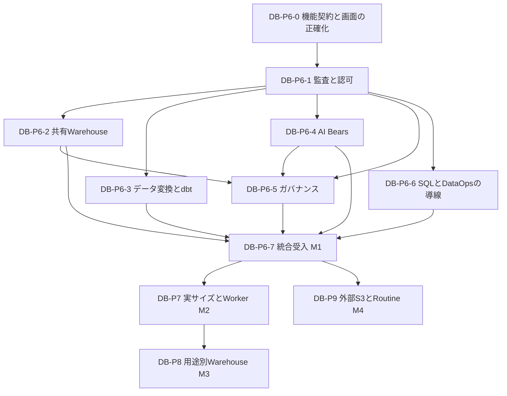

# Databaseコア機能統合とコンピュート拡張の実装計画

2026年10月28日。状態は**実装計画案**。まず共有LOCAL WarehouseでDatabase対応のコア機能を揃え、その後に実サイズ変更とWorker増減へ進む。用途別Warehouse、外部S3、ストアドプロシージャは、それぞれの採用条件を満たした段階で追加する。

本計画ではDatabase trackの作業を`DB-P6`〜`DB-P9`と呼ぶ。[DEV-04F](../design/04_Development/04F_Commander_Worker_and_Pragmatic_Roadmap.md)にある旧コアPhase 6〜19とは別の番号である。計画作成によって製品機能・配備・既存の技術受入状態は変更しない。

## 1 到達点

最初の到達点を**Databaseコア機能統合完了 M1**とする。SQL・探索・取り込み・変換・Job・予定実行・AI Bears・監査・共有コンピュート管理を、通常のWorkbenchと対応API／CLIから、同じDatabaseと権限の意味で利用できる状態である。

「この段階では利用できません」という画面全体の案内を残したままM1としない。対応機能は実操作へつなぎ、権限不足、起動待ち、未対応の個別操作、復旧が必要な状態を区別する。未対応操作には理由と次に利用できる導線を表示する。

M1は単一Macのローカル実験版の完成条件であり、Snowflakeの全SQL言語・商用SLA・無制限容量を含まない。任意Schema管理、外部connector、全面DRなども、以下の追加trackに明記したもの以外は別計画とする。既存画面のコア操作はDB-P6-0で全件を必須行として棚卸しする。対象を外す場合は所有者と範囲変更を合意し、理由と代替導線を記録する。実装側の判断で除外してM1を完了にしない。

| 到達点 | 利用できる範囲 | 完了条件 |
| --- | --- | --- |
| M1 Databaseコア機能統合 | 共有LOCAL、DB別のデータ操作、5 Bears、監査、休止・自動復帰 | DB-P6の対象機能が技術受入と所有者操作性受入を通過 |
| M2 共有コンピュートの伸縮 | 実効的なサイズ変更、Worker増減、容量と性能の表示 | DB-P7で実資源・データ保全・性能・縮小時の挙動を確認 |
| M3 用途別コンピュート | LOAD_WHとBI_WH等の独立した実行先 | DB-P8の採用判断後、実行先固定・権限・干渉緩和を確認 |
| M4 外部接続と再利用可能な処理 | 個別に採用した外部S3とRoutine／Task | DB-P9の各unitを独立して受入。M1〜3の達成と合算しない |

## 2 現状と設計上の前提

### 2.1 現行実装

2026年10月29日の開発checkoutの確認結果へ更新した。DB作成・SQL・実データ・Job・role切替は[本人の条件付き受入](database-logical-create-owner-acceptance-2026-10-28.md)まで進んでいる。DB-P6-0／1は技術受入済み、DB-P6-2の技術受入は完了（cold 30回: p50 26.44秒・p95 26.92秒（30回すべて成功））とする。DB作成待ち時間の[性能改善](database-logical-create-performance-2026-10-28.md)とM1の本人受入は独立して継続する。

| 観点 | 現行実装 | 計画への反映 |
| --- | --- | --- |
| LOCAL／XS／S | 同じ`trino-local`の別名。実CPU・メモリのサイズ切替ではない | DB-P7まで実効サイズを偽装せず「共有LOCAL」と表示 |
| 手動休止・起動 | `logical_v1`のP専用API／CLI／UIと共有操作receiptを実装。技術受入は完了 | 0／0と1／設定Worker数、実engine検証、全DBへの共有影響を区別。旧profileの対応を自動宣言しない |
| 自動休止・自動復帰 | `logical_v1`の既存server lifecycleと共通SQL経路へ接続。技術受入は完了、cold 30回はp50 26.44秒・p95 26.92秒（30回すべて成功） | 元intent・現在権限・admissionを維持し、queued取消とUNKNOWNを保護。未接続dbt／AIは後続 |
| Coordinator／Worker | 分離済み。ただし現在のfoundationはWorker数を0または1に制限し、資源設定も固定 | DB-P7で設定契約・検証・秘密参照配布まで拡張する |
| ストレージ | SeaweedFSのデータとPolaris／PostgreSQLをTrinoから分離。catalog store・runtime秘密参照にも永続領域がある | compute停止試験とstorage／metadata保全を別々に確認 |
| データ変換 | 手動WAP・管理MartはDB対応済み。旧dbt profileは`iceberg`固定 | 既存操作を保ち、dbt実行を共通境界へ接続する |
| AIと監査 | DB-P6-1の保存metadata監査は技術受入済み。Pawprintsは独立P専用preview、Bears／Copilotは未接続 | telemetryと耐久監査を分離。AIはDB-P6-4で認可／WAPへ接続する |

根拠は[Warehouse](../../tools/local_experiment/warehouse_resident.py)、[foundation生成](../../tools/local_experiment/logical_foundation.py)、[SQL共通実行](../../tools/local_experiment/query_service.py)、[Workbench server](../../tools/local_experiment/workbench_server.py)、[dbt pipeline](../../tools/local_experiment/lake_pipeline.py)、[Bears](../../tools/local_experiment/bears_resident.py)。旧PhaseのCompletedは、現在のDatabase対応を自動的に意味しない。

### 2.2 拡張の意味

コンピュートとオブジェクトストレージの分離は伸縮に適した土台である。ただしTrinoは実行中queryの状態を持ち、Podを増減するだけでは、安全な縮小・認可・再開・リサイズは完成しない。Worker追加、用途別Warehouse、同時実行数に応じた複数クラスタは別の機能として扱う。[Trinoの構成](https://trino.io/docs/current/overview/concepts.html)、[Snowflakeのmulti-cluster](https://docs.snowflake.com/en/user-guide/warehouses-multicluster)を参照する。

0スケールで減るのはTrinoの計算資源であり、Colima VM、k3s、SeaweedFS、Polaris、PostgreSQL等は残る。データ保全にはcatalog・Iceberg metadata・object・必要な秘密参照の整合が必要で、ホスト障害耐性やバックアップを自動的に得るものではない。[Icebergの整合性](https://iceberg.apache.org/docs/latest/reliability/)に従って検証する。

容量はMac／VMのディスク、PVC／StorageClass、SeaweedFSのvolume設定に制限される。容量追加時は既存ファイルの再配置が常に不要とは約束せず、実配置・空き容量・拡張方法を確認する。単一Mac内のWorkerやWarehouse追加では、ホストの総CPU・メモリは増えない。

## 3 実装順序と依存関係

| 段階 | 目的 | 着手条件 | 優先度 |
| --- | --- | --- | --- |
| DB-P6 | Databaseコア機能を通常導線へ統合 | 現行logical_v1と既存P3〜5の契約を出発点にする | 最優先 |
| DB-P7 | 単一Warehouseの実サイズ変更とWorker増減 | M1、容量計測、変更時のdrain／復旧契約 | 高 |
| DB-P8 | 用途別Warehouse | M2の計測で用途別分離の利益を確認し、Optional Trackの採用判断を記録 | 条件付き |
| DB-P9 | 外部S3とRoutine／Task | 各unitの認証・意味・費用・運用契約が確定 | 独立した追加track |

DB-P6-2〜6は契約と読取り実装を並行できる。DB-P6-5の管理操作とBears観測の統合受入は、DB-P6-2／4の対応API受入後に行う。実データ変更、Warehouse停止、故障注入は共有環境で競合させず、一単位ずつ実施する。P7以降の変更をP6の画面開放の前提へ増やさない。

## 4 DB-P6 Databaseコア機能統合

### DB-P6-0 機能契約と画面の正確化

2026-10-29：[89項目の機能一覧と利用条件](database-capability-matrix-2026-10-29.md)を固定し、画面案内・利用条件の表示の実装と技術検証を完了した。[実装と検証記録](database-p6-0-implementation-2026-10-29.md)を参照。後続DB-P6-1の監査対応を機能表へ反映した。

全ナビゲーション、Copilot、Worksheet出力、探索操作、AI設定、管理操作を棚卸しし、機能別に「DB／platform scope、許可role、入力、出力、実行owner、監査、回復、対応入口」を一表へ固定する。platform adminとDB内のadminを分け、既存の例外権限を各APIで再確認する。

手動WAP・管理Martまで利用不能に見える案内を修正する。DB対応済みの操作へ進める導線を示し、旧dbt等には具体的な未対応理由を出す。capabilityは現在のrole・DB状態・実装対応から一貫して返し、UI表示だけで認可しない。

**主対象**：`workbench/index.html`、`database_inventory.py`、`workbench_server.py`、`docs/guides/workbench_ui_design.md`と機能一覧。製品の大きな再構成は行わない。

**受入**：全表示操作に対応行がある。直リンク・reload・role切替・DB切替・失効・遅延応答で利用可否が一致する。既存WAP／Martへ実際に到達でき、未対応APIは明示拒否を維持する。

### DB-P6-1 Database別の監査ログ

2026-10-29：[実装契約](database-p6-1-contract-2026-10-29.md)に基づくAPI／CLI／Workbenchを実装し、[技術受入を完了](database-p6-1-implementation-2026-10-29.md)した。公開するのは保存済みmetadataであり、全遷移の再現やSQL本文の監査コピーではない。Pawprintsは独立したP専用previewとして扱い、現環境の`TELEMETRY_UNAVAILABLE`を耐久監査の失敗と混同しない。DB-P6-2の結果は以下に別記する。

既存control storeのquery／operation／Job／WAP／作成／権限変更を正本とし、Database・actor・保存role・実効role・実行先・版・時刻・状態・関連IDを辿れる監査APIと画面を作る。PawprintsはAI／運用テレメトリとして関連付け、実操作の成否を置き換えない。

利用者は本人に許可された履歴、DB管理者は契約で許可されたDB内管理情報、platform管理者は全体管理イベントを参照する。詳細・SQL・prompt・結果・downloadをそれぞれ再認可する。DB識別のない旧Pawprintsは新DBへ推測で割り当てず、権限のあるplatform履歴へ分ける。

SQL／promptの保存範囲、秘密値の除去、保持期間を契約にし、相関に不要な結果全文を監査へ複製しない。実行状態を決める台帳の保持と、補助テレメトリの削除方針は分ける。

**主対象**：`control_store.py`、`request_auth.py`、query／DataOpsの関連記録、監査route／client、`workbench/index.html`、AgentHouse投影。既存SQLite／ClickHouseを再利用する。

**受入**：同名資源を持つ2DB、別owner、role降格、grant剥奪、retireで一覧と詳細の漏えいがない。ページングと期間検索を提供し、最新100件だけを全履歴と表示しない。テレメトリ停止でも実効果を誤表示せず、UNKNOWN・commit後の記帳失敗を区別する。

### DB-P6-2 共有Warehouseの休止と自動復帰

2026-10-29：共有LOCALのAPI／HTTP CLI／UI、server側Auto-Chill、共通SQLのAuto-resumeを実装した。[実装と検証記録](database-p6-2-implementation-2026-10-29.md)の技術受入は完了、cold 30回はp50 26.44秒・p95 26.92秒（30回すべて成功）である。warm各30回の標本p95は変更前168.2ms／変更後203.5ms（差35.3ms）。read-only UNKNOWNは[限定復旧契約](database-p6-2-logical-recovery-contract-2026-10-29.md)で実行だけを閉鎖し、元結果をUNKNOWNのまま保持した。元の138 DB／552 Schemaと既存bindingの保全を確認し、M1本人受入と未接続機能は別に残す。

最初に読取り状態と明示Wake／Chillを通常API／UIへつなぎ、次にDatabase版Auto-ChillとAuto-resumeを接続する。共有LOCALの操作は全DBへ影響するため、手動変更と自動休止設定はplatformの権限で管理する。データ利用者の自動Wakeは、許可された処理の実行権限として別に定義する。

Workbench SQL、通常CLI、native SQL endpoint、Job、Stage、Mart、予定実行、dbt、AIが発行するSQLを入口表で確認する。送信前に要求と認可を確定し、休止中なら同一の起動処理へ合流する。起動後はcatalog・秘密参照・実engineの準備と最新権限を確認してから、元のSQL intentを一度だけ送る。認可拒否された要求だけでは起動しない。

Auto-Chillは画面の有無に依存しない既存server lifecycleへ統合する。単一の実行ownerを決め、新しい監視サービスを追加しない。実行中／待機中query、受理済みJob／DataOps、起動処理、未解決UNKNOWN、保守処理を数え、単なる最終HTTPアクセス時刻で停止しない。既存global admission／drainを維持し、DB作成と停止の競合も検証する。

**主対象**：`warehouse_resident.py`、`query_service.py`、`warehouse_admission.py`、`runtime_profile.py`、Workbench／native起動経路と管理route、各実行adapter。

**受入**：0／0→1／N→実SQL、同時要求でscale処理1回、拒否要求で起動0、SQL二重送信0、長時間query・Job・取消・UNKNOWN中の不正休止0を実機で確認する。起動失敗・権限失効・再起動後に自動再送せず状態を照会できる。BI接続は選定した実clientで認証・poll・timeout・cancelを確認し、他の全ODBC／JDBC製品の認定へ広げない。

UIは受付・起動中・利用可能・停止中・失敗を表示し、通常の起動待ち時間と次の操作を案内する。休止はVM／storage停止と区別する。cold startの`SELECT 1`とwarm queryの受付overheadを別計測し、提案予算は各30回の標本p95でcold 30秒以内、warm追加250ms以内とする。DB-P6-0で現環境baselineと条件を固定し、目標変更は理由を記録する。

### DB-P6-3 データ変換とdbt

手動WAPと管理Martを既存の基準動作として残し、信頼するローカルprojectのモデル一覧・compile・build／test・結果・lineageをDatabase対応へ移す。`iceberg`固定profile、暗黙Schema作成、管理者credentialへのfallbackを除く。最初はSQLモデルと明示したmaterializationを対象とし、Pythonモデル・任意shell・外部package実行は含めない。

初期の公開契約は、同じDBのSANDBOX内に実行ごとの候補relationを作り、dbt build／testと品質確認の成功後に、明示したWAP公開でMARTS等の公開先へ反映する方式とする。dbtから公開先を直接上書きしない。候補のmodel版・Table Ref・SnapshotとWAP側のsource／監査／公開を関連付け、成功と確認した候補だけを公開する。SANDBOXを越える配置やmaterializationは、先行実証でこの契約と両立するものに限る。

先行unitでdbtが発行するSQLとrelation操作を列挙し、現在のSQL guard、schema purpose、query intent、admission、cancelと両立する経路を実証する。必要な内部管理操作は型付きadapterへ限定する。dbtのために任意SQLのguardを外す方式を採らず、既存projectが使うmaterializationを含む対応一覧をDB-P6-0へ戻して確定する。必須機能が実証できない場合はM1の未完了項目とする。

**主対象**：`lake_pipeline.py`、`dataops/dbt_persistent`、`manual_wap.py`、`query_service.py`、`dataops_service.py`、変換API／UI。承認されたproject／model版と実行contextを保存する。

**受入**：2DBの同名モデルを複数モデルのbuild／testで独立実行し、実Table・値・lineageを照合する。未許可source／target、test失敗、権限失効、cancel、process停止、commit後失敗を確認する。test失敗・取消・公開前中断では従来の公開先Snapshotと値を保持する。成功時は指定候補から既存WAPの監査と明示公開を通し、公開後の記帳失敗は実commitと分ける。実証できないmaterializationを対応済み一覧へ入れない。

### DB-P6-4 AI BearsとCopilot

読取り支援から実装し、次に明示実行を接続する。Query Doctorは許可されたSQL／planの説明、Data EngineerはSQL案とWAPへの引渡し、Catalog Curatorは許可metadataの説明・提案を扱う。SRE BearとPolicy GatekeeperはDB内情報とplatform情報を分け、cluster状態や全体policyの観測はplatform権限を検査する。

5 Bearsの各既存actionをDB-P6-0の一覧へ対応付ける。AIが生成したSQL・model・変更提案は既存の認可／SQL guard／WAP／operationへ渡し、AI専用の高権限実行を作らない。publish／rollbackや運用変更は対象・影響を示した明示操作とする。別Worksheetを選んでも、進行中の提案と実行先は変えない。

**主対象**：`bears_resident.py`、Bears／Copilot API／client、AI設定、`manual_wap.py`、監査関連、`workbench/index.html`。既存のローカル推論を標準とする。

**受入**：実ローカル推論で任意の許可入力を扱い、固定サンプル以外でも説明・生成・WAP連携が成立する。2DB間のprompt／metadata／出力／履歴分離、秘密値の除外、role失効、モデル停止、遅い応答、生成SQLの拒否と利用者による修正を確認する。AI設定管理権限はデータ閲覧権限と分ける。

### DB-P6-5 コンピュートとガバナンス画面

共有computeの状態、実際の資源、query／Jobの活動、Auto-Chill設定、起動履歴、容量、認可理由を一画面で確認できるようにする。DBのgrant／roleとplatformの運用権限を別に示す。既存のDB管理導線を重複させず、該当管理画面へつなぐ。

SRE／Policyの観測結果には対象・観測時刻・現在の状態との関係を表示する。過去のHealthyやscan PASSを現在の稼働保証へ変換しない。設定変更はDB-P6-2のAPIと既存operationを利用し、画面から直接kubectlや任意policyを書き換える入口を作らない。

**主対象**：Warehouse状態／管理API、認可情報、Bearsの観測API、`workbench/index.html`。実サイズ変更ボタンはDB-P7が受入されるまで未提供とする。

**受入**：閲覧者・data engineer・DB admin・platform adminで表示と操作が一致する。全DBへの影響、休止待ちの理由、現在の許可、資源不足を通常画面だけで理解できる。read-only画面から運用権限を取得できない。

### DB-P6-6 SQL探索とDataOpsの残る導線

Worksheetの返却済み結果保存とSnapshot固定Table全件Exportを区別し、CSV／JSON／TSVの対応範囲、行数上限、NULL・型・文字コードを明示する。結果の取得・保存時にownerと現在権限を検査する。次の各操作を独立した必須capability行にし、DB／Table identityを固定する。

| 操作 | 個別の受入条件 |
| --- | --- |
| Worksheet結果のCSV／JSON／TSV保存 | 返却済み範囲・件数を明示し、NULL／引用符／Unicode／数値精度を保持。失効後取得を拒否 |
| Snapshot固定Table全件Export | 開始時Snapshotと件数・内容が一致し、同時更新で変わらない。未対応形式とViewは具体的に表示 |
| 現在／過去Snapshotのclone | 明示した同DB sourceと作成先を固定し、コピーの意味・実値・権限・名前競合を確認 |
| Time Travel | 選んだSnapshotの値を取得し、消失時にlatestへ代替しない。reload後も参照先を識別 |
| Table profiling | 選んだDB／Tableと集計範囲を表示し、実集計値・権限・失効後の情報消去を確認 |
| lineage | dbt／WAPのsource・model版・公開先と実関係が一致し、別DBのmetadataを返さない |

Job・Stage・Mart・schedule・alertは既存のDB対応を再利用する。予定が保存した定義版、role、対象DBを維持し、UIでその実行意図を確認できるようにする。dbt／AIからJob化する場合も既存の型付きstepへ接続し、新しいschedulerを作らない。

**主対象**：`workbench/index.html`、`database_inventory.py`、`manual_export.py`、`db_jobs.py`、`db_stages.py`、`db_marts.py`、`db_schedules.py`と各route／client。

**受入**：直接表示・reload・深いURL・role切替後もSQL／DB／schema／保存role／warehouse／modeを保持する。別ownerの結果取得、失効後download、同名Table再作成を拒否する。取り込み→変換→Job→予定→監査の一連を通常導線で確認する。

### DB-P6-7 統合受入

全対象unitの技術受入後、既存環境と独立したclean環境で縦断する。未確認の外部効果やUNKNOWNを別環境の成功で消さず、保存済み履歴の状態を保つ。DB作成性能の継続条件は独立した合否欄で確認する。

**完了条件**：DB-P6-0の全必須行が対応し、実API／CLI、実engine／dbt／LLM、実ブラウザー、故障回復の結果が揃う。未対応の必須行はM1を止める。対象範囲の縮小は所有者と合意した変更だけを反映し、変更前の全機能が完成したとは記録しない。通常UIからの所有者本人の操作性評価を別に記録し、blocking指摘が残る間はM1を完了にしない。

## 5 DB-P7 実サイズ変更とWorker増減

### DB-P7-0 容量とprofile設計

Mac、Colima、Kubernetes allocatable、常駐storage／catalog／DB等の使用量を測り、安全にcomputeへ割り当てられる予算を固定する。profileにはCoordinator／Worker別requests・limits、JVM heap、query memory、headroom、同時実行数、Worker数を一組で持たせる。`XS=2CPU/4GB`等は計測前の確定値にしない。

LOCALは接続形態、XS／Sは実効profileとして整理し、旧aliasを保存した定義は意図を変えず明示的に扱う。まず既定と小規模な2profileで受入し、M／L等は実際に収容できる場合だけ追加する。foundation、秘密参照のpublisher、status、起動後検証のWorker上限も合わせて変更する。

### DB-P7-1 垂直サイズ変更

初期実装は新規受付停止→受理済み処理の完了／明示取消→profile適用→実engine確認→受付再開とする。設定変更を永続的な基盤定義へ反映し、Podの一時patchだけで完了にしない。Coordinatorは1台を維持する。

**受入**：拡大と縮小の両方向で実requests／limits／heap／query memoryがprofileに一致し、queryとデータが正しい。変更中に新規JobやSQLが混入せず、失敗は元の利用可能な構成へ戻すか、理由を示して停止する。再起動で元サイズへ戻らない。実行中queryの無停止高速化は初期要件に含めない。[Snowflakeのサイズ変更](https://docs.snowflake.com/en/user-guide/warehouses-overview)とも区別して挙動を説明する。

### DB-P7-2 Workerの水平増減

既存のCoordinator／Worker分離を使い、Coordinator 1台、Worker 1→2→1を最初の範囲とする。新Workerへのcatalog・認証・秘密参照配布とdiscoveryを確認し、全Workerの実I/OでDB隔離を検証する。Coordinator Deploymentのreplica増加をWorker追加として実装しない。

縮小は初期実装ではWarehouse全体のdrainで保護する。Worker単位のgraceful縮小は、その後に必要性を確認して追加できる。[Trinoのgraceful shutdown](https://trino.io/docs/current/admin/graceful-shutdown.html)はWorker用であり、採用APIは現行483の実装と照合する。

**受入**：単発重いqueryと複数同時queryを別々に測り、結果一致、経過時間、待機時間、throughput、CPU、RSS、OOMを比較する。Worker数の増加だけで高速化成功としない。同一hostの制約で利益がない構成は既定へ昇格させない。

### DB-P7-3 M2の受入

休止後も選択profileとWorker数を保持し、Auto-resumeで同じ構成へ戻ることを確認する。UIに要求サイズ・適用サイズ・進行・実資源を表示する。M1の監査、失効、DB隔離、Job、UNKNOWN保護を回帰し、性能の比較条件と採用profileを記録する。

## 6 DB-P8 用途別Warehouse

### DB-P8-0 採用判断

[Optional Plugin Track](../design/02_Architecture/02D_Optional_Plugin_Tracks.md)にある単一compute方針は、M2の計測だけでは自動変更しない。ETL混在時のBI待機、CPU／メモリ競合、起動時間を比較し、独立computeの利益が運用負担を上回る場合にADRへ採用範囲を記録する。追加の物理hostやクラウドは本計画の前提にしない。

### DB-P8-1 実行先のidentityとルーティング

Warehouse ID、endpoint、profile、設定revision、状態、使用権限を保存し、Databaseの権限と独立して検査する。最初は最大2Warehouseの明示選択とし、同じDBをLOAD_WH／BI_WHから扱えるようにする。実行前に保存したquery／Job／schedule／dbt／AIの実行先を固定し、表示中の最新選択へ付け替えない。

### DB-P8-2 独立した休止と負荷分離

WarehouseごとにCoordinatorとWorker群を持ち、admission／活動／Auto-Chill／Wake／監査を分ける。DB作成・catalog変更等の共有基盤操作は全体と各Warehouseの更新確認を維持する。一方を休止・再起動しても他方の受理済みqueryを止めない。

**受入**：同DB・別DBの正負認可、片側停止、双方同時起動、両方の負荷、resource予算超過、worker秘密参照を実機で確認する。BI単独時、ETL同居時、Warehouse分離時のlatencyとthroughputを同条件で比較する。共有host／storageの干渉は残るため「BIへ影響ゼロ」は保証しない。負荷連動のmulti-cluster自動増減は次の独立計画とする。

## 7 DB-P9 外部S3とRoutineおよびTask

### DB-P9-1 外部S3 profile

SeaweedFSを既定に保ち、外部接続は個別のstorage profileとして追加する。endpoint、TLS、region、path style、IAM／STS、短期credential、prefix制約、catalogのlocationを一組で扱う。現行のlocal endpoint／STS／account固定契約を単に緩めない。

AWS S3、R2、MinIOを一括対応済みとせず、まず利用要件のある1providerで認証・credential更新・read／write／delete・multipart・Iceberg commit・権限剥奪・障害復旧を受入する。既存DBの置き場所を自動変更せず、新DB／新profileから開始する。[TrinoのS3設定](https://trino.io/docs/current/object-storage/file-system-s3.html)を参照し、483とPolaris／STSの実互換性を確認する。

M1後にDB-P7／8と独立して実施できる。既存のShirokuma内の検証用資源を使える範囲は継続し、新規外部account、有料資源、外部へのデータ転送・公開を必要とする場合は、その具体的な実行前に承認範囲を確定する。

### DB-P9-2 再利用可能なRoutineとTask

まず必要な意味を「型付き引数を持つ版管理済みの処理を呼び、既存scheduleから実行する」と定める。これで要件を満たす場合は、既存Jobの型付きstep、保存role、owner、定義版、監査、取消を再利用する。呼出者の権限で実行し、文字列連結によるSQL引数展開や暗黙の権限昇格を許さない。

現在のSQL whitelistは単文かつ`CALL`を含まない。engineネイティブのストアドプロシージャ、SQLの制御構文、definer rights、複数stepを跨ぐtransactionが必要な場合は先に有界実証とADRを作る。Jobを提供しただけでSnowflake互換のStored Procedureと呼ばない。

**受入**：引数型、不正入力、同じ受理版、実行role、別DB拒否、再起動、失効、予定の重複防止、UNKNOWN停止を確認する。複数stepの原子性は既存Jobの実際の保証範囲を表示する。Taskは既存schedulerへ接続し、新しい汎用DAG engineを追加しない。

## 8 共通の受入と性能評価

| 層 | 必須の確認 | 完了の根拠 |
| --- | --- | --- |
| コード | unitごとの意味のあるfocused test、必要なGo test／vet、設計検査 | 変更対象に対応する実行結果 |
| 認可と隔離 | 2DB以上、同名資源、別owner、viewer／engineer／DB admin／platform admin、失効 | 許可された実操作と拒否された実操作の両方 |
| 実運用 | 通常UI／API／CLI→実engine／dbt／ローカルLLM、Pod状態と実データ | コードtestやHealthy表示とは別の結果照合 |
| 故障と回復 | 応答喪失、起動失敗、query進行中、commit後中断、UNKNOWN、再起動 | 同一intentの照合、二重実行なし、未確認効果の保持 |
| ブラウザー | direct／reload／deep link、role／context切替、遅延応答、keyboard、200% zoom、日英 | 保存context、focus、表示とAPIの一致 |
| 所有者評価 | 手順を知らない状態で作成→投入→変換→AI→Job／予定→監査→休止／復帰 | 所有者本人の評価とblocking指摘の解消 |

性能はwarm／cold、単発／同時、初回／再実行を分け、dataset・SQL・profile・Worker数・競合サービスを固定して比較する。sample数、中央値、標本p95、失敗件数を記録し、標本の値を商用SLAに読み替えない。採用対象の全profileで少量データだけでなくメモリとscan負荷がある条件も確認する。

既存環境、独立clean環境、故障用環境を区別し、同一のDB／材料を再登録して成功を増やさない。既存の未解決履歴、host-local設定、利用者のdraftは保持する。P6は新しい全体resetを必須にせず、必要なclean受入だけを独立した専用環境で行う。

## 9 実装の進め方と直近の着手単位

Commanderが一unitごとに対象ファイル、禁止事項、検証コマンド、終了条件を固定し、既存のCommander／Workerモデルで実装・独立レビューする。機能開放は各unitの実機受入後に行い、feature flag解除を受入の代わりにしない。新しい監督サービスや汎用workflowを導入しない。

DB-P6-0の機能棚卸し・表示契約とDB-P6-1の保存metadata監査は技術受入済みである。現在のDB-P6-2は技術受入が完了（cold 30回: p50 26.44秒・p95 26.92秒（30回すべて成功））。次のunitは**DB-P6-3**のdbt先行実証とする。Bears／Copilot・SRE／Policy、残る探索操作、実サイズ変更と用途別Warehouseは各後続unitへ残す。M1の全必須行の対応と本人受入は未完了である。

日付による完成約束はDB-P6-0の棚卸しとdbt先行実証の結果で具体化する。各unitは「未着手／設計確定／実装済み／技術受入済み／本人受入済み」を分けて追跡し、計画の記載を実装完了に変換しない。M1の残件を明示したまま、任意のP8／P9を先に進めて全面対応と表示しない。

## 10 主なリスクと対処

| リスク | 対処と判断点 |
| --- | --- |
| dbtが現SQL guardやschema purposeと合わない | P6-3の実証を先行。採用materializationと内部操作を限定し、未受入機能は残件へ明示 |
| 自動Wakeで非冪等SQLを再送する | 起動と元query intentを関連付け、送信済みを復帰処理で再POSTしない |
| shared computeの停止が他DBを巻き込む | platform権限、全体活動、drain、共有影響の表示をP6から維持 |
| サイズ拡大でホスト／VMが不足する | allocatableと常駐サービス予算で事前拒否。実OOMやlatency悪化を計測しprofileを採用し直す |
| Worker追加で秘密参照や認可が不一致になる | foundation契約、publisher、起動後検証、全Workerの実I/Oを同じunitで受入 |
| AIと監査から別DBの情報が漏れる | scopeを保存し、prompt／一覧／詳細／artifactで再認可。旧unscoped履歴を推測で流用しない |
| 外部S3を互換と誤認する | provider別profileと実互換matrix。STS方式・catalog・credential更新まで確認 |
| オブジェクトが残れば復元可能と誤認する | catalog／metadata／秘密参照の保全を確認。全面DRの達成は別計画で判定 |

外部資料の`current`は調査時点の説明であり、Trino 483の更新を前提にしない。具体的な設定・APIの採用は現行版と実機で確認する。
