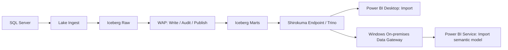

# Power BI Import connection guide

WP-P10-002 connects Power BI Desktop and Power BI Service to curated Shirokuma
Iceberg marts through the warehouse endpoint. Use **Import** mode and the
`bi_reader` identity. This guide targets the single-host `mac-studio-solo` lab;
Power BI Desktop and the On-premises data gateway run on Windows.

## Architecture and refresh flow



Lake Ingest preserves source types in Iceberg raw tables. WAP validates model
changes before publishing the curated `iceberg.marts` tables used for reporting.
The endpoint proxies the Trino client protocol, wakes a chilled warehouse for
statements, and keeps result-page URLs on the endpoint. Desktop imports the
published data into its semantic model; Service refreshes that model through
the Windows gateway. Report interactions then use the imported model.

## Prerequisites and endpoint setup

- A working Shirokuma CLI and reachable resident Trino/Iceberg stack on the Mac.
- Published marts and a known source row count or business total for comparison.
  The examples use `iceberg.marts.fct_orders`; substitute your published table
  and columns when using a different model.
- Windows with Power BI Desktop and a compatible 64-bit Trino/Presto ODBC driver,
  or a Trino/Presto Power Query connector supported by your provider.
  Connector availability, authentication choices, and field names vary by driver.
- For Service, an always-on Windows gateway host and access to the target
  Power BI workspace. Verify connector/driver licensing separately.

On the Mac, check the lab and start the endpoint in a terminal kept running:

```sh
shirokuma doctor
shirokuma warehouse endpoint --port 8080 --bind 127.0.0.1
```

The local endpoint is `http://127.0.0.1:8080`, using Trino's `/v1/statement`
protocol. Keep it running throughout imports and scheduled refreshes. The default
warehouse is `LOCAL`. Configure the driver for this local HTTP endpoint; do not
enable HTTPS against a plain HTTP listener.

### Reach the Mac from Windows

`127.0.0.1` always means the computer running the client. Windows cannot directly
reach the Mac's loopback listener. With an already authorized SSH connection to
the Mac, run this on the Windows Desktop machine:

```powershell
ssh -N -o ExitOnForwardFailure=yes -o ServerAliveInterval=30 -L 127.0.0.1:8080:127.0.0.1:8080 <ssh-user>@<mac-private-host>
Test-NetConnection 127.0.0.1 -Port 8080
```

Keep the SSH process alive and run the connection check in a second terminal.
Use an unused local port if 8080 is occupied, and update the driver consistently.
For a separate Windows gateway machine, establish the same private forwarding
path on that machine as well. Its local port must be available to the gateway
service account and survive interactive logout and reboot before scheduling.
Use your existing host service management for persistence. Do not expose the
endpoint on a public interface to make the connection work.

## Power BI Desktop: Import setup

Use these settings for either connection route:

| Setting | Value |
| --- | --- |
| Host / Server | `127.0.0.1` (Windows-local SSH forwarding listener) |
| Port | `8080` |
| Protocol | HTTP over the private SSH forwarding path |
| Catalog | `iceberg` |
| Schema | `marts` |
| User | `bi_reader` |
| Data connectivity / storage mode | **Import** |

### Option A: Trino/Presto connector

1. Install the provider's Power BI connector and its required driver, following
   its instructions. Confirm it supports the deployed Trino protocol and Service
   gateway refresh; a connector named Presto is not automatically compatible.
2. Open **Home > Get data > More** and select the installed Trino/Presto connector.
3. Enter the settings above. If the connector uses a single server field, use
   `http://127.0.0.1:8080` or `127.0.0.1:8080` as its documentation specifies.
4. Set the connection identity to `bi_reader`. Choose the provider's authentication
   method for a username-only local Trino connection. Do not use an administrator
   identity to work around a connection error.
5. Select **Import** when offered. In **Navigator**, expand `iceberg > marts`,
   select the published tables, and choose **Transform Data**.
6. Apply the data types below, then **Close & Apply**. Confirm the resulting
   tables have **Import** storage mode in the model properties.

### Option B: ODBC

1. Install a compatible **64-bit** Trino/Presto ODBC driver on Windows.
2. Open **ODBC Data Sources (64-bit)** and create a **System DSN** named
   `ShirokumaMarts`. Configure all settings in the table above inside the DSN;
   connection-string property names are driver-specific. Test the DSN.
3. In Desktop select **Home > Get data > More > Other > ODBC** and select
   `ShirokumaMarts`. Use the driver-supported authentication choice; for a DSN
   already supplying the username, this may be **Default or Custom**. Verify the
   actual Trino user remains `bi_reader`.
4. Select the mart in **Navigator**, then **Transform Data** or **Load**. The
   generic ODBC connector supports Import; it may not show a mode selector.
5. If navigation is unavailable, enter this native SQL in **Advanced options >
   SQL statement**, substituting your actual table and columns:

   ```sql
   SELECT order_id, customer_code, total_amount, order_date
   FROM iceberg.marts.fct_orders
   ```

6. Set column types explicitly and **Close & Apply**. Save the `.pbix` and use
   **Refresh** to test a complete import, beyond the preview rows.

Microsoft documents the DSN, authentication, Navigator, and native SQL options
in the [ODBC connector guide](https://learn.microsoft.com/en-us/power-query/connectors/odbc).

## Why Import rather than DirectQuery

- Import serves report interactions from Power BI's in-memory model, targeting
  sub-second responses without a Trino round trip or warehouse wake for every
  visual. Measure actual response times for your model; this is a target.
- Import provides full DAX modeling support without the source-dependent DAX
  limitations associated with DirectQuery.
- DirectQuery depends on the connector translating interactive queries into a
  compatible Trino dialect. Import avoids that per-visual query-folding path.
  Import refresh transformations can still fold: if generated SQL fails, use an
  explicit Trino SELECT and move transformations into the published mart or
  perform them locally in Power Query after retrieval.

Imported reports reflect the last successful refresh. Size the model for the
available Power BI capacity and schedule daily refresh after ingestion and WAP
publication complete. See Microsoft's
[DirectQuery guidance](https://learn.microsoft.com/en-us/power-bi/connect-data/desktop-directquery-about).

## Data type mapping and validation

| SQL Server source | Shirokuma (Trino / Iceberg) | Power BI type | Validation |
| --- | --- | --- | --- |
| `DECIMAL(p,s)` / `NUMERIC(p,s)` | `DECIMAL(p,s)` / decimal | Fixed decimal number for scale up to 4 within range; otherwise Decimal number or Text | Fixed decimal has 4 decimal places and 19 significant digits; Decimal number is floating point. Use Text for exact values outside those limits and design numeric measures deliberately. |
| `BIGINT` | `BIGINT` / long | Whole number (`Int64.Type`) | Preserve signed 64-bit integers; use Text for identifiers that downstream visuals could round. |
| `VARCHAR` / `NVARCHAR` | `VARCHAR` / string | Text | Keep `customer_code = '000123'` as Text throughout ingestion and Power Query. Remove automatic numeric Changed Type steps; zeros lost upstream cannot be recovered by a later cast. |
| `DATE` | `DATE` / date | Date | Compare calendar dates, nulls, and boundaries without timezone conversion. |
| `DATETIME2` / `DATETIME` | `TIMESTAMP(p)` / timestamp (without zone) | Date/Time | Define the business timezone upstream and check fractional-second precision. Normalize timezone-aware sources explicitly before import. |
| `BIT` | `BOOLEAN` / boolean | True/False | Check true, false, and null distinctly. |

These are target mappings; confirm the driver-reported types before loading.
Power BI Date/Time does not preserve timezone metadata. Keep exact high-precision
timestamps as additional text columns when required. Validate row counts, null
counts, minimum/maximum dates, and a decimal business total against the published
mart. See [Power BI data types](https://learn.microsoft.com/en-us/power-bi/transform-model/desktop-data-types)
for model precision and range limits.

## Security and guardrails

Send `X-Trino-User: bi_reader`, `X-Trino-Catalog: iceberg`, and
`X-Trino-Schema: marts` through the connector/driver session configuration.
The endpoint applies the BI read-only SQL policy before accessing or waking
Trino. Writes and multi-statement requests are rejected. References to Iceberg
`raw`, `staging`, and `sandbox` are blocked, including two-part references such as
`raw.orders` when the session catalog is `iceberg`.

Metadata queries needed for discovery are allowed, including `SHOW SCHEMAS FROM
iceberg`, `SHOW TABLES FROM iceberg.marts`, and queries against
`information_schema.tables`. Metadata visibility does not grant access to raw
table data; metadata results are not guaranteed to hide other schema names.
Select only published marts for the report.

The local proxy's username header is client-supplied, not an authenticated
identity boundary. Keep its listener on loopback and access controlled through
the private forwarding path. Trino/catalog authorization must enforce the
intended grants before sharing access beyond trusted lab clients. Imported data
also lives in the `.pbix` and Service semantic model: control workspace/report
access and apply Power BI row-level security where required.

## Power BI Service: daily refresh through a Windows gateway

1. Prepare an always-on Windows host. Install the **On-premises data gateway
   (standard mode)**, register it with the appropriate tenant, and keep its
   recovery key in the approved credential store. The gateway runs on Windows,
   while Shirokuma remains on the Mac.
2. Install the same compatible 64-bit ODBC driver on every gateway cluster member
   that can execute refreshes. Create the **System DSN** `ShirokumaMarts` with
   matching host, port, catalog, schema, and user. A user DSN is insufficient for
   the Windows gateway service. For a provider connector, install/configure its
   gateway support on each member according to the provider's instructions.
3. Establish persistent private forwarding on each gateway host as described
   above. Verify connectivity and DSN access in the gateway service context.
   An SSH tunnel open only in a Desktop user's session is insufficient for
   unattended refresh. Keep the Mac, lab, endpoint, and Windows host available.
4. Publish the tested Import `.pbix` to the intended workspace using Desktop
   **Publish**. Publishing uploads imported data, so use the authorized workspace.
5. In Service **Manage connections and gateways**, add an on-premises ODBC
   connection using `dsn=ShirokumaMarts`, the matching authentication method,
   `bi_reader` identity, and the appropriate privacy level (normally
   **Organizational**). Store any required credentials in the gateway connection.
   Match the Desktop data source identity exactly; when using a DSN, put the
   properties in the DSN rather than appending overrides to the connection string.
6. Grant the semantic model owner permission to use this connection. In the
   semantic model's **Settings > Gateway and cloud connections**, select the
   gateway and map each data source to its connection. Confirm the gateway is
   online and the credentials/connection test succeeds.
7. Run **Refresh now** and inspect **Refresh history**. Reconcile the imported
   count, totals, and freshness with the newly published mart. Confirm refresh
   works with Desktop closed and after the Windows interactive user logs out.
8. Enable **Schedule refresh**, choose **Daily**, set an explicit timezone and
   time after the expected ingestion/WAP completion window, and enable failure
   notifications. A daily schedule does not itself wait for WAP completion;
   investigate delayed upstream publication before relying on the next report.
9. Check the first scheduled refresh in **Refresh history** and periodically
   review failures and data freshness. Revalidate after driver upgrades, DSN
   changes, credential rotation, or gateway/host restarts.

Microsoft's [gateway source matching guidance](https://learn.microsoft.com/en-us/power-bi/connect-data/service-gateway-enterprise-manage-scheduled-refresh)
and [scheduled refresh guide](https://learn.microsoft.com/en-us/power-bi/connect-data/refresh-scheduled-refresh)
describe connection mapping and scheduling. A gateway relays Service requests to
the private data source; Service cannot directly access the Mac's loopback URL.

## Verification and troubleshooting

| Symptom | Check |
| --- | --- |
| Connection refused / timeout | Endpoint running on Mac, Windows-local tunnel alive, correct port, and gateway service connectivity. |
| Driver or DSN missing | 64-bit driver and System DSN on the machine performing the import or refresh. |
| HTTP/TLS or authentication failure | Driver HTTP setting, username-only lab authentication support, and effective `bi_reader` session user. |
| SQL policy violation (403) | Session catalog/schema and generated SQL; target `iceberg.marts`, remove writes and raw/staging/sandbox references. |
| SQL dialect / folding error | Use a native Trino SELECT and review Power Query steps or publish the transformation in a mart. |
| Service gateway unavailable | Gateway online, owner allowed to use the connection, and exact Desktop/source mapping. |
| Lost zeros or rounded totals | Explicit Text / numeric type steps and source-to-mart mappings before loading. |
| Stale report | Refresh history, schedule timezone, upstream WAP publication, and host/tunnel uptime. |

Run the repository contract tests:

```sh
python3 -m unittest discover -v -s tests -p test_warehouse_resident.py
```

`test_powerbi_desktop_import_simulation` sends the Power BI Mashup User-Agent
and Trino session headers through a real local HTTP exchange with a mocked Trino
backend. It checks the three metadata queries above, order-data retrieval
(including leading-zero text and decimal values), header forwarding, and 403
rejection of both `iceberg.raw.orders` and `raw.orders` before backend access.
It verifies the endpoint contract; Windows driver compatibility, Desktop model
types, actual report latency, and Service daily refresh require the manual
checks in this guide. Record the connector/driver version and refresh result
when performing those checks.
